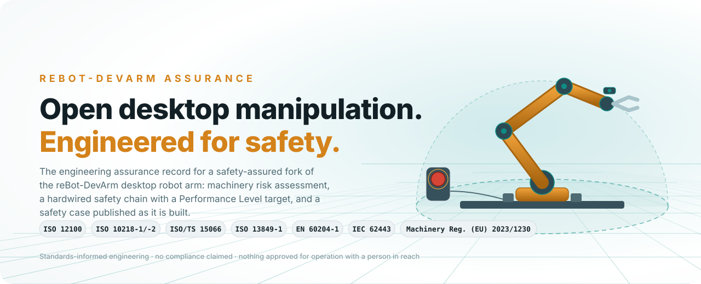
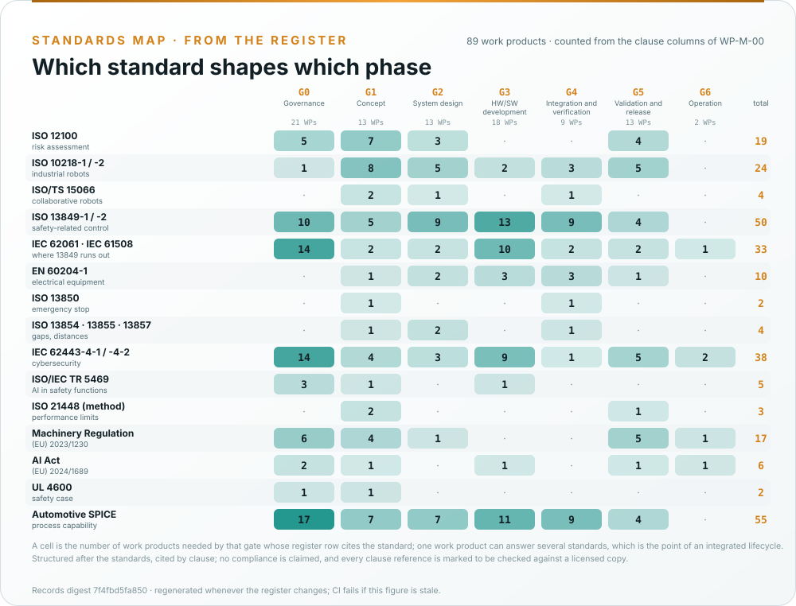

# 🦾 reBot-DevArm: Open Source Robotic Arm for All Developers

<p align="center">
  
</p>

> [!IMPORTANT]
> **This fork adds a safety-assurance record to upstream's design.** Upstream Seeed Studio's README follows below
> unchanged; the fork's record starts at [The assurance record](#the-assurance-record). The arm is research and
> education hardware, nothing here is CE-marked or assessed, no safety function reaches any Performance Level today,
> and no configuration is approved for operation with a person inside its 650 mm reach. The
> [gap assessment](assurance/00-assessment/gap-assessment.md) says exactly what is missing.


<p align="center">
    <!-- Replaced with CC BY-NC-SA 4.0 badge, explicitly indicating non-commercial use -->
    <a href="./LICENSE">
    
    </a>
    
    
    
    
</p>

<p align="center">
  <strong>🚀 100% Open Source · Embodied AI · Full Hardware + Software Stack</strong>
</p>

<p align="center">
  <strong>📦 Build your own robotic arm · 🧠 Learn robotics · 🏭 Deploy real applications</strong>
</p>


<table align="center">
  <tr>
    <td>
      <a href="https://www.youtube.com/watch?v=ONbpv3seiG8">
        
      </a>
    </td>
    <td>
      <a href="https://www.youtube.com/watch?v=ONbpv3seiG8">
        About The reBot Arm
      </a>
    </td>
  </tr>
</table>

<p align="center">
  <strong>
    <a href="./README_zh.md">简体中文</a> &nbsp;|&nbsp;
    <a href="./README.md">English</a> &nbsp;|&nbsp;
    <a href="./README_JP.md">日本語</a>&nbsp;|&nbsp;
    <a href="./README_Fr.md">français</a>&nbsp;|&nbsp;
    <a href="./README_es.md">Español</a>
  </strong>
</p>

<p align="center">
<a href="https://discord.gg/AbGuqJhDpQ">
    </a>
<a href="https://wiki.seeedstudio.com/robotics_page/">  
    </a>
</p>


## 📖 Introduction

**reBot-DevArm (reBot Arm B601 DM and reBot Arm B601 RS)** is a robotic arm project dedicated to lowering the barrier to learning Embodied AI. We focus on **"True Open Source"** — not just the code, we unreservedly open source everything:
- 🦾 **Two versions of the robotic arm**：We will provide all open-source files for two versions of the robotic arm with the same appearance: **Robostride** and **Damiao**.
- 🛠️ **Hardware Blueprints**: Source files for sheet metal parts and 3D printed parts.
- 🔩 **BOM List**: Detailed down to the specifications and purchase links for every single screw.
- 💻 **Software & Algorithms**: Python SDK, ROS1/2, Isaac Sim, LeRobot, etc.

## Get Your Own reBot Arm

- We offer five kit options  at  [Seeedstudio.com](https://www.seeedstudio.com/reBot-Arm-B601-DM-Bundle.html) :
  - **Arm Body Motor Kit**: Includes only motors and wiring harnesses for the robotic arm.
  - **Arm Body Structural Kit**: Includes only mechanical structural components.
  - **Gripper Complete Kit**: Includes motors, wiring harnesses and structural components for the gripper.
  - **Full Kit**: Includes the complete set of the robotic arm body and gripper.
  - **Pre‑assembled Robotic Arm**: Fully assembled finished robotic arm.

- You can also purchase the [Leader Arm](https://www.seeedstudio.com/Star-Arm-102-p-6765.html?qid=P2U7IG_yskyak5m_1776415593315)

## 🗺️ Roadmap & Status

We are committed to continuously maintaining and adapting to mainstream robot development ecosystems. Below is our current adaptation progress and planned release schedule:

### reBot Arm B601 DM
| Supported Ecosystem | Status | Description / Estimated Release Date | Related Documentation |
| :--- | :---: | :--- | :--- |
| **Basic Motor Usage** | ✅ Completed | Basic motion control and API encapsulation | [Damiao Technology](https://wiki.seeedstudio.com/cn/damiao_series/) |
| **Open-Sourcing of the New STEP 3D Structural Parts and BOM** | ✅ Completed | STEP files for all parts in the new version, parts BOM, and reference prices for all machined components | [reBot Arm B601-DM BOM](./hardware/reBot_B601_DM/readme.md) |
| **Reference for Real Machine Performance Testing** | ✅ Completed   | Performance Reference of Robotic Arm under Normal and Extreme Operating Conditions |[Performance Testing](./hardware/reBot_B601_DM/performance_testing/Performance_Testing.md) |
| **Assembly Video** | ✅ Completed | Ultra-detailed assembly steps and video | [Getting Started with reBot Arm B601-DM](https://wiki.seeedstudio.com/rebot_b601_dm_getting_started/) |
| **ROS2 (Humble)** | 🚧 In Progress  | Core drivers have been completed, and MoveIt2 is currently being optimized | [Expected: 2026.04.20] |
| **Python SDK** | ✅Continuously optimized, PRs welcome | One-stop integration of motor read/write and control for Robstride, Damiao, Mota, Gaoqing, Hexfellow and other motors. | [Getting Started with Motorbridge](https://motorbridge.seeedstudio.com) and [Web UI](https://rebot-devarm.w0x7ce.eu/)|
| **Pinocchio Integration** |  ✅ Completed  | Adaptation to the Pinocchio framework, enabling forward/inverse kinematics and gravity compensation for the robotic arm | [Getting Started with Pinocchio for reBot Arm B601-DM](https://wiki.seeedstudio.com/rebot_arm_b601_dm_pinocchio_meshcat/) and [Github repo](https://github.com/vectorBH6/reBotArm_control_py) |
| **Isaac Sim Simulation** | 🚧 In Progress  | Import USD models and enable simulated teleoperation | [Expected: 2026.04.20] |
| **LeRobot Integration** | ✅ Completed  | Adaptation to the Hugging Face LeRobot training framework | [Getting Started with LeRobot-based reBot Arm](https://wiki.seeedstudio.com/rebot_arm_b601_dm_lerobot/) |
| **Depth Camera Integration** | ✅ Completed  | Visual Grasping Demonstration Based on YOLO and Depth Camera | [Getting Started with Visual Grasping Demo](https://wiki.seeedstudio.com/rebot_arm_b601_dm_grasping_demo/) |
| **Gradual Updates of the Latest Algorithms** | ⏳ Planned | Mainstream algorithms will be updated progressively | Ongoing |
| **Launch of a Series of Completely Free Courses** | ⏳ Planned | Mainstream algorithms will be updated progressively | Ongoing |


### reBot Arm B601 RS

| Supported Ecosystem | Status | Description / Estimated Release Date | Related Documentation |
| :--- | :---: | :--- | :--- |
| **Basic Motor Usage** | ✅ Completed | Basic motion control and API encapsulation | [Robstride](https://wiki.seeedstudio.com/cn/robstride_control/) |
| **Open-Sourcing of the New STEP 3D Structural Parts and BOM** | 🚧 In Progress | STEP files for all parts in the new version, parts BOM, and reference prices for all machined components | Expected [2026.05] |
| **Assembly Video** | 🚧 In Progress | Ultra-detailed assembly steps and video | [Expected 2026.05] |
| **ROS2 (Humble)** | ⏳ Planned | Core drivers have been completed, and MoveIt2 is currently being optimized | [Expected 2026.05] |
| **LeRobot Integration** | ⏳ Planned | Adaptation to the Hugging Face LeRobot training framework | [Expected 2026.05] |
| **Pinocchio Integration** | ⏳ Planned | Adaptation to the Pinocchio framework, enabling forward/inverse kinematics and gravity compensation for the robotic arm | [Expected 2026.05] |
| **Isaac Sim Simulation** | ⏳ Planned | Import USD models and enable simulated teleoperation | [Expected 2026.05] |
| **Gradual Updates of the Latest Algorithms** | ⏳ Planned | Mainstream algorithms will be updated progressively | Ongoing |
| **Launch of a Series of Completely Free Courses** | ⏳ Planned | Mainstream algorithms will be updated progressively | Ongoing |

---

## ⚙️ Hardware Specifications

reBot-DevArm is designed for desktop Embodied AI applications, balancing payload capacity with flexibility.

| Parameter | reBot Arm B601-DM |
| :--- | :--- |
| **Recommended Continuous Payload** | Less than 1.5 kg within 70% of arm reach workspace |
| **Recommended Payload** | **1.5 kg** |
| **Max Reach** | **650 mm** |
| **Weight** | Approx. 4.5 kg |
| **Repeatability** | < 0.2 mm |
| **Degrees of Freedom (DOF)** | 6 DOF + 1 Gripper (Open source CAN servo gripper and joint motor gripper coming soon) |
| **Supported Platforms/Ecosystems** | ROS1, ROS2, LeRobot, Pinocchio, Isaac Sim, Python SDK |
| **Supply Voltage** | DC 24V |

## 🧹Optional Hardware
###  Wirst Camera Mount
| 32×32 UVC  | Intel D435i | Intel D405 & Gemini 305 | Gemini 2|
| --- | --- | --- | --- | 
|  |  |   |  | 
| [STEP](/hardware/reBot_B601_DM/3D_Printed_Parts/UVC32_mount.step) | [STEP](/hardware/reBot_B601_DM/3D_Printed_Parts/D435_Gemini2_Mount.step) | [STEP](/hardware/reBot_B601_DM/3D_Printed_Parts/D405_305_Mount.step) |[STEP](/hardware/reBot_B601_DM/3D_Printed_Parts/D435_Gemini2_Mount.step) |

###  Compatible with Leader Arm
| Star Arm 102-LD  |  Open to compatibility integration  | 
| --- | --- |
|    |Comming soon| 
|  [Github repo](https://github.com/servodevelop/Star-Arm-102) |Comming soon |

### DIY Finger
| Soft Finger  |  Open to compatibility integration  | 
| --- | --- |
|    |Comming soon| 
| [Finger Mount(ABS/PLA)](/hardware/reBot_B601_DM/3D_Printed_Parts/Soft_Gripper_Mount.step) and [Finger (TPU 95+)](/hardware/reBot_B601_DM/3D_Printed_Parts/Soft_Gripper_Finger.step)  |Coming soon |


---

### 🎓 Full-Stack Robotics Ecosystem
reBot-DevArm is not just a robotic arm, but a robotics learning community. We share the following general tutorials for free:

#### 🖥️ Edge Computing & Master Control
*   [](https://wiki.seeedstudio.com/NVIDIA_Jetson/) —— **AI Inference & Compute Core**
*   [](https://wiki.seeedstudio.com/raspberry-pi-devices/) —— **General Linux Development Environment**
*   [-0091BD?style=for-the-badge&logo=espressif&logoColor=white)](https://wiki.seeedstudio.com/SeeedStudio_XIAO_Series_Introduction/) —— **Low-power Wireless Control Node**

#### 📡 Sensors & Peripherals
*   **🚗 Motors & Servos**: [Damiao / Gogo / Robstride / Mita / Feite / Fashion Star](https://wiki.seeedstudio.com/robotics_page/)
*   **👁️ Visual Perception**: [Depth Cameras / LiDAR / Vision Algorithms](https://wiki.seeedstudio.com/robotics_page/)
*   **👂 Auditory Interaction**: [ReSpeaker Mic Arrays / Speech Recognition](https://wiki.seeedstudio.com/ReSpeaker_Mic_Array_v2.0/)
*   **🧭 Motion & Attitude**: [IMU (6-axis/9-axis) / Gyroscopes / Magnetometers](https://wiki.seeedstudio.com/Sensor/IMU/)
*   **🤖 Comprehensive Kits**: [More Robotics Sensors & Driver Examples](https://wiki.seeedstudio.com/robotics_page/)


> 👉 **[Click to Enter Wiki Knowledge Base](https://wiki.seeedstudio.com/)** (All tutorials are free to view)

---

## 🙌 References & Acknowledgments
The path of open source is never lonely. The birth of the reBot-DevArm project would not be possible without the full support of Seeed Studio, the global open source community, and excellent hardware partners. We pay our highest respects to the following projects and teams:

### 🌍 Ecosystem & Software Support
*   **[Seeed Studio](https://www.seeedstudio.com/)** - Providing comprehensive hardware supply chain and technical support.
*   **[Hugging Face LeRobot](https://github.com/huggingface/lerobot)** - An excellent end-to-end robot learning framework.
*   **[NVIDIA Isaac Sim](https://developer.nvidia.com/isaac/sim)** - A powerful robot simulation and synthetic data platform.

### ⚙️ Core Hardware Partners
Thanks to the following manufacturers for providing high-performance motor and actuator solutions:
*   **[Damiao Technology](https://www.damiaokeji.com/)**
*   **[Robstride](https://robstride.com/)**
*   **[Fashion Star](https://fashionstar.com.hk/wiki/)**

### 💡 Inspiration
This project is deeply inspired by the following excellent open source projects:
*   **[SO-ARM100](https://github.com/TheRobotStudio/SO-ARM100/tree/main)**
*   **[Mobile ALOHA](https://github.com/tonyzhaozh/aloha)**
*   **[Dummy-Robot (Zhihui Jun)](https://github.com/peng-zhihui/Dummy-Robot)**
*   **[OpenArm](https://openarm.dev/)**
*   **[I2RT](https://i2rt.com/)**
*   **[TRLC-DK1](https://github.com/robot-learning-co/trlc-dk1)**

### 🎃 Prototype Contributors
- **SeeedStudio AI Robotics Team's**: Yaohui Zhu (yaohui.zhu@seeed.cc)
- **SeeedStudio STU**: Wentao Dong
- **SeeedStudio STU**: Weiwei Xu
- **SeeedStudio Purchasing Department**: Fengqun Peng


### 👥 Contributors

## Our Top Contributors 
<p align="center"><a href="https://github.com/Seeed-Projects/reBot-DevArm/graphs/contributors">
  
</a></p>


*Coming soon... Welcome to submit PRs to become a contributor!*

## Star History

[](https://www.star-history.com/#Seeed-Projects/reBot-DevArm&type=date&legend=top-left)

# reBot-DevArm Project License
Copyright (c) [2025] [Seeed Studio]

This work is licensed under the **Creative Commons Attribution-NonCommercial-ShareAlike 4.0 International License**.
To view a copy of this license, visit: http://creativecommons.org/licenses/by-nc-sa/4.0/

--------------------------------------------------------------------------------

## Rights and Restrictions Statement

The core purpose of this open-source project is to promote knowledge sharing and enable developers and enthusiasts to access and learn cutting-edge robotic arm technologies at minimal cost. We provide completely free and publicly available documentation and video tutorials to help users get started quickly, conduct in-depth research, and jointly promote the popularization and practical application of robotics.

### I. Non-Commercial Use Policy

All open-source content of this project is fully available for personal learning, research, and non-commercial use. Individual users are allowed to:

* View and study the project’s open-source documentation, code, and tutorials;
* Modify and debug the open-source content for personal learning and research purposes;

### II. Commercial Use Policy

We actively encourage and support developers, robotics enthusiasts, and third-party platforms to carry out secondary development based on the reBot robotic arm and promote real-world applications. The following outlines permitted and prohibited commercial activities:

#### (1) Permitted Commercial Activities

We respect every developer’s efforts and legitimate earnings.Including but not limited to:

* Developing application-oriented software systems and promoting or selling them commercially;
* Creating structured educational courses (online/offline) and offering paid training or knowledge services;
* Conducting offline education, training, and technology outreach activities worldwide;
* Other commercial activities that contribute to the open-source community, knowledge dissemination, and real-world application of robotics technology.

For the above compliant commercial activities, you are welcome to contact us. We will provide free commercial authorization, implementation support, and promotional assistance. We may also publicly announce your authorization to help your project succeed.

#### (2) Prohibited Commercial Activities

It is prohibited to make minor modifications to this project’s product, replace IP, logos, or related identifiers, and sell it under a self-owned brand. Such actions do not constitute substantial technical innovation and do not benefit developer growth, the open-source community, or the project itself. These behaviors are considered violations, and we reserve the right to take action.

### III. Collaboration & Contact

We hope to collaborate with all developers and partners within a compliant framework to promote the maturity and deployment of the reBot robotic arm project. For individuals and organizations interested in bringing real-world robotic applications to life, we offer:

* Commercial licensing and intellectual property compliance support;
* Assistance in promoting project solutions;
* Custom development services for robotic arms and related solutions;
* Joint R&D and co-development opportunities.

If you are interested in commercial collaboration or have related needs, please feel free to contact us. Let’s work together to advance the adoption and industrialization of robotics technology.


## ☎ Contact Us
- **Open‑Source Progress & Technical Support**-Yaohui: yaohui.zhu@seeed.cc
- **Future Collaboration & Customization**-Elaine: elaine.wu@seeed.cc


---

## The assurance record

<p align="center">
  
</p>

<p align="center">
  <b>The engineering assurance record for a safety-assured fork of the reBot-DevArm desktop robot arm: machinery risk assessment under ISO 12100 and ISO 10218, a hardwired safety chain with a Performance Level target, collaborative-operation limits, cybersecurity and machine-learning safety, and a safety case published as it is built.</b>
</p>

<p align="center">
  <a href="docs/README.md">Documentation</a> &nbsp;·&nbsp;
  <a href="https://github.com/jherrodthomas/reBot-DevArm/wiki">Wiki</a> &nbsp;·&nbsp;
  <a href="#record-status">Record status</a> &nbsp;·&nbsp;
  <a href="#safety-architecture">Architecture</a> &nbsp;·&nbsp;
  <a href="#standards-and-engineering-framework">Standards</a> &nbsp;·&nbsp;
  <a href="#roadmap">Roadmap</a> &nbsp;·&nbsp;
  <a href="#known-gaps">Known gaps</a> &nbsp;·&nbsp;
  <a href="#getting-started-with-the-record">Getting started</a> &nbsp;·&nbsp;
  <a href="#contributing-to-the-record">Contributing</a>
</p>

<p align="center">
  <a href="https://github.com/jherrodthomas/reBot-DevArm/actions/workflows/assurance.yaml"></a>
  <a href="https://github.com/jherrodthomas/reBot-DevArm/actions/workflows/wiki.yaml"></a>
  <a href="assurance/01-management/decisions/README.md"></a>
  <a href="assurance/00-assessment/gap-assessment.md"></a>
  <a href="assurance/case/README.md"></a>
</p>

### Why the record exists

The reBot Arm B601-DM is an open mechanical and actuator design with a broad software ecosystem, sold as a kit for
embodied-AI research and teaching. What it lacks, by the fork's own
[concept-phase review](assurance/00-assessment/gap-assessment.md), is the safety engineering a machine needs before it
may work with a person in reach: there is no emergency stop in the documented design, no supply disconnect or fuse,
no watchdog between the host and the actuators, no operating-mode state machine, no declared joint limits, no
reliability data, no force or pressure measurement, no validation, and the software lives outside the fork. This
fork keeps upstream's design and adds the record around it, under the standards that apply to an industrial robot.

The concept-phase engineering package the fork published first (`reBot_DevArm_Safety_Case.xlsx` and its companions
in this folder: 34 hazards, 31 safety functions, 28 gaps, 104 requirements, 127 test cases) is the **input** to
the record; its identifiers are kept and its gaps are re-stated as GAP-01 to GAP-36.

### Record status

Every work product lives under [`assurance/`](assurance/README.md), numbered in lifecycle order, with a
document-control header that says what it is, which clauses it answers to, and whether anyone has reviewed it.
Nothing is marked complete before its review, and every number below is computed from the records by
[`make_assets.py`](docs/assets/rebot/make_assets.py) and checked by CI on every pull request.

<p align="center">
  
</p>

<!-- BEGIN GENERATED: record-headline (docs/assets/rebot/make_assets.py) -->

**P0 Governance** · no gate passed · 90 work products (14 draft, 76 skeleton, 0 approved) · 36 gap findings (19 high) · 10 decisions open · 1 of 11 cross-domain interfaces open · 0 of 22 confirmation measures performed · records digest `672e3b895766`

<!-- END GENERATED: record-headline -->

<p align="center">
  
</p>

| What the card guarantees | |
|---|---|
| A gate counts as passed | only when its record in [`10-safety-case/gates/`](assurance/10-safety-case/gates/README.md) says Pass; a skeleton generated from the process model is not a record |
| A work product counts as approved | only after a verification review by someone other than its author ([WP-P-05](assurance/07-supporting/WP-P-05-verification-review-procedure.md)); a confirmation measure counts only by its record under [`confirmation/`](assurance/10-safety-case/confirmation/README.md) |
| The Living Safety Case dashboard | is generated from the records in [`assurance/case/`](assurance/case/README.md): claims, evidence with review state, defeaters, actions, configurations and reviews, with a validator that refuses an accepted claim whose evidence is not available and accepted or whose defeater is open |
| The records digest | identifies the exact state of the register, the gap assessment, the decision register, the process model and the gate and confirmation records these figures describe, so two readers can confirm they saw the same state |

<p align="center">
  
</p>

<!-- BEGIN GENERATED: assurance-headline (assurance/case/tools/generate_dashboard.py) -->

**Development** · baseline `BL-001` at `206ebda` · 21 claims (0 with accepted evidence) · 20 evidence items (0 accepted) · 36 open defeaters · records digest `70cc4d1dd1dc`

<!-- END GENERATED: assurance-headline -->

**Start here:** [assurance strategy (WP-M-01)](assurance/01-management/WP-M-01-assurance-strategy.md) · [safety plan (WP-M-02)](assurance/01-management/WP-M-02-safety-plan.md) · [process model and maps (WP-P-11)](assurance/process/README.md) · [powered-test hold point (WP-V-07)](assurance/06-validation/WP-V-07-test-operations.md) · [decision register](assurance/01-management/decisions/README.md)

> **Assurance status represents recorded engineering evidence and review state. It does not constitute certification or approval for operation with a person in reach.**

### Safety architecture

<p align="center">
  
</p>

The argument is a doer-and-checker argument with one more step. The host stack proposes; the controller safety
layer checks; and a hardwired safety chain is the checker of last resort that nothing in software can override. Only
the chain carries a Performance Level target. The safety layer and the host stack are hardened so that the chain is
rarely demanded, and recorded as defence in depth.

| Layer | Role | State |
|---|---|---|
| Host stack | The SDK, the ROS 2 driver, Pinocchio, the LeRobot policies, the web UI; everything that decides where the arm goes | Inherited and upstream; hardening proposed once forked (DQ-007) |
| Controller safety layer | Validates, clamps, times out and reports every command before it reaches the motor bus; the mode machine | **Does not exist yet.** Where it runs is DQ-020 |
| Hardwired safety chain | Emergency stop, enabling, manual reset, power removal by contactor | **Does not exist yet.** Bench version first ([WP-V-07](assurance/06-validation/WP-V-07-test-operations.md), DQ-006), product version in the [SRP/CS architecture](assurance/03-system/WP-S-03-technical-safety-concept.md) |
| Safety and assurance | Risk assessment, safety functions and PLr, PL calculation, validation, cybersecurity, safety case | Draft and skeleton work products, not yet reviewed |

More in the [architecture overview](docs/architecture.md) and [WP-M-01 §6](assurance/01-management/WP-M-01-assurance-strategy.md#6-safety-architecture-argument-the-central-strategy).

### Standards and engineering framework

<p align="center">
  
</p>

The arm is machinery and an industrial robot, so the frame is the machinery set, applied with one method: one hazard
log, one requirements database, generated figures, a safety case with its defeaters published. Work products are
structured after these standards and cite their clauses; **no compliance is claimed**, because no assessment has been
performed and no standard is held. [WP-M-01 §4](assurance/01-management/WP-M-01-assurance-strategy.md#4-the-standards-and-how-each-one-is-used)
explains how each standard is used and where it is tailored; the wiki's
[How we use each standard](https://github.com/jherrodthomas/reBot-DevArm/wiki/How-we-use-each-standard) is the
plain-language version.

| Topic | Standard | Main work products |
|---|---|---|
| Risk assessment and reduction | ISO 12100:2010 | [Item definition](assurance/02-concept/WP-C-01-item-definition.md) · [Risk assessment](assurance/02-concept/WP-C-03-risk-assessment.md) · [Risk reduction concept](assurance/02-concept/WP-C-05-risk-reduction-concept.md) |
| Industrial robots and robot applications | ISO 10218-1:2025, ISO 10218-2:2025 | [Safety functions and required PL](assurance/02-concept/WP-C-04-safety-functions-and-plr.md) · [Operating envelopes](assurance/02-concept/WP-C-02-operating-environment-and-tasks.md) |
| Collaborative operation | ISO/TS 15066:2016 | [Human-robot interaction](assurance/02-concept/WP-C-06-human-robot-interaction-and-misuse.md) · [Collaborative operation validation](assurance/06-validation/WP-V-03-collaborative-operation-validation.md) |
| Safety-related parts of control systems | ISO 13849-1:2023, ISO 13849-2:2012 | [SRP/CS architecture](assurance/03-system/WP-S-03-technical-safety-concept.md) · [PL calculation](assurance/04-hardware/WP-H-04-reliability-data-and-pl-calculation.md) · [Safety validation](assurance/06-validation/WP-V-01-safety-validation.md) |
| Where ISO 13849 runs out | IEC 62061:2021, IEC 61508:2010 | [Software safety requirements](assurance/05-software/WP-W-02-software-safety-requirements.md) · [Confirmation measures](assurance/01-management/WP-M-06-confirmation-measures-plan.md) |
| Electrical equipment, emergency stop, gaps and distances | EN 60204-1:2018, ISO 13850:2015, ISO 13854:2019, ISO 13855:2024, ISO 13857:2019 | [Electrical safety](assurance/04-hardware/WP-H-05-electrical-safety.md) · [Mechanical analysis](assurance/04-hardware/WP-H-08-mechanical-analysis.md) · [Stopping and separation budget](assurance/03-system/WP-S-04-response-time-and-stopping-budget.md) |
| Cybersecurity | IEC 62443-4-1:2018, IEC 62443-4-2:2019 | [Threat and risk assessment](assurance/02-concept/WP-C-07-cybersecurity-threat-and-risk-assessment.md) · [Cybersecurity plan](assurance/01-management/WP-M-08-cybersecurity-plan.md) |
| Machine learning in safety functions | ISO/IEC TR 5469:2024 | [ML component definition](assurance/02-concept/WP-C-09-ml-component-definition-and-safety-requirements.md) · [ML safety plan](assurance/01-management/WP-M-09-ml-safety-plan.md) |
| Regulatory | Regulation (EU) 2023/1230 (Machinery), Regulation (EU) 2024/1689 (AI Act) | [Regulatory conformity strategy](assurance/01-management/WP-M-13-regulatory-conformity-strategy.md) |
| Safety case structure | UL 4600 principles | [Safety case](assurance/10-safety-case/WP-K-01-safety-case.md) |

<p align="center">
  
</p>

| Supporting practice | Where it is applied |
|---|---|
| Integrated process model | [WP-P-11](assurance/process/README.md): activities, lanes, cross-domain interfaces and gates as data; generated swimlane maps and gate skeletons |
| Process capability | [ASPICE self-assessment, WP-M-12](assurance/01-management/WP-M-12-process-capability-baseline.md) |
| Performance limits of sensing and the learned policy | ISO 21448 used as a method, not a standard, in the [insufficiency analysis](assurance/02-concept/WP-C-10-functional-insufficiency-analysis.md) |
| Safety analysis | [FMEA](assurance/08-analyses/WP-A-01-system-fmea.md) · [FTA](assurance/08-analyses/WP-A-02-fault-tree-analysis.md) · [CCF](assurance/08-analyses/WP-A-03-common-cause-failure-analysis.md) · [STPA](assurance/08-analyses/WP-A-04-stpa.md) · [Independence of the chain](assurance/08-analyses/WP-A-05-independence-of-the-safety-chain.md) |
| Independent review | [Confirmation measures plan](assurance/01-management/WP-M-06-confirmation-measures-plan.md) · [Verification and review procedure](assurance/07-supporting/WP-P-05-verification-review-procedure.md) |
| Decisions | [Decision register](assurance/01-management/decisions/README.md): every question for the project lead, self-contained, in batches of ten |

### Roadmap

<p align="center">
  
</p>

Status is taken from what exists in the repository. "Draft" means written but not reviewed; "skeleton" means the
structure and clause map exist and the content is still to be written.

| Phase | Work | Status |
|---|---|---|
| **1 · Foundation** | [Assurance strategy](assurance/01-management/WP-M-01-assurance-strategy.md), [safety plan](assurance/01-management/WP-M-02-safety-plan.md), [confirmation measures](assurance/01-management/WP-M-06-confirmation-measures-plan.md), [regulatory strategy](assurance/01-management/WP-M-13-regulatory-conformity-strategy.md) | Draft |
| | [Baseline gap assessment](assurance/00-assessment/gap-assessment.md) | Draft |
| | [Work product register](assurance/01-management/WP-M-00-work-product-register.md), [process model and maps](assurance/process/README.md), [decision register](assurance/01-management/decisions/README.md) | Draft; checked by CI |
| | [Living Safety Case records and dashboard](assurance/case/README.md) | Draft: records at BL-001, validated and drawn by CI |
| **2 · Safety engineering** | [Item definition](assurance/02-concept/WP-C-01-item-definition.md), [operating envelopes](assurance/02-concept/WP-C-02-operating-environment-and-tasks.md), [risk assessment](assurance/02-concept/WP-C-03-risk-assessment.md), [safety functions and PLr](assurance/02-concept/WP-C-04-safety-functions-and-plr.md), [interaction and misuse](assurance/02-concept/WP-C-06-human-robot-interaction-and-misuse.md) | Draft, from the concept-phase package |
| | [Risk reduction concept](assurance/02-concept/WP-C-05-risk-reduction-concept.md), [insufficiency analysis](assurance/02-concept/WP-C-10-functional-insufficiency-analysis.md), [cybersecurity threat assessment](assurance/02-concept/WP-C-07-cybersecurity-threat-and-risk-assessment.md), [ML component definition](assurance/02-concept/WP-C-09-ml-component-definition-and-safety-requirements.md) | Skeleton |
| | [Powered-test hold point](assurance/06-validation/WP-V-07-test-operations.md) | Draft; the bench chain waits on the lead (DQ-006) |
| **3 · Build and verify** | Bench safety chain, software fork and safety layer, [chain architecture](assurance/03-system/WP-S-03-technical-safety-concept.md) and [PL calculation](assurance/04-hardware/WP-H-04-reliability-data-and-pl-calculation.md), [stopping and holding tests](assurance/06-validation/WP-V-02-stopping-performance-and-holding-tests.md), [fault injection](assurance/06-validation/WP-V-05-fault-injection.md) | Planned |
| **4 · Validate and release** | [Safety validation](assurance/06-validation/WP-V-01-safety-validation.md), [assessment](assurance/10-safety-case/WP-K-04-functional-safety-assessment.md), [technical documentation](assurance/10-safety-case/WP-K-02-technical-documentation-index.md), [release record](assurance/10-safety-case/WP-K-06-release-record.md), [field monitoring](assurance/09-production-operation/WP-O-04-field-monitoring.md) | Planned |

### Known gaps

The project publishes its own counter-evidence. The [baseline gap assessment](assurance/00-assessment/gap-assessment.md)
reviewed the hardware record and the concept-phase package, finding by finding, against the standards above. The
findings that shape everything:

| | Finding | Closes through |
|---|---|---|
| GAP-08 | No emergency stop exists in the documented design; the only stop is a software command on the motor bus | The bench chain before any powered test with a person in reach ([WP-V-07](assurance/06-validation/WP-V-07-test-operations.md), DQ-006); the hardwired chain ([WP-S-03](assurance/03-system/WP-S-03-technical-safety-concept.md)) |
| GAP-09, GAP-11 | No supply disconnect or fuse; an open-frame mains supply with exposed terminals | Electrical safety ([WP-H-05](assurance/04-hardware/WP-H-05-electrical-safety.md)) |
| GAP-16, GAP-17, GAP-18 | The software is outside the fork; no mode machine; a lost connection holds the last command | Fork the software (DQ-007) and build the controller safety layer ([WP-W-03](assurance/05-software/WP-W-03-software-architecture.md)) |
| GAP-19, GAP-02, GAP-03 | No declared joint limits, end-stops, mass or fixing | Mechanical analysis ([WP-H-08](assurance/04-hardware/WP-H-08-mechanical-analysis.md)) and the parameter sets ([WP-W-09](assurance/05-software/WP-W-09-safety-parameters-and-configuration-data.md)) |
| GAP-28, GAP-06 | No force or pressure measurement; no separation-distance plan | The collaborative-operation decision (DQ-005) and its validation ([WP-V-03](assurance/06-validation/WP-V-03-collaborative-operation-validation.md)) |
| GAP-22, GAP-23 | Anyone with the CAN adapter or the network can move the arm | Cybersecurity requirements and architecture ([WP-C-08](assurance/02-concept/WP-C-08-cybersecurity-requirements-and-sl-target.md), [WP-S-07](assurance/03-system/WP-S-07-cybersecurity-architecture.md)) |
| GAP-14, GAP-31 | No reliability data, no validation of any safety function | Supplier data (DQ-019), the PL calculation ([WP-H-04](assurance/04-hardware/WP-H-04-reliability-data-and-pl-calculation.md)) and the validation plan ([WP-V-01](assurance/06-validation/WP-V-01-safety-validation.md)) |

Every finding becomes a defeater against a claim in the safety case and stays open until the work product that
closes it is reviewed.

### Getting started with the record

Only Python 3 is needed (PyYAML for the decision register):

```bash
git clone https://github.com/jherrodthomas/reBot-DevArm.git
cd reBot-DevArm
python3 assurance/01-management/decisions/check_decisions.py     # the questions for the lead
python3 assurance/process/tools/process_model.py --check         # process maps and gate skeletons current
python3 assurance/tools/folder_index.py --check                  # folder indexes match the register
python3 docs/assets/rebot/make_assets.py --check                 # README figures match their generator
python3 tools/wiki/build_wiki.py                                 # the wiki pages check clean
```

**On an arm:** the fork publishes no software build and changes no hardware yet. No arm is powered with a person
inside its 650 mm reach under the fork's control until the conditions of
[WP-V-07](assurance/06-validation/WP-V-07-test-operations.md) hold: a fused and switched 24 V supply, a dual-channel
emergency stop through a safety relay, the arm fixtured, pinned software with the watchdog on, and nobody but the
operator at the bench.

### Contributing to the record

Contributions are welcome in machinery and robot safety, safety-related control systems, electrical and mechanical
engineering, embedded and ROS 2 software, cybersecurity, verification, documentation and review. Safety-relevant
changes need a rationale, an impact analysis and appropriate verification.

| | |
|---|---|
| [Contributing](CONTRIBUTING.md) | Rules for safety-relevant changes and assurance records |
| [Issues](https://github.com/jherrodthomas/reBot-DevArm/issues) · [Pull requests](https://github.com/jherrodthomas/reBot-DevArm/pulls) | Problem reports, safety concerns, reviews of the analyses; pull requests target `main` |
| [Security policy](SECURITY.md) | Private vulnerability reporting |
| [Wiki](https://github.com/jherrodthomas/reBot-DevArm/wiki) | Orientation: processes, process maps, how each standard is used, glossary, how decisions are made. Kept in [`wiki/`](wiki/README.md) and mirrored on merge |
| [Upstream reBot-DevArm](https://github.com/Seeed-Projects/reBot-DevArm) | The arm this fork is derived from |

### The concept-phase engineering package

The package of 2026-05-04 stays at the repository root as the record's input; the files are not edited.

| File | Purpose |
|---|---|
| `reBot_DevArm_Safety_Case.xlsx` | 15-tab preliminary safety case (ISO 12100 / 10218 / TS 15066 / 13849 / 9001 / 60204-1): 34 hazards, 31 safety functions, 28 gaps |
| `reBot_DevArm_Safety_Case_Report.docx` | Narrative safety case |
| `reBot_DevArm_Safety_Case_Summary.pdf` | 2-page executive summary |
| `reBot_DevArm_DFMEA.xlsx` | AIAG-VDA 2019 DFMEA: 27 failure modes (11 high action priority) |
| `reBot_DevArm_Requirements.xlsx` | SyRS, SRS and HwRS: 104 requirements, traced |
| `reBot_DevArm_Architecture.docx` | 5 architectural views with embedded diagrams |
| `reBot_DevArm_TestPlan.xlsx` | V-model test plan: 127 cases, ISO 13849-2 and TS 15066 V&V matrices |
| `reBot_DevArm_Trace_Memo.docx` | Cross-package traceability verification |
| `reBot_DevArm_Engineering_Bundle.pdf` | Single-file stakeholder bundle |
| `01_hero_banner.png` … `05_mode_fsm.png` | The package's banner, KPI, envelope and architecture figures |

### Maintainer and upstream attribution

**Jherrod Thomas** maintains this record as an open engineering initiative: a public demonstration of
safety-lifecycle development, systems engineering and assurance practice on a real robot arm.

reBot-DevArm is designed and published by [Seeed Studio](https://github.com/Seeed-Projects/reBot-DevArm) under
CC BY-NC-SA 4.0. This fork keeps that licence for the whole repository, including the record, and is non-commercial;
`hardware/` is upstream's record, merged and never edited here. The fork is an independent project and is not
affiliated with or endorsed by Seeed Studio; it carries no reBot trademark claim.

Open-source licensing does not establish machinery safety certification, CE marking, or suitability for operation
with a person in reach.
