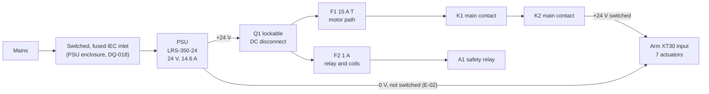
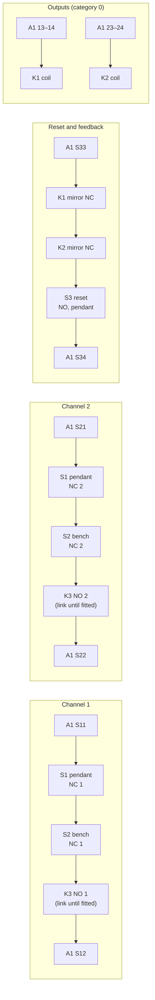

# WP-H-02 Electrical and safety-chain design

| Field | Value |
|---|---|
| Work product | WP-H-02 Electrical and safety-chain design (schematics, wiring, enclosure) |
| Standard reference | SRP/CS: 13849-1 §6; IEC 62443: 62443-4-2 CR 2.13 (physical); Other: 60204-1 §5–§13, ISO 13850:2015 §4, IEC 60947-5-5 (direct opening action), IEC 60947-4-1 Annex F (mirror contacts); ASPICE: HWE.2. Clause numbers are to be checked against licensed copies |
| Version | 0.1 (bench safety chain designed: architecture, wiring, candidate parts, response budget, first PL estimate; 2026-11-01) |
| Status | Draft |
| PL / scope | SF-32 (emergency stop), SF-24 (manual reset) and the chain stage of SF-08, PL d target (DQ-004 answered A); bench equipment, not claimed with a PL until WP-C-04 and WP-H-04 (WP-M-02 §4.1); CFG-001 in OE-1 |
| Author | Assurance team (AI-assisted draft, I0) |
| Reviewer(s) | TBD (I1) |
| Approver | Safety manager |
| Baseline | BL-001 (`206ebda`) |

## 1. Purpose

The design of the bench safety chain and of the electrical installation around the arm: the PSU, the lockable
disconnect, the fuses, the contactors, the safety relay, the emergency-stop devices, the drive supply and the harness.
Diagnostic signals from the chain to the controller are informative only.

The lead chose the wired chain for the bench on 2026-11-01 (DQ-006, answered A). Under
[WP-M-02 §4.1](../01-management/WP-M-02-safety-plan.md#41-early-implementation-of-at-risk-work) it is built before its
phase as bench equipment for [WP-V-07](../06-validation/WP-V-07-test-operations.md) conditions C-1 and C-2, and it is
designed here as the first draft of the product chain, so nothing bought for the bench is thrown away. No Performance
Level is claimed for it until [WP-C-04](../02-concept/WP-C-04-safety-functions-and-plr.md) specifies the functions and
[WP-H-04](WP-H-04-reliability-data-and-pl-calculation.md) calculates them; §8 is a first estimate only.

## 2. Design decisions

| # | Decision | Why | Consequence |
|---|---|---|---|
| E-01 | **Category 3, two channels from button to contactor**: two NC contacts per E-stop device into a two-channel safety relay with cross-fault detection, and **two contactors K1 and K2 in series** in the 24 V line | SF-32 targets PL d, category 3 (WP-C-04); a single contactor is a single channel at the output, and a welded contactor would then leave the arm powered with no second means. DQ-006 named "a contactor"; the second one costs about €30 and is what category 3 needs | Each contactor's mirror contact sits in the relay's feedback loop (E-03), so a welded contactor is found at the next reset |
| E-02 | **Both contactors switch the +24 V line**; the 0 V line is not switched | The arm's 0 V is also the CAN adapter's ground through the host's USB port. Opening 0 V would leave a return path through the CAN interface: the arm could stay partly powered and the adapter would carry motor current | The 0 V line is continuous from the PSU to the arm; it is bonded once, at the PSU |
| E-03 | **Monitored manual reset** on the pendant: the reset acts on the falling edge, and only with both channels closed and both contactors' NC mirror contacts closed | SF-24: releasing a button never restarts; power return lands in OFF; a welded contactor blocks the next start | Releasing an E-stop does nothing until reset; the host must also be in IDLE before any motion (SF-24, enforced by the safety layer, not the chain) |
| E-04 | **Stop category 0 now, with a relay that also has delayed outputs** | SF-32 is category 0 today (WP-C-04 §3.1), but whether the actuators hold the arm without power is unknown (GAP-07); if they do not, a category 1 stop (controlled stop first, then power removal) is better. A relay with delayed outputs changes category by moving two wires, not by buying again | Category 0: K1 and K2 on the instantaneous outputs. Category 1: on the delayed outputs, with the delay set from WP-V-02 (WP-C-04 OI-1) |
| E-05 | **The chain switches the arm's whole 24 V input** | The Damiao drives take one 24 V input for logic and power (to be confirmed from the DM4310 and DM4340P datasheets, OI-2); there is no separate motor-power input to switch | After a stop the drives power down and drop off the CAN bus; the host sees every actuator vanish, which WP-S-05 defines as the expected signature of a chain stop |
| E-06 | **The relay's own supply is fused separately and taken ahead of the contactors** | The relay must stay powered and latched while motor power is off; a fault in the arm's harness must not take the relay down with it | F2 (1 A) feeds the relay and the contactor coils; F1 protects the motor path |
| E-07 | **The safety layer can open the chain** through an interlock relay K3 with force-guided contacts, energised while the layer is healthy; one NO contact of K3 in each E-stop channel | SF-08's second stage removes power when a controlled stop does not reach standstill in 300 ms (WP-C-04 §3.2); loss of the controller de-energises K3 and stops the arm | K3 is fitted when the safety layer exists (where it runs is DQ-020); until then each channel has a wire link in its place, recorded in the change record |
| E-08 | **Contactor coils carry suppression that does not slow drop-out** (a diode with a Zener, or a varistor, or the contactor's own suppressor module) | A plain diode across a DC coil can lengthen the drop-out time several times over and eat the 200 ms budget of SF-32 | Drop-out time is in the response budget of §7 and measured in WP-V-04 |
| E-09 | **A lockable DC disconnect Q1 at the PSU output, ahead of everything else**; the mains side in an enclosure with a switched, fused inlet | EN 60204-1 asks for a lockable supply disconnect (clause to be checked); the open-frame PSU has exposed mains terminals (GAP-09, GAP-11) | The mains part follows the recommended option of the open supply-disconnect question (DQ-018) and changes if the lead chooses otherwise |

## 3. Schematics and wiring

### 3.1 Supply and power path

### 3.2 Stop channels, reset and outputs

### 3.3 Terminal list

Terminal names follow the convention of two-channel E-stop relays (S11…S34, 13/14, 23/24); the bought relay's
datasheet governs.

| From | To | Signal | Conductor | Note |
|---|---|---|---|---|
| PSU +V | Q1 line | +24 V unswitched | 2.5 mm² | Inside the enclosure |
| Q1 load | F1, F2 | +24 V after the disconnect | 2.5 mm² to F1, 0.75 mm² to F2 | Q1 padlockable in OFF |
| F1 | K1 1/L1 | +24 V motor path | 2.5 mm² | 15 A time-delay, DC-rated (sizing OI-1) |
| K1 2/T1 | K2 1/L1 | +24 V between contactors | 2.5 mm² | |
| K2 2/T1 | Arm XT30 + | +24 V switched | 1.5 mm² (16 AWG) in the harness | Polarised connector (GAP-12 in WP-H-05) |
| PSU −V | Arm XT30 − | 0 V | 1.5 mm² (16 AWG) | Not switched (E-02) |
| F2 | A1 A1, K1 A1, K2 A1 via the relay outputs | +24 V control | 0.75 mm² | |
| A1 S11/S12, S21/S22 | S1, S2, K3 | Channels 1 and 2 | 0.75 mm², pendant cable 4 × 0.75 mm² + reset pair | Channels in separate conductors of one sheathed cable; cross-fault detection covers a short between them |
| A1 S33/S34 | K1, K2 mirror NC, S3 | Reset and feedback loop | 0.75 mm² | |
| A1 13/14 | K1 A1 | K1 coil | 0.75 mm² | Suppressor per E-08 |
| A1 23/24 | K2 A1 | K2 coil | 0.75 mm² | Suppressor per E-08 |
| A1 auxiliary or semiconductor output | Safety layer input | "Chain open" (informative) | 0.75 mm² | Defined in WP-S-05; never a channel |
| K1, K2 auxiliary NO | Safety layer input | "Motor power on" (informative) | 0.75 mm² | Defined in WP-S-05 |

## 4. Parts

Candidate parts for the bench, chosen so they carry into the product chain. Every rating is to be confirmed against
the supplier's datasheet before ordering; prices are rough budget figures, excluding VAT.

| Ref | Part | Requirement | Candidates (to be confirmed) | Qty | Budget |
|---|---|---|---|---|---|
| S1 | Pendant E-stop station with reset button S3 | ISO 13850 mushroom head, red on yellow, latching, direct opening action (IEC 60947-5-5), two NC contacts; a blue momentary reset with one NO in the same station; IP65; 3 m cable with strain relief | Schneider Harmony XAL-K, IDEC or EAO pendant stations | 1 | €50–90 |
| S2 | Bench E-stop | As S1 without the reset, surface-mounted at the bench edge within the observer's reach | Same families | 1 | €30–60 |
| A1 | Safety relay | Two-channel E-stop input with cross-fault detection, monitored manual reset with feedback loop, at least two instantaneous and two delayed safety outputs (E-04), 24 V DC supply, PL e / category 4 by the manufacturer's declaration | Pilz PNOZ s5 (instantaneous and delayed outputs); Pilz PNOZ s3 or Phoenix Contact PSR class if category 0 is settled | 1 | €200–300 |
| K1, K2 | Contactors | 24 V DC coil; NC auxiliary as a mirror contact (IEC 60947-4-1 Annex F); main contacts rated for DC-1 at 24 V at least 20 A, and a making capacity above the measured inrush (OI-1); coil suppressor available | Siemens 3RT20 size S00 or Schneider TeSys Deca class with DC coil | 2 | €40–80 |
| K3 | Interlock relay (when the safety layer exists) | Force-guided contacts (EN 50205), 24 V coil, two NO | Finder 7S or Phoenix Contact force-guided relay class | 1 | €20–40, later |
| Q1 | Lockable DC disconnect | Rotary switch-disconnector, padlockable in OFF, rated DC-21 or better at 24 V for at least 20 A | ABB OT16 or OT25 class with DC rating | 1 | €30–50 |
| F1, F2 | Fuse holders and fuses | DIN rail, DC-rated; F1 15 A time-delay, F2 1 A | 10 × 38 mm holders | 2 | €20–30 |
| — | Enclosure | DIN rail, IP54, about 200 × 150 × 100 mm, glands for the supply, the arm and the pendant cable; Q1 on the lid | Polycarbonate DIN enclosure | 1 | €40–60 |
| — | PSU enclosure and inlet | Encloses the open-frame LRS-350-24; IEC inlet with switch and fuse; protective earth to the PSU's earth terminal | Per DQ-018 option A | 1 | €30–60 |
| — | Wiring | 2.5 mm² in the enclosure for the motor path, 0.75 mm² control, ferrules, labels, an XT30 pair | — | — | €30–50 |

The bench chain comes to roughly **€500 to €800** with the PSU enclosure.

## 5. Enclosure

One IP54 DIN-rail box on the bench beside the PSU holds Q1, F1, F2, A1, K1 and K2 (and K3 later); the PSU sits in its
own enclosure so no mains part shares the 24 V box. The pendant cable leaves the box through a gland with strain
relief; the bench button S2 is at the bench edge where the observer of WP-V-07 C-6 stands. Every device is labelled
with its reference from this document, and the box carries the supply voltage and a "lock Q1 before work on the arm"
label.

## 6. Behaviour

| Event | What the chain does | What the host sees |
|---|---|---|
| S1 or S2 pressed | Both channels open; A1 drops K1 and K2; the arm's 24 V is removed (category 0) | Every actuator leaves the bus; "chain open" asserted |
| Button released | Nothing; A1 stays off | No change |
| S3 pressed and released, both buttons released, both mirror contacts closed | A1 closes K1 and K2; the arm is powered; the drives boot unenabled | Actuators reappear; the safety layer stays in OFF until the host moves it to IDLE |
| Reset with a contactor welded | Refused: that contactor's mirror contact is open | "Chain open" stays asserted |
| Short between channels (pendant cable crushed) | Detected by A1's cross-fault detection; A1 stays off until the fault is cleared | "Chain open" stays asserted |
| Mains or PSU lost | Everything off; A1 needs a reset when power returns (no automatic restart) | Bus silent |
| Q1 opened and locked | Everything after Q1 dead, including A1 | Bus silent |
| Safety layer drops K3 (once fitted) | As a button press | "Chain open" asserted |

## 7. Response-time budget for SF-32

The target is power removed within 200 ms of the button (WP-C-04). Values are planning figures until WP-V-04 measures
them.

| Stage | Budget | Basis |
|---|---|---|
| Button contact opens | ≤ 5 ms | Direct opening action |
| A1 output opens | ≤ 30 ms | Typical release time of two-channel E-stop relays; datasheet to confirm |
| K1, K2 drop out | ≤ 40 ms | DC coil with a suppressor that keeps drop-out short (E-08); datasheet to confirm |
| Drive input capacitance discharges below the drives' undervoltage cut-off | Unknown | Measured in WP-V-04 (OI-6); a bleed resistor across the arm side is added if it is too slow |
| **Total to power removal at the contactors** | **≤ 75 ms** | Leaves 125 ms for the drive-side discharge |

## 8. Estimated PL (first estimate, chain only)

This is an order-of-magnitude check that the design can reach the PL d target, not a claim. WP-H-04 replaces it with a
calculation from the bought parts' data. The B10D values below are the typical ones ISO 13849-1 Annex C gives
for these device types (to be checked against a licensed copy and replaced with manufacturer data).

| Subsystem | Category | Data used | MTTFD per channel | DCavg | Contribution |
|---|---|---|---|---|---|
| Input: S1, S2 | 3 | B10D 100,000 (E-stop devices, typical); about 440 operations a year (two pre-session tests a day on 220 days) | B10D / (0.1 × nop) ≈ 2,300 years, so "high" (capped at 100 years) | 99 % (two channels, cross-fault detection) | Plausibly PL e |
| Logic: A1 | 4 | Manufacturer's declaration (PL e, PFHD from the datasheet) | — | — | PL e |
| Output: K1, K2 | 3 | B10D 1,300,000 at nominal load (contactors, typical), to be derated for DC-1 at the measured current; about 1,000 operations a year | "high" | 99 % (mirror contacts in the feedback loop) | Plausibly PL e |
| **Chain** | **3** | Common-cause failure score of at least 65 points to be shown in WP-H-04 | | | **PL d target plausible with margin** |

The estimate does not cover K3 (it adds a series contact to each channel and needs its own B10D) or the drives'
behaviour after power removal (E-05, OI-6), and it assumes no fault exclusion.

## 9. Verification on the bench

Before the chain is relied on, and after any change to it, these checks are run and recorded in the change record
(WP-V-04 specifies them properly):

1. Each button on its own removes the arm's power; releasing it does not restore power.
2. Reset restores power only with both buttons released; holding reset in does not restart (falling edge).
3. Removing one contactor's mirror-contact wire from the feedback loop makes reset fail.
4. Opening each channel alone (a jumper removed at the relay) stops the arm and latches.
5. A short between the channels, made at the relay terminals with the arm unpowered, prevents reset.
6. Mains off and on: the arm stays off until reset.
7. Q1 locked off: no voltage at the arm's connector (measured).

The pre-session check of WP-V-07 §4 repeats checks 1 and 2 before every powered session.

## 10. Open items

| ID | Item | Owner | Due |
|---|---|---|---|
| OI-1 | Measure the arm's inrush current when K1 and K2 close, and its peak current in a fast move at the DQ-016 limits; size F1 and confirm the contactors' making capacity and DC-1 rating from it | EM | Before purchase |
| OI-2 | Confirm from the DM4310 and DM4340P datasheets whether logic and power share one 24 V input, and how the drives behave on undervoltage and restart | EM | Before purchase |
| OI-3 | Choose the stop category for SF-32 once WP-V-02 shows whether the arm holds without power (WP-C-04 OI-1, GAP-07); move K1 and K2 to the delayed outputs if category 1 | SM | G1 |
| OI-4 | Apply the lead's answer on the supply disconnect (DQ-018) to the mains side | EM | G1 |
| OI-5 | Specify K3 and the "chain open" and "motor power on" signals in WP-S-05 once the safety layer's location is answered (DQ-020) | SRP | G2 |
| OI-6 | Measure the drive-side discharge after power removal and check that hand-moving the unpowered arm cannot wake the drives by back-EMF; size a bleed resistor if needed (WP-V-04) | EM | G4 |
| OI-7 | Calculate the chain's PL from the bought parts' data (WP-H-04) | SRP | G3 |
| OI-8 | Record the bench build as an impact-analysed change under `07-supporting/impact/` (WP-M-02 §4.1) | SM | At the build |
