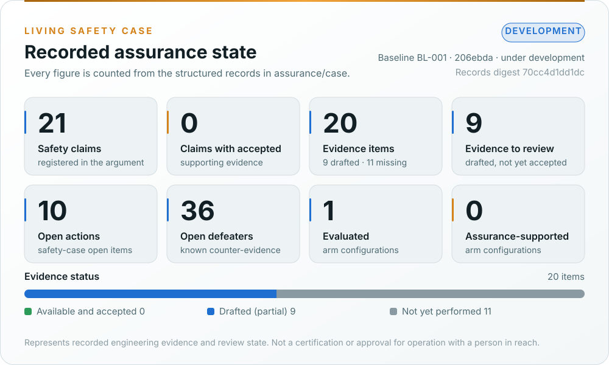
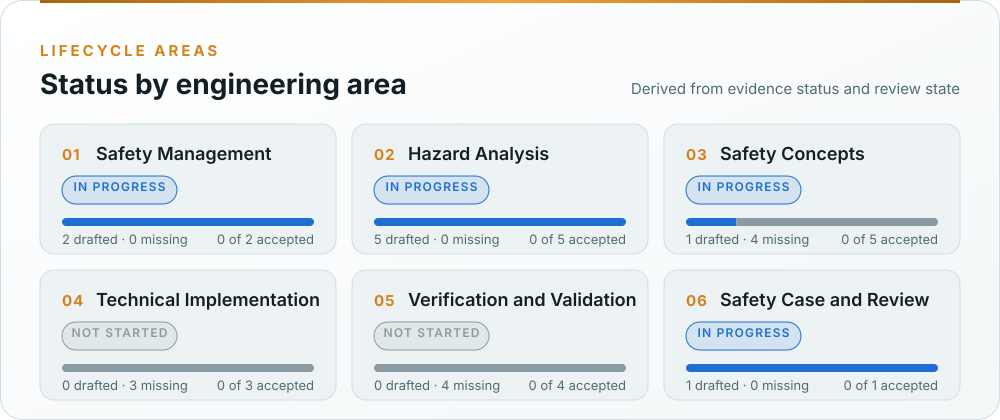
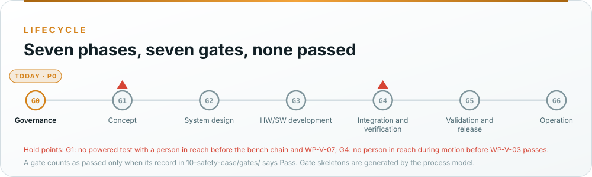

# reBot-DevArm assurance repository

This tree holds the engineering assurance work products for the reBot-DevArm fork: machinery risk assessment
(ISO 12100), industrial-robot and collaborative-operation requirements (ISO 10218-1/-2, ISO/TS 15066), safety-related
control (ISO 13849-1/-2, with IEC 62061 and IEC 61508 where 13849 runs out), electrical safety (EN 60204-1), gaps and
distances (ISO 13854, 13855, 13857), cybersecurity (IEC 62443-4-1/-4-2), machine learning in safety functions
(ISO/IEC TR 5469) and the regulatory file for Regulation (EU) 2023/1230. Safety-case structure follows UL 4600 principles.

> [!WARNING]
> Everything here is a **draft prepared for engineering review**. None of it has passed verification review,
> confirmation review or a functional safety assessment. A document existing here does not mean the activity behind
> it is complete. Read the `Status` field of each work product and the register in
> [`01-management/WP-M-00-work-product-register.md`](01-management/WP-M-00-work-product-register.md).

## Living Safety Case

<p align="center">
  
</p>
<p align="center">
  
</p>

The records (claims, arguments, evidence, defeaters, actions, configurations, baselines, reviews) live in
[`case/`](case/README.md); [`case/tools/validate.py`](case/tools/validate.py) checks them and
[`case/tools/generate_dashboard.py`](case/tools/generate_dashboard.py) draws the figures above and fills the table
below. CI fails if any of them is stale. The document form of the same argument is
[WP-K-01](10-safety-case/WP-K-01-safety-case.md); check X3 keeps its tables equal to the records.

<details>
<summary><b>Recorded values as text</b></summary>

<!-- BEGIN GENERATED: assurance-summary (assurance/case/tools/generate_dashboard.py) -->

| Indicator | Recorded value |
|---|---|
| Assurance state | Development |
| Engineering baseline | `BL-001` at `206ebda` (under development) |
| Registered safety claims | 21 |
| Claims with accepted supporting evidence | 0 |
| Registered evidence items | 20 (0 available, 9 drafted, 11 not yet performed) |
| Evidence requiring review | 9 |
| Open assurance actions | 10 |
| Open defeaters (known counter-evidence) | 36 |
| Evaluated configurations | 1 |
| Assurance-supported configurations | 0 |
| Records digest | `70cc4d1dd1dc` |

| Lifecycle area | Status | Evidence (drafted / missing / accepted) |
|---|---|---|
| Safety Management | In Progress | 2 (2 / 0 / 0) |
| Hazard Analysis | In Progress | 5 (5 / 0 / 0) |
| Safety Concepts | In Progress | 5 (1 / 4 / 0) |
| Technical Implementation | Not Started | 3 (0 / 3 / 0) |
| Verification and Validation | Not Started | 4 (0 / 4 / 0) |
| Safety Case and Review | In Progress | 1 (1 / 0 / 0) |

<!-- END GENERATED: assurance-summary -->

</details>

**What the dashboard guarantees:** a claim counts as accepted only when a recorded review accepts it, every piece
of evidence it cites is available and accepted, and no defeater against it is open. A passing CI run never accepts
a claim on its own, and no figure here is a safety claim.

## Start here

| Document | Why read it |
|---|---|
| [00-assessment/gap-assessment.md](00-assessment/gap-assessment.md) | Baseline review of the hardware record and the concept-phase package: GAP-01…GAP-36 |
| [01-management/WP-M-01-assurance-strategy.md](01-management/WP-M-01-assurance-strategy.md) | The assurance path: what is claimed, the three-layer architecture argument, how each standard is used, tailoring, phases and gates |
| [01-management/WP-M-00-work-product-register.md](01-management/WP-M-00-work-product-register.md) | Every required work product, its clauses, gate and status |
| [01-management/WP-M-02-safety-plan.md](01-management/WP-M-02-safety-plan.md) | Roles, activities per phase, the early-implementation rule for the bench safety chain, gate reviews |
| [01-management/WP-M-06-confirmation-measures-plan.md](01-management/WP-M-06-confirmation-measures-plan.md) | Which work products get an independent review, at what independence, at which gate |
| [process/README.md](process/README.md) | The integrated process model: swimlane maps per phase, cross-domain interfaces, gate readiness |
| [06-validation/WP-V-07-test-operations.md](06-validation/WP-V-07-test-operations.md) | The hold point: what must be true before any arm is powered with a person in reach under the fork's control |
| [01-management/decisions/README.md](01-management/decisions/README.md) | Questions that wait on the project lead |

## Layout



*Generated by [`make_assets.py`](../docs/assets/rebot/make_assets.py); CI fails if stale. A gate counts as passed only when its record in [`10-safety-case/gates/`](10-safety-case/gates/README.md) says Pass.*

| Folder | Content | Primary standard clauses |
|---|---|---|
| [`00-assessment/`](00-assessment/README.md) | Baseline gap assessment of the hardware record and the concept-phase package | n/a |
| [`01-management/`](01-management/README.md) | Assurance strategy, safety plan, confirmation measures, regulatory strategy, upstream and supplier management, the decision register | ISO 13849-1 §4, IEC 62061 §5, IEC 61508-1 §6 and §8, Machinery Reg. Art. 25 |
| [`02-concept/`](02-concept/README.md) | Item and limits, operating envelopes, risk assessment, safety functions and their required PL, risk reduction concept, interaction and collaborative operation, cybersecurity and ML concepts, insufficiency analysis | ISO 12100 §5–§6, ISO 10218-1 §5, ISO 10218-2 §5, ISO/TS 15066 §5, ISO 13849-1 §5 and Annex A, IEC 62443-4-1 SR, TR 5469 |
| [`03-system/`](03-system/README.md) | Safety requirements specification, SRP/CS architecture, response-time, stopping and separation budget, safety-chain I/O, cybersecurity architecture, system verification | ISO 13849-1 §5–§6 and §8, EN 60204-1 §9, ISO 13855 |
| [`04-hardware/`](04-hardware/README.md) | Safety-chain hardware, electrical safety, failure analysis, MTTFD, DCavg, CCF and PL calculation, component qualification, mechanical analysis | ISO 13849-1 §6 and Annexes C–F, ISO 13849-2, EN 60204-1, ISO 13854 |
| [`05-software/`](05-software/README.md) | The controller safety layer and the hardened host stack: requirements, architecture, safety analysis, units, verification, safety parameters, ML engineering, cybersecurity implementation | ISO 13849-1 §7, IEC 61508-3, IEC 62443-4-1 SI and SVV |
| [`06-validation/`](06-validation/README.md) | Validation plan and records: stopping and holding, force and separation, E-stop, fault injection, cybersecurity validation, the powered-test hold point, field trials | ISO 13849-1 §10, ISO 13849-2, ISO 10218-2 §6, ISO/TS 15066 Annex A |
| [`07-supporting/`](07-supporting/README.md) | Configuration, change and problem management, documentation, review, traceability, tool and component qualification, release | IEC 61508-1 §6–§7, ISO 13849-1 §12, Machinery Reg. Annex IV |
| [`08-analyses/`](08-analyses/README.md) | System FMEA, FTA, common cause failure, STPA, independence of the safety chain | ISO 13849-1 §6 and Annex F, IEC 60812, IEC 61025 |
| [`09-production-operation/`](09-production-operation/README.md) | Assembly and commissioning, operation, information for use, field monitoring, incident response | ISO 12100 §6.4, ISO 10218-2 §5, Machinery Reg. Art. 10 |
| [`10-safety-case/`](10-safety-case/README.md) | Safety case, technical documentation index, cybersecurity case, assessment reports, release record and declaration draft; gate and confirmation records | UL 4600, IEC 61508-1 §8, Machinery Reg. Annexes IV–V |
| [`process/`](process/README.md) | Integrated process model: activities, lanes, cross-domain interfaces and gates as data; generated maps and gate skeletons | ISO 13849-1 §4, IEC 61508-1 §6, MAN.3 |
| [`trace/`](trace/README.md) | Machine-readable hazards, safety functions and assumptions of use (`items/`), later requirements and trace matrices | ISO 13849-1 §5 |
| [`case/`](case/README.md) | Living Safety Case records (claims, evidence, defeaters, actions, configurations, baselines, reviews), validator and dashboard generator | UL 4600 |
| [`sim/`](sim/README.md) | Hazard scenes on upstream's CAD: the joint rig, the scene catalogue, the Blender renders and review dashboards (WP-P-12; pictures only, no evidence credit) | ISO 12100 §5.4 (aid) |
| [`tools/`](tools/) | Folder index generator, link and table checkers | WP-P-04 |

## Conventions

### Identifiers

| Prefix | Meaning | Example |
|---|---|---|
| `WP-<area>-<nn>` | Work product; areas M, C, S, H, W, V, P, A, O, K, T as in the register | `WP-C-04` (safety functions and PLr) |
| `HZ-<cat><nn>` | Hazard from the ISO 12100 risk assessment (the package's identifiers) | `HZ-M01` |
| `SF-<nn>` | Safety function, with its required Performance Level `PLr` | `SF-32` (emergency stop, PLr d) |
| `DM-<nn>` / `IFU-<nn>` | Design measure / information for use (the package's non-control "safety functions", reclassified) | `DM-02` |
| `OE-<n>` / `M-<nn>` | Operating envelope / operating mode | `OE-1`, `M-04` |
| `SR-<nn>` | Safety requirement of the SRP/CS (WP-S-02) | `SR-012` |
| `HWSR-<nn>` / `SWSR-<nn>` | Hardware / software safety requirement | `SWSR-031` |
| `CSR-<nn>` / `TS-<nn>` | Cybersecurity requirement / threat scenario | `CSR-04` |
| `AIR-<nn>` | Requirement on a learned component | `AIR-02` |
| `FI-<nn>` / `TC-<nn>` | Functional insufficiency / triggering condition (WP-C-10) | `TC-05` |
| `PAR-<nn>` | Safety-related parameter (WP-W-09) | `PAR-07` |
| `AOU-<nn>` | Assumption of use (on the operator, the supply, the parts, the bench) | `AOU-05` |
| `VS-<area>-<nn>` | Verification specification (test case) | `VS-UV-03` |
| `DF-<nn>` | Defeater: known counter-evidence against a claim | `DF-12` |
| `GAP-<nn>` | Finding of the baseline gap assessment; never reused | `GAP-17` |
| `OI-<nn>` | Open item to resolve before the next gate (per document) | `OI-3` |
| `IX-<nn>` / `FB-<nn>` | Cross-domain interface / feedback route in the process model | `IX-02` |
| `DQ-<nnn>` | Decision question for the project lead | `DQ-005` |
| `G0`…`G6` | Lifecycle gates | `G1` |

Requirement IDs never get reused. A withdrawn requirement keeps its ID and is marked `Withdrawn`.

### Document control header

Every work product starts with this block:

```
| Field | Value |
|---|---|
| Work product | WP-x-nn <name> |
| Standard reference | <clause list> |
| Version | 0.1 |
| Status | Skeleton / Draft / In review / Approved / Baselined |
| PL / scope | <highest PLr addressed, or process / cybersecurity / ML> |
| Author | <name> |
| Reviewer(s) | <name, independence level I0–I3> |
| Approver | <name> |
| Baseline | <git commit or tag the content refers to> |
```

### Status meanings

| Status | Meaning |
|---|---|
| Skeleton | Structure and clause mapping exist; content still to be written |
| Draft | Content written, derived from code review and engineering judgement; not yet verified |
| In review | Verification review open (pull request) |
| Approved | Verification review passed and approved by the approver named in the safety plan |
| Baselined | Approved and frozen in a tagged configuration baseline |

### Changing a work product

Work products change through pull requests in the same way code does (see
[WP-P-02 change management](07-supporting/WP-P-02-change-management.md)). If a pull request touches a safety-relevant
path (see [`07-supporting/safety-relevant-paths.txt`](07-supporting/safety-relevant-paths.txt), owned by
[WP-P-01](07-supporting/WP-P-01-configuration-management-plan.md)), it updates the affected work products or records an
impact analysis that says why none are affected.

Some files are generated from others and checked in CI. If you edit a source, run the generator and commit its
output:

| Generator (run this) | Its outputs | Sources it reads |
|---|---|---|
| `python3 assurance/tools/folder_index.py` | `assurance/<folder>/README.md` for the numbered folders | WP-M-00 §3 |
| `python3 assurance/process/tools/process_model.py` | `process/maps/*.md`, `10-safety-case/gates/skeletons/*.md` | `process/model/*.yaml`, WP-M-00 §2–§3, WP-M-02 §3.1, WP-M-06 §9, the confirmation records |
| `python3 assurance/01-management/decisions/fig_lifecycle.py` | `decisions/figures/fig-dr-1-lifecycle.svg` | The lifecycle table of the decisions README |
| `python3 docs/assets/rebot/make_assets.py` | The README figures | The data at the top of the generator |
| `python3 tools/wiki/tour_figures.py` | The wiki's standards-tour figures, `docs/assets/rebot/tour/*.svg` | The tour order in the generator, WP-C-03 §5 ratings, the ISO 13854 gaps in `sim/blender/scenes.yaml` |
| `python3 tools/wiki/wiki_hero.py` (`--photo` to re-crop the image) | The wiki's Home banner, `docs/assets/rebot/wiki-hero.svg` and `wiki-hero-arm.jpg` | Upstream's image `media/v1.1_2.png` |
| `python3 assurance/sim/blender/gallery.py` | `sim/blender/dashboards/README.md` and the dashboard JPEGs | `sim/blender/scenes.yaml`, `out/<scene>/scene.json`, `out/<scene>/dashboard.png` |

### Reference configuration

The assessed configuration is **CFG-001, the reBot Arm B601-DM v1.1**: the arm upstream sells as a kit and
pre-assembled (six Damiao V4 actuators and a gripper on one CAN chain, a DM CAN-USB adapter, a host PC, a MEAN WELL
24 V supply), fixtured on a bench in the supervised laboratory envelope OE-1, plus the bench safety chain the fork
adds before any powered test with a person in reach ([WP-V-07](06-validation/WP-V-07-test-operations.md)). The
B601-RS (RobStride) variant is **CFG-002**, tracked and unverified until its BOM is released. The software the arm
runs is upstream and unpinned until the lead decides to fork it (DQ-007).

### Standards text

The standards are copyrighted and are not reproduced here. Clause references point to the editions named in
[WP-M-01 §4](01-management/WP-M-01-assurance-strategy.md#4-the-standards-and-how-each-one-is-used) and must be
checked against a licensed copy before an audit ([WP-M-06](01-management/WP-M-06-confirmation-measures-plan.md) OI-1).
