<!-- Generated by assurance/sim/blender/gallery.py from scenes.yaml and out/<scene>/scene.json; do not edit by hand. -->

# Hazard-scene dashboards

One dashboard per scene of [`scenes.yaml`](../scenes.yaml), composed by [`compose.py`](../compose.py) from the
posed CAD renders. **Pictures only: synthetic, no evidence credit** ([method](../../README.md#4-what-the-pictures-are-and-are-not)).
The ratings are the package's (WP-C-03 §5), not yet re-rated for OE-1. Every motion is kinematic at an assumed rate;
no actuator, controller, person or contact is modelled.

| Scene | Hazard | PLr (package) | Motion | Outcome | Status |
|---|---|---|---|---|---|
| `hz-m01-elbow-pinch-teach` | HZ-M01: Elbow closes on the operator's fingers while hand-guiding in TEACH | e (cat. 4) | J3 110° to 5° at 30 °/s (assumed) | **contact**: finger caught in the gap at +3.30 s | [dashboard](hz-m01-elbow-pinch-teach.jpg) |
| `hz-m02-gripper-finger-teach` | HZ-M02: Gripper closes on the operator's finger between the jaws in TEACH | d (cat. 3) | jaws 64 to 4 mm at 30 mm/s (assumed) | **contact**: finger caught in the gap at +1.30 s | [dashboard](hz-m02-gripper-finger-teach.jpg) |
| `hz-p03-wrist-against-bench` | HZ-P03: Wrist pitch traps a finger between the gripper and the bench top | e (cat. 4) | J3 100° to 45° at 30 °/s (assumed) | **contact**: finger caught in the gap at +1.60 s | [dashboard](hz-p03-wrist-against-bench.jpg) |
| `hz-m04-sweep-strike-run` | HZ-M04: Arm sweeps into a bystander's head during RUN | e (cat. 4) | J1 -45° to 60° at 90 °/s (assumed) | no contact; minimum distance 17 mm | [dashboard](hz-m04-sweep-strike-run.jpg) |
| `hz-p02-hand-reach-in-run` | HZ-P02: Operator reaches in to catch a fumbled object during RUN | e (cat. 4) | J3 100° to 45° at 90 °/s (assumed) | **contact**: hand struck at 0.76 m/s (peak finger-tip speed) at +0.60 s | [dashboard](hz-p02-hand-reach-in-run.jpg) |
| `hz-m06-tip-over-unfixtured` | HZ-M06: Unfixtured base tips under the arm's own moment at full reach | a (cat. B) | static pose (assumed) | static picture | [dashboard](hz-m06-tip-over-unfixtured.jpg) |
| `hz-m07-payload-drop-power-loss` | HZ-M07: Gripper releases the payload when motor power is removed | b (cat. 1) | payload free fall (assumed) | payload hits the bench at 2.5 m/s | [dashboard](hz-m07-payload-drop-power-loss.jpg) |
| `hz-p04-auto-restart-in-envelope` | HZ-P04: Power returns and the arm resumes with the operator inside the reach envelope | d (cat. 3) | J1 30° to -60° at 90 °/s (assumed) | no contact; minimum distance 25 mm | [dashboard](hz-p04-auto-restart-in-envelope.jpg) |
| `hz-c05-joint-limit-overshoot` | HZ-C05: A position command past the software limit drives the elbow into its end-stop | c (cat. 2) | J3 60° to 0° at 120 °/s (assumed) | no contact; minimum gap 3 mm | [dashboard](hz-c05-joint-limit-overshoot.jpg) |
| `hz-c01-topic-stall-last-cmd-hold` | HZ-C01: The ROS topic stalls in RUN and the joints hold the last velocity command | e (cat. 4) | J3 120° to 0° at 60 °/s (assumed) | no contact; minimum gap 3 mm | [dashboard](hz-c01-topic-stall-last-cmd-hold.jpg) |
| `hz-m05-entanglement-joint-axis` | HZ-M05: Hair or a lanyard winds onto the wrist roll axis | d (cat. 3) | J6 0° to 360° at 120 °/s (assumed) | no contact; minimum distance 66 mm | [dashboard](hz-m05-entanglement-joint-axis.jpg) |
| `hz-p01-head-quasi-static` | HZ-P01: The gripper presses the forehead against the bench edge | d (cat. 3) | J2 60° to 100° at 45 °/s (assumed) | **contact**: head struck at 0.30 m/s (peak finger-tip speed) at +0.90 s | [dashboard](hz-p01-head-quasi-static.jpg) |
| `hz-c06-policy-ood-into-hand` | HZ-C06: A policy on a scene it was not trained on drives the gripper into the operator's hand | e (cat. 4) | J2 60° to 100° at 120 °/s (assumed) | **contact**: hand struck at 0.79 m/s (peak finger-tip speed) at +0.40 s | [dashboard](hz-c06-policy-ood-into-hand.jpg) |
| `hz-c07-singularity-wrist-flip` | HZ-C07: Inverse kinematics at the workspace boundary flips the wrist at full speed | c (cat. 2) | J4 -60° to 60° at 300 °/s (assumed) | peak finger-tip speed 1.35 m/s | [dashboard](hz-c07-singularity-wrist-flip.jpg) |
| `hz-m08-cable-trip-at-base` | HZ-M08: The PSU cable runs over the bench edge to the floor where the operator walks | b (cat. 1) | static pose (assumed) | static picture | [dashboard](hz-m08-cable-trip-at-base.jpg) |

Clips (mp4, open to play; every step of the main camera, cut by [`clip.py`](../clip.py)): [hz-m01-elbow-pinch-teach](clips/hz-m01-elbow-pinch-teach.mp4) · [hz-m02-gripper-finger-teach](clips/hz-m02-gripper-finger-teach.mp4) · [hz-m04-sweep-strike-run](clips/hz-m04-sweep-strike-run.mp4) · [all three in one reel](clips/reel.mp4)

## hz-m01-elbow-pinch-teach

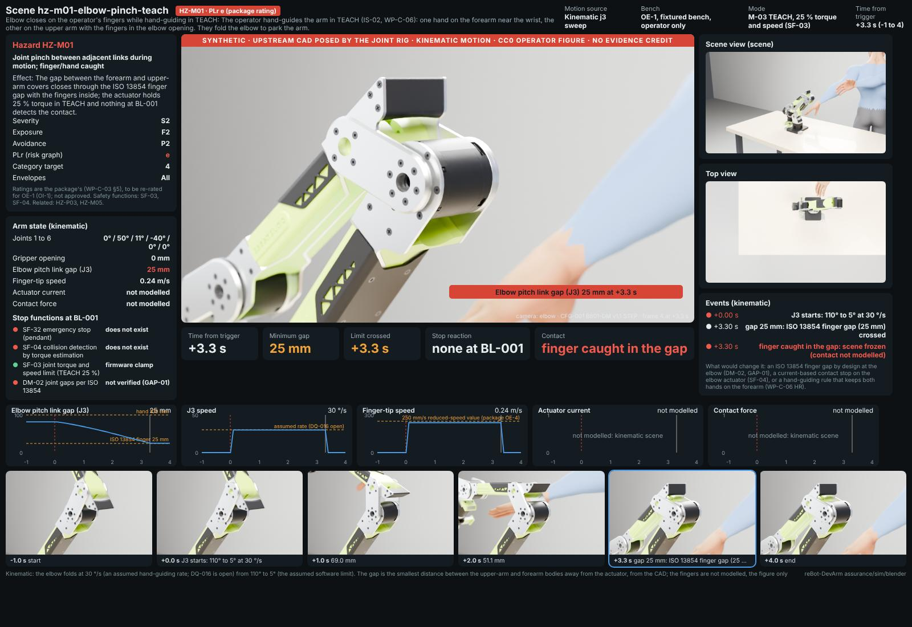

*Kinematic: the elbow folds at 30 °/s (an assumed hand-guiding rate; DQ-016 is open) from 110° to 5° (the assumed software limit). The gap is the smallest distance between the upper-arm and forearm bodies away from the actuator, from the CAD; the fingers are not modelled, the figure only shows where they are.*

## hz-m02-gripper-finger-teach

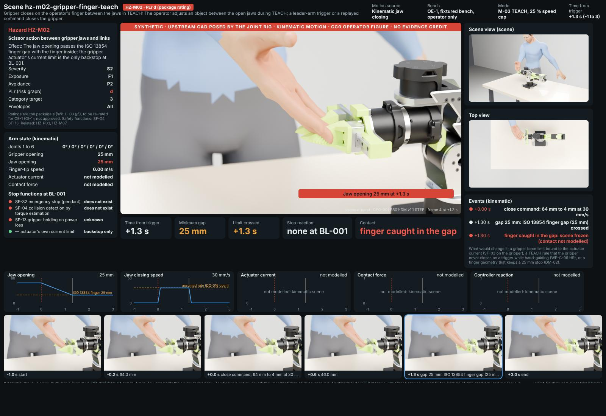

*Kinematic: the jaws close at 30 mm/s (assumed; DQ-016) from 64 mm to 4 mm. The arm holds the as-modelled pose. The finger is not modelled; the operator figure shows where it is.*

## hz-p03-wrist-against-bench

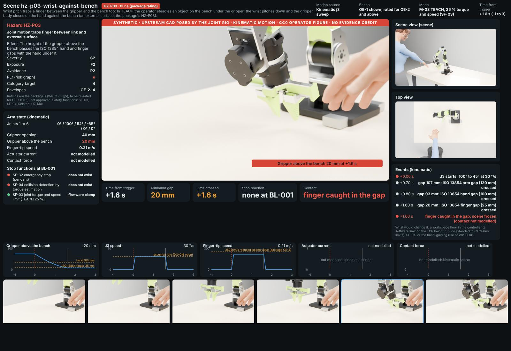

*Kinematic: the elbow closes at 30 °/s (assumed) from 100° to 45° with the shoulder at 100° and the wrist at -65°, so the gripper comes straight down onto the bench. The height is the lowest point of the gripper body above the bench plane, from the CAD. The hand is not modelled.*

## hz-m04-sweep-strike-run

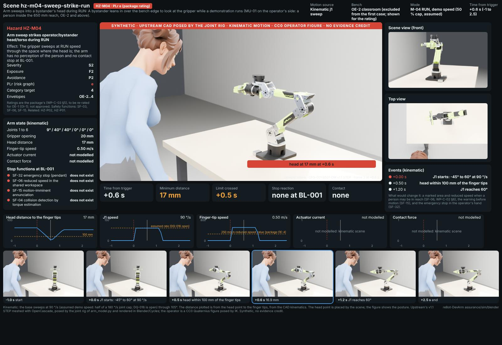

*Kinematic: the base sweeps at 90 °/s (assumed demo speed: half of a 180 °/s joint cap; DQ-016 is open) through 105°. The distance plotted is from the head point to the finger tips, from the CAD kinematics. The head point is placed by the scene; the figure shows the posture.*

## hz-p02-hand-reach-in-run

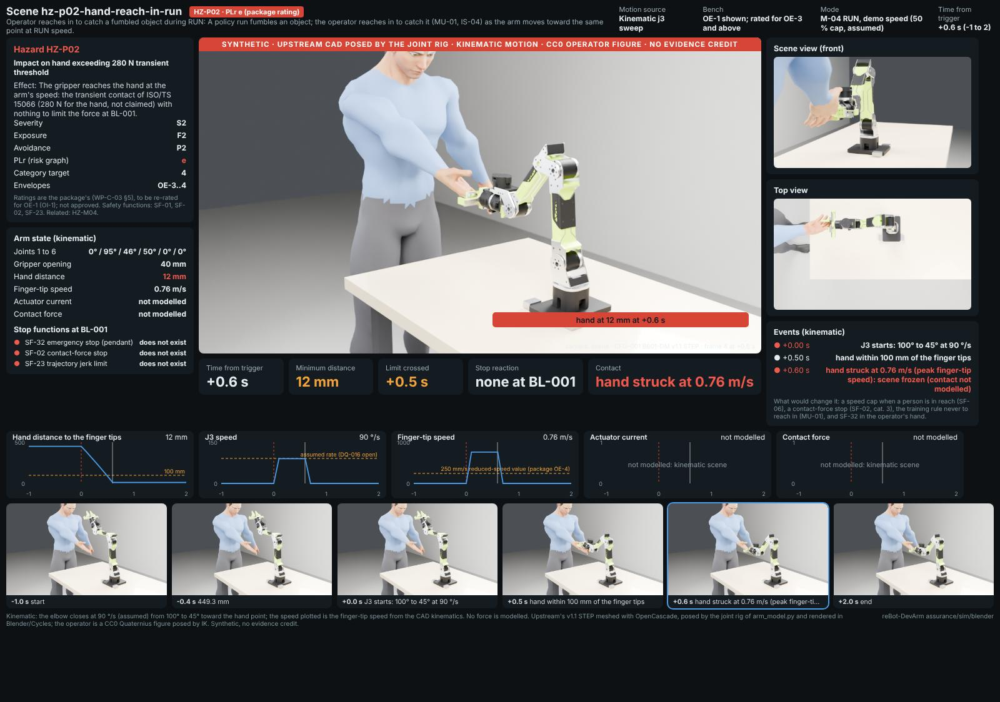

*Kinematic: the elbow closes at 90 °/s (assumed) from 100° to 45° toward the hand point; the speed plotted is the finger-tip speed from the CAD kinematics. No force is modelled.*

## hz-m06-tip-over-unfixtured

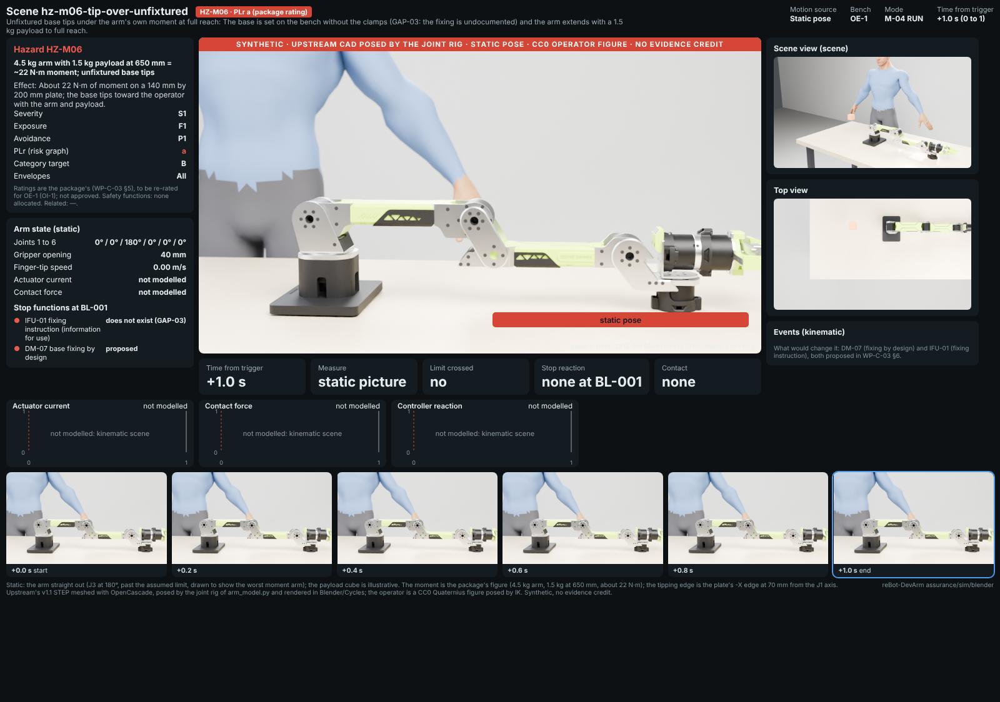

*Static: the arm straight out (J3 at 180°, past the assumed limit, drawn to show the worst moment arm); the payload cube is illustrative. The moment is the package's figure (4.5 kg arm, 1.5 kg at 650 mm, about 22 N·m); the tipping edge is the plate's -X edge at 70 mm from the J1 axis.*

## hz-m07-payload-drop-power-loss

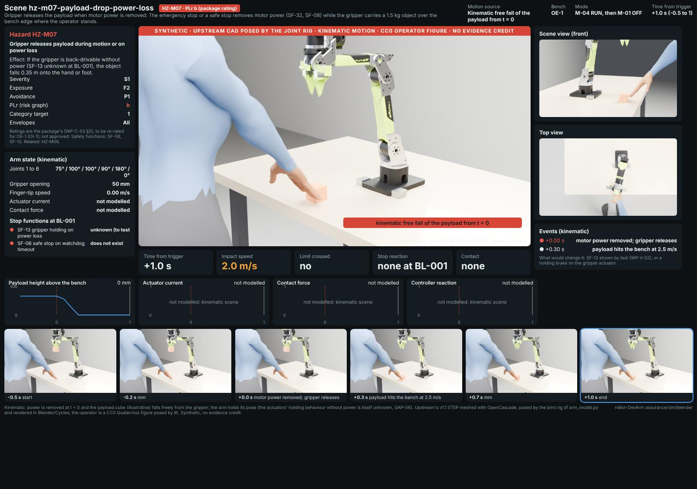

*Kinematic: power is removed at t = 0 and the payload cube (illustrative) falls freely from the gripper; the arm holds its pose (the actuators' holding behaviour without power is itself unknown, GAP-06).*

## hz-p04-auto-restart-in-envelope

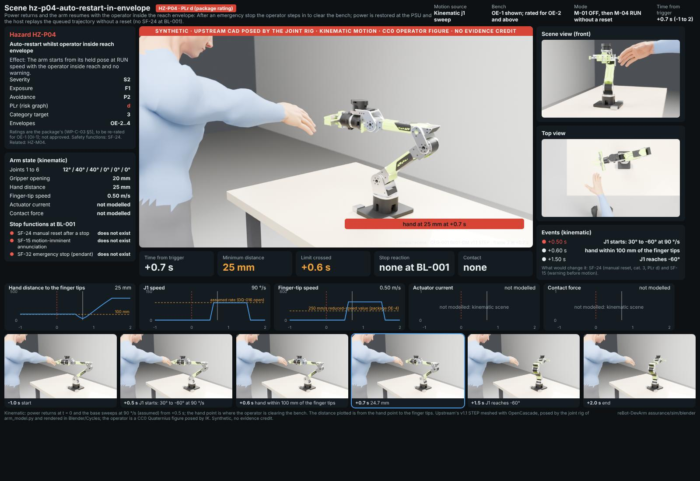

*Kinematic: power returns at t = 0 and the base sweeps at 90 °/s (assumed) from +0.5 s; the hand point is where the operator is clearing the bench. The distance plotted is from the hand point to the finger tips.*

## hz-c05-joint-limit-overshoot

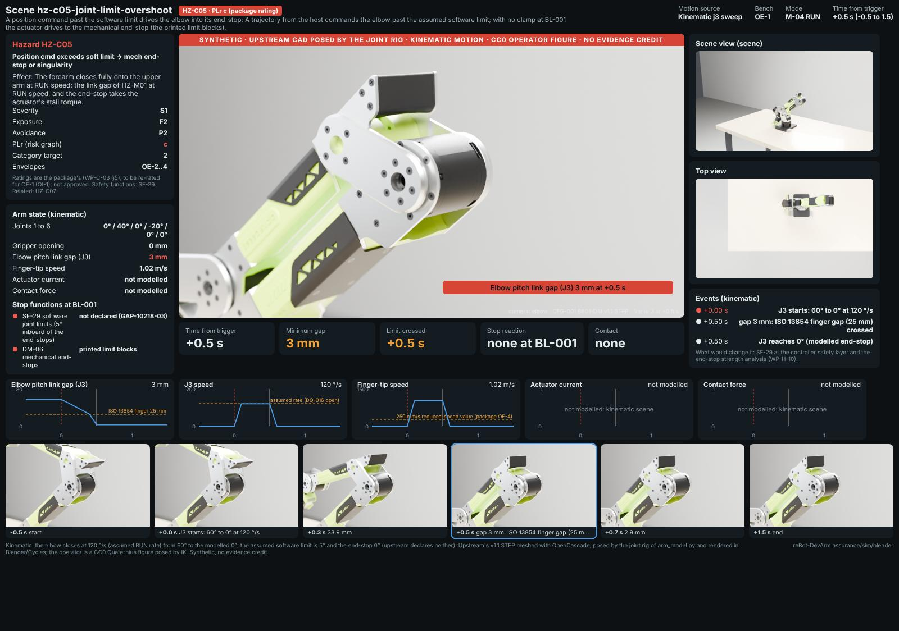

*Kinematic: the elbow closes at 120 °/s (assumed RUN rate) from 60° to the modelled 0°; the assumed software limit is 5° and the end-stop 0° (upstream declares neither).*

## hz-c01-topic-stall-last-cmd-hold

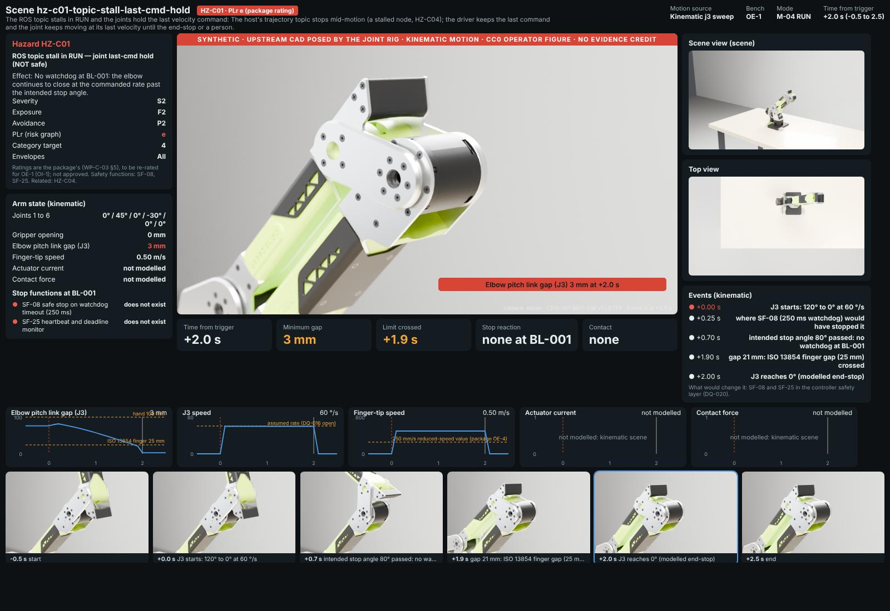

*Kinematic: the topic stalls at t = 0 with the elbow closing at 60 °/s (assumed); the intended stop was 80°; with SF-08 the motion would end 250 ms after the stall (drawn as a marker), without it the elbow runs to the end-stop.*

## hz-m05-entanglement-joint-axis

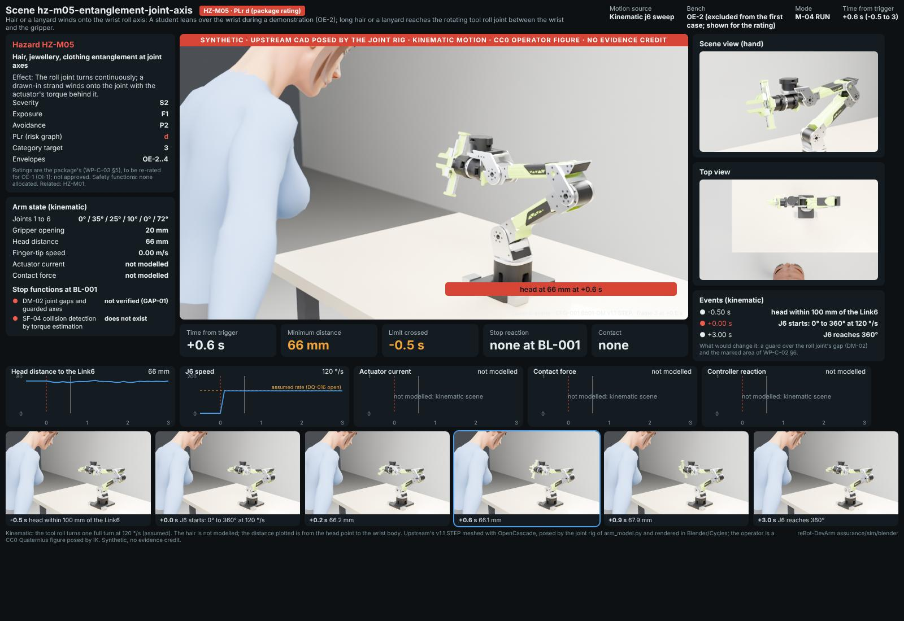

*Kinematic: the tool roll turns one full turn at 120 °/s (assumed). The hair is not modelled; the distance plotted is from the head point to the wrist body.*

## hz-p01-head-quasi-static

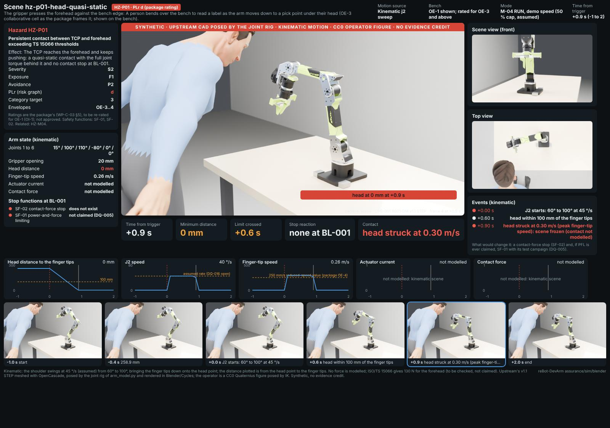

*Kinematic: the shoulder swings at 45 °/s (assumed) from 60° to 100°, bringing the finger tips down onto the head point; the distance plotted is from the head point to the finger tips. No force is modelled; ISO/TS 15066 gives 130 N for the forehead (to be checked, not claimed).*

## hz-c06-policy-ood-into-hand

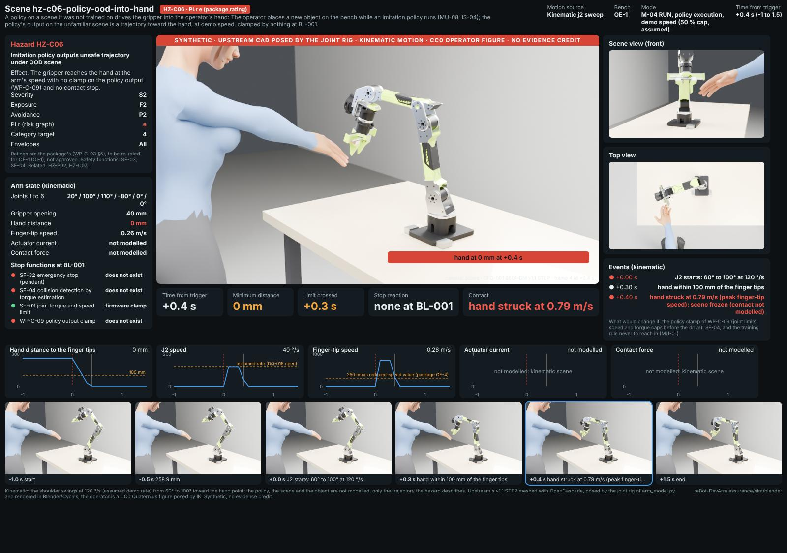

*Kinematic: the shoulder swings at 120 °/s (assumed demo rate) from 60° to 100° toward the hand point; the policy, the scene and the object are not modelled, only the trajectory the hazard describes.*

## hz-c07-singularity-wrist-flip

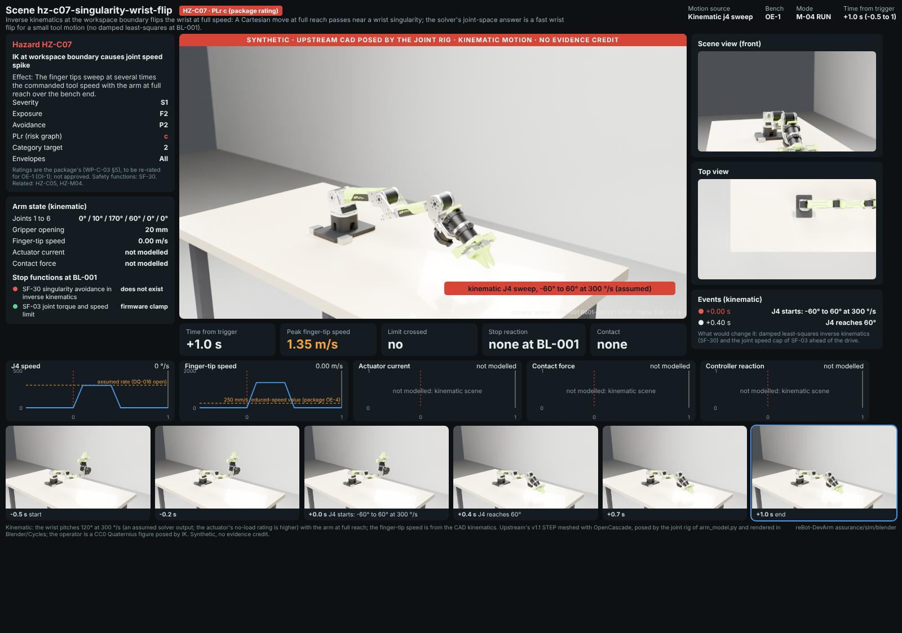

*Kinematic: the wrist pitches 120° at 300 °/s (an assumed solver output; the actuator's no-load rating is higher) with the arm at full reach; the finger-tip speed is from the CAD kinematics.*

## hz-m08-cable-trip-at-base

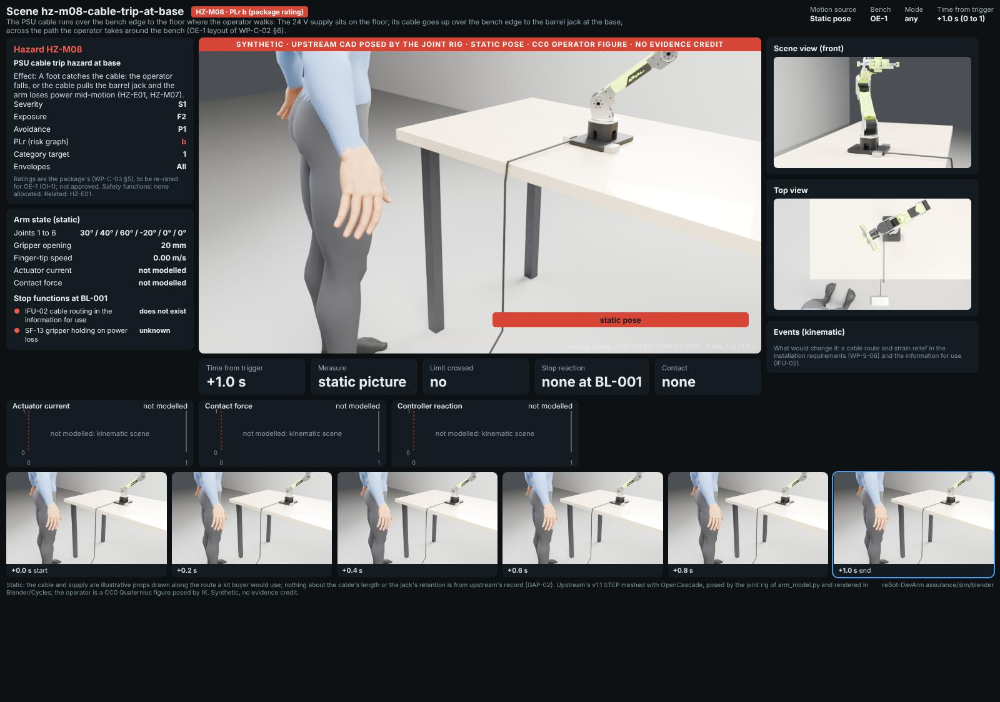

*Static: the cable and supply are illustrative props drawn along the route a kit buyer would use; nothing about the cable's length or the jack's retention is from upstream's record (GAP-02).*
