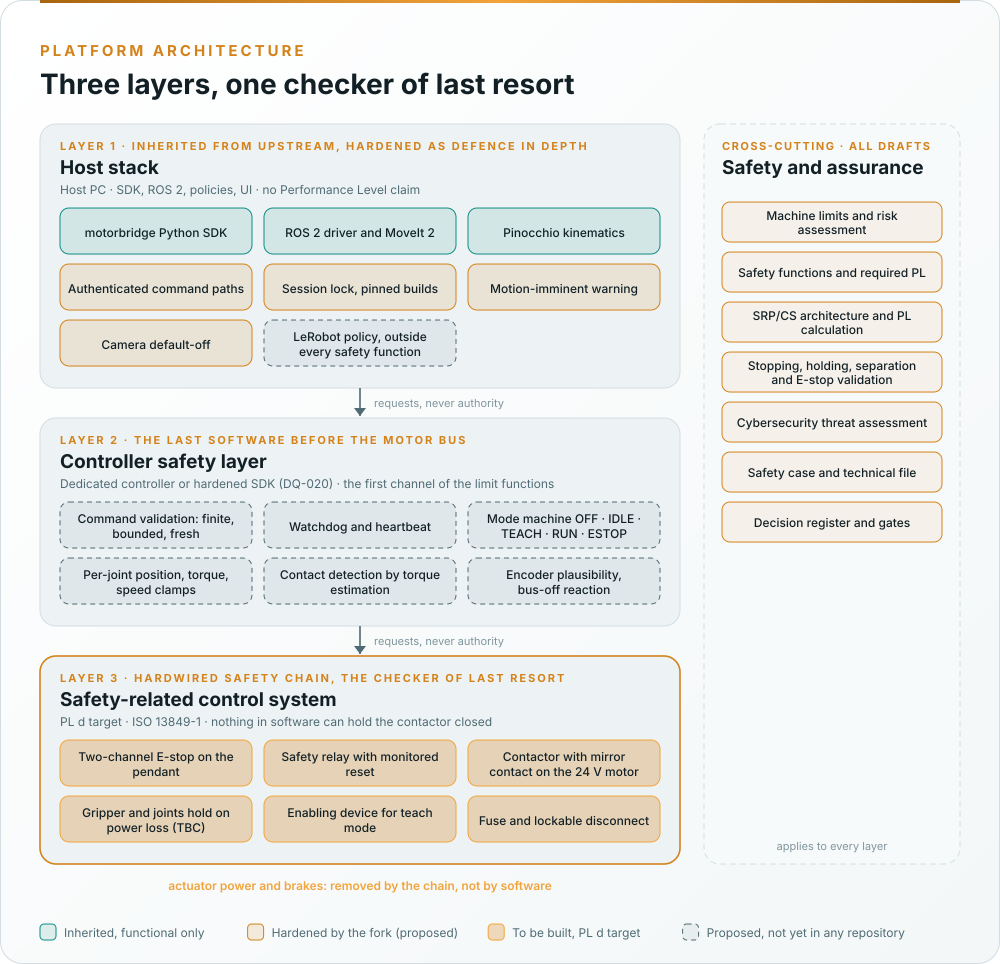

# Architecture

  

reBot-DevArm as inherited has one layer: a host PC runs the Python SDK, the ROS 2 driver, the kinematics and the
learned policies, and sends torque, velocity or position commands straight down a CAN bus to seven actuators whose
closed firmware is the last software before the motors. Nothing sits between a command source and a joint, and
nothing removes motor power without software. The fork keeps upstream's hardware and adds two layers below the
host: a controller safety layer that checks every command, and a hardwired safety chain that removes motor power
without any software in the loop.

| Layer | Role | Standard | Claim |
|---|---|---|---|
| Host stack (the SDK, ROS 2 and MoveIt 2, Pinocchio, the LeRobot policies, the web UI, the leader arm) | Decides where the arm goes and how fast; publishes requests | Hardened as defence in depth; cybersecurity under IEC 62443; learned components under ISO/IEC TR 5469 | No Performance Level. Outside every safety function |
| Controller safety layer (where it runs is decision DQ-020) | The checker between every command source and the bus: the watchdog and heartbeat, the mode state machine (OFF, IDLE, TEACH, RUN, ESTOP), per-joint position, torque and speed clamps, encoder plausibility, a clamp on every learned output | ISO 13849-1 §7 practices, as "could be claimed later" | No Performance Level in the first safety case ([WP-M-01](../assurance/01-management/WP-M-01-assurance-strategy.md) §5) |
| Hardwired safety chain | Two-channel E-stop and enabling inputs into a safety relay that drops a contactor with mirror contact on the 24 V motor supply; a lockable disconnect and a fuse | ISO 13849-1 categories, MTTFD, DCavg, CCF; EN 60204-1; ISO 13850 | **PL d target** for the emergency stop, the safe stop and the manual reset (decision DQ-004) |

The argument is a doer-and-checker argument with one more step: the host stack proposes, the safety layer
checks, and the chain is the checker of last resort that nothing in software can override. The full strategy is
[WP-M-01 §6](../assurance/01-management/WP-M-01-assurance-strategy.md#6-safety-architecture-argument-the-central-strategy);
the architecture work products are [WP-S-03](../assurance/03-system/WP-S-03-technical-safety-concept.md) (the chain
and the allocation), [WP-W-03](../assurance/05-software/WP-W-03-software-architecture.md) (the safety layer and the
host software) and [WP-A-05](../assurance/08-analyses/WP-A-05-independence-of-the-safety-chain.md) (why the chain is
independent of the stack).

**Today neither added layer exists.** The B601-DM as inherited has no E-stop, no fuse, no disconnect, no watchdog
and no declared joint limits; a lost connection leaves each joint under its last command. The first engineering
act of the fork is the bench safety hardware of [WP-V-07](../assurance/06-validation/WP-V-07-test-operations.md),
and the software that would carry the safety layer is upstream's until it is forked (DQ-007).
