# Automotive SPICE: process capability

[Standards tour](Standards-tour.md) · stop 18 of 20 · ← [UL 4600](UL-4600-safety-case.md) · [Machinery Regulation](Machinery-Regulation.md) →

*Six capability levels as a staircase, each built on the one below; each level adds process attributes, rated not, partly, largely or fully achieved. Generated by [`tour_figures.py`](../tools/wiki/tour_figures.py); it explains the standard's idea and claims nothing about the arm.*

> **In one sentence.** Automotive SPICE is a model for rating how capable a project's processes are, from performed to innovating; the record uses it to rate its own processes because machinery has no such model.

## What it is

Automotive SPICE, version 4.0, a process assessment model from the automotive industry. It defines processes
(management, system, software, hardware, machine learning, support and others) and rates each on six
**capability levels**.

## The idea in the picture

- **CL0 Incomplete**: the process does not achieve its purpose.
- **CL1 Performed**: its outcomes are achieved.
- **CL2 Managed**: it is planned and monitored, and its work products are controlled.
- **CL3 Established**: a defined standard process is used.
- **CL4 Predictable**: it is measured and controlled in numbers.
- **CL5 Innovating**: it is improved continuously.

Each level adds **process attributes**, each rated N, P, L or F: not, partly, largely or fully achieved.

## Why it matters for a desktop arm

The concept-phase package found the basic quality records missing: design reviews, nonconformance, corrective action
(GAP-32). A capability model makes the gap measurable and gives each process a target.

## How this project uses it

| What the record takes | Where |
|---|---|
| A self-assessment baseline per process, with a target per gate: CL2 for management, support, system and software, CL1 for hardware and machine learning | [Process capability baseline, WP-M-12](../assurance/01-management/WP-M-12-process-capability-baseline.md) |
| The ASPICE column of the work product register | [WP-M-00](../assurance/01-management/WP-M-00-work-product-register.md) |

## What the project does not claim

An assessment: the baseline is a self-assessment, not one by a qualified assessor.

## Words you will meet

- **Capability level (CL)**: 0 to 5.
- **Process attribute (PA)**: a measurable property of a process at a given level.
- **N, P, L, F**: not, partly, largely, fully achieved.

## Clauses to know

No standard is held by the project, so every clause number on this page is **to be checked** against a licensed copy. Whether to buy the standards is a queued question for the lead (DQ-011). The record uses the model's process and capability definitions as a whole.

---

[Standards tour](Standards-tour.md) · stop 18 of 20 · ← [UL 4600](UL-4600-safety-case.md) · [Machinery Regulation](Machinery-Regulation.md) →
