# EN 60204-1: electrical equipment of machines

[Standards tour](Standards-tour.md) · stop 6 of 20 · ← [IEC 61508](IEC-61508-functional-safety.md) · [ISO 13850](ISO-13850-emergency-stop.md) →

*The three stop categories of EN 60204-1 against one stop demand: category 0 removes power at once, category 1 stops under control then removes power, category 2 stops under control and keeps power. Beside them, the other topics of the standard. Generated by [`tour_figures.py`](../tools/wiki/tour_figures.py); it explains the standard's idea and claims nothing about the arm.*

> **In one sentence.** EN 60204-1 is how a machine's electrics are made safe: a way to isolate it, protection against shock and overcurrent, sound control circuits, and three defined ways to stop.

## What it is

EN 60204-1:2018, *Safety of machinery: electrical equipment of machines, Part 1: general requirements*, the European
adoption of IEC 60204-1. A type-B standard for everything electrical on a machine, from the supply terminals to the
control circuits and the final tests.

## The idea in the picture

Every stop function belongs to one of three **stop categories**:

- **Category 0**: power to the drives is removed at once; the machine coasts to a stop, uncontrolled.
- **Category 1**: a controlled stop with power available to the drives, then power removed once it has stopped.
- **Category 2**: a controlled stop with power left available, standstill held and monitored.

An emergency stop must be category 0 or 1 ([ISO 13850](ISO-13850-emergency-stop.md)). The rest of the standard covers
the supply disconnecting device, protection against electric shock, overcurrent protection, protective bonding,
control circuits and functions, operator controls, and the verification tests of the finished machine.

## Why it matters for a desktop arm

Upstream's design takes a 24 V supply straight into a daisy chain of seven actuators: no lockable disconnect (GAP-09),
no fuse per branch (GAP-10), an open-frame mains supply with exposed terminals (GAP-11), and no emergency stop
(GAP-08). The first engineering act of the fork is to fix exactly these on the test bench.

## How this project uses it

| What the record takes | Where |
|---|---|
| The electrical safety design: disconnect, fusing, shock protection, bonding, the 24 V bus as SELV | [Electrical safety, WP-H-05](../assurance/04-hardware/WP-H-05-electrical-safety.md) |
| The safety chain's wiring and stop category | [Chain design, WP-H-02](../assurance/04-hardware/WP-H-02-electrical-and-safety-chain-design.md) |
| The verification of the chain and the emergency stop | [WP-V-04](../assurance/06-validation/WP-V-04-emergency-stop-and-safety-chain-validation.md) |
| The supply disconnecting device | The disconnect question (DQ-018, queued) |
| The emergency-stop hardware on the bench before any powered test | The bench stop question (DQ-006, open) |

## What the project does not claim

That any arm is wired to the standard today. The bench chain is a planned engineering act behind a hold point
([WP-V-07](../assurance/06-validation/WP-V-07-test-operations.md)).

## Words you will meet

- **Stop category 0, 1, 2**: the three ways to stop, by when power is removed.
- **Supply disconnecting device**: the switch that isolates the machine from its supply, lockable for maintenance.
- **SELV, PELV**: safety and protective extra-low voltage; circuits at a voltage low enough, and separated well
  enough, that touching them is not a shock hazard.
- **Protective bonding**: connecting exposed conductive parts so a fault cannot leave them live.

## Clauses to know

No standard is held by the project, so every clause number on this page is **to be checked** against a licensed copy. Whether to buy the standards is a queued question for the lead (DQ-011).

| Clause | What it covers |
|---|---|
| §5 | Incoming supply terminations and the supply disconnecting device |
| §6 | Protection against electric shock |
| §7 | Protection of equipment, including overcurrent protection |
| §8 | Equipotential bonding |
| §9 | Control circuits and control functions; the stop categories (§9.2.2) |
| §10 | Operator interface and control devices, including emergency stop devices |
| §18 | Verification |

---

[Standards tour](Standards-tour.md) · stop 6 of 20 · ← [IEC 61508](IEC-61508-functional-safety.md) · [ISO 13850](ISO-13850-emergency-stop.md) →
