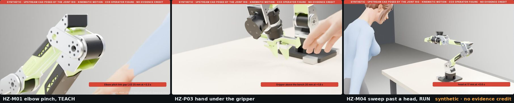

# Hazard scenes

The risk assessment rates 34 hazards of a desktop arm that nobody in the project has yet seen move under the fork's
rules. Fifteen of them are drawn: upstream's v1.1 CAD, posed by a joint rig at the moment the hazard occurs, a person
where the interaction analysis puts them, and the numbers the geometry gives beside the package's rating and the stop
functions that do or do not exist at the baseline.

**They are pictures, not evidence.** Every render carries a red band reading *synthetic, no evidence credit*. No scene
is referenced from a claim in the safety case. Every rate and limit is an assumption named on the picture, because
upstream declares no joint limits or speeds and the speed caps per mode are an open decision.

## Where to look

| If you want to | Read |
|---|---|
| See all fifteen dashboards with their outcomes | [the gallery](../assurance/sim/blender/dashboards/README.md) |
| Understand what a dashboard shows and does not show | [WP-P-12 §4](../assurance/sim/README.md#4-what-the-pictures-are-and-are-not) |
| Know how the joint rig was built from the CAD | [WP-P-12 §3](../assurance/sim/README.md#3-the-joint-rig) |
| Add a scene or re-render one | [the pipeline page](../assurance/sim/blender/README.md) and [`scenes.yaml`](../assurance/sim/blender/scenes.yaml) |
| See the hazards the scenes picture | [the risk assessment](../assurance/02-concept/WP-C-03-risk-assessment.md) |

## How to read one

Hazard card and arm state on the left; the large view with the red band, the outcome tiles and a callout in the
middle; the scene and top views and the event list on the right; a row of plots (the gap or distance against the
ISO 13854 limits, the joint speed against the assumed rate, the finger-tip speed, and "not modelled" where a current
or a force would be); a film strip of the key frames; a footer that says what the picture is and is not. The layout
is LionDriver's scene dashboard, so a reviewer of both projects reads them the same way.

## What the first fifteen show

- The elbow and wrist covers as modelled close through the ISO 13854 finger gap long before the modelled end-stop,
  so a joint-gap design measure is not optional.
- A person at the near bench edge is inside the gripper's sweep at every pose that reaches that side, so the marked
  area has to be on the far side of the bench or the base turned.
- Every outcome turns on the assumed TEACH and RUN rates, which is the open speed-cap decision.
