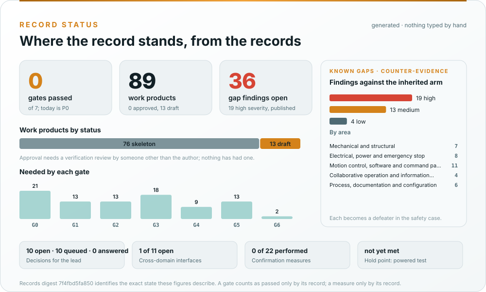

# reBot-DevArm assurance, explained

[reBot-DevArm](https://github.com/Seeed-Projects/reBot-DevArm) is an open desktop robot arm by Seeed Studio: six
Damiao actuators and a gripper on one CAN bus, sheet-metal and printed links, a 24 V bench supply, and a software
ecosystem (a Python SDK, a ROS 2 driver, LeRobot policies, Pinocchio kinematics) that lives in upstream
repositories. This fork keeps upstream's hardware record and adds what a machine needs before it may work with a
person in reach, and what upstream does not have: a risk assessment, safety functions with a required Performance
Level, a hardwired emergency-stop chain, a supply that can be switched off, a controller safety layer between
every command source and the motors, a cybersecurity case, and a safety case that publishes its own
counter-evidence. The standards are the machinery set for an industrial robot: ISO 12100, ISO 10218-1/-2,
ISO/TS 15066, ISO 13849-1, EN 60204-1, IEC 62443, ISO/IEC TR 5469 and the Machinery Regulation.

This wiki is the orientation layer. It explains how the project is organised, how the work flows through its
phases and gates, which standard shapes which part of the record, and where to look. It never states a safety
claim: those live in the [assurance record](../assurance/README.md), where they are reviewed.

> [!IMPORTANT]
> **reBot-DevArm is research and education hardware and this record is a draft prepared for engineering review.**
> Nothing has passed verification review, confirmation review or a functional safety assessment. The arm is not
> CE-marked, no safety function reaches any Performance Level today, there is no emergency stop in the documented
> design, and no configuration is approved for operation with anyone inside its 650 mm reach.

## The project in one picture

*One repository holds upstream's hardware record, the fork's concept-phase package and the assurance record;
every figure, map and page is generated from the record and checked by CI. Generated by
[`make_assets.py`](../docs/assets/rebot/make_assets.py).
[How the repository is organized](How-the-repository-is-organized.md) walks through it folder by folder.*

## How the work flows: one lifecycle, seven gates

*Every discipline works inside the same phase and decides at the same gate; there is no separate cybersecurity or
machine-learning lifecycle. Drawn from the process model by
[`process_figures.py`](../assurance/process/tools/process_figures.py). [Processes](Processes.md) explains the
phases, hold points and review levels; [Process maps](Process-maps.md) shows the swimlane of every phase.*

## Which standard shapes which phase

*Counted from the clause columns of the [work product register](../assurance/01-management/WP-M-00-work-product-register.md),
so it changes whenever the register does. [Standards at a glance](Standards-at-a-glance.md) gives the question each
standard answers; [How we use each standard](How-we-use-each-standard.md) says what is taken from each and what
is not claimed.*

## The safety argument in one picture

*The host stack proposes, the controller safety layer checks, and a hardwired chain that nothing in software can
override is the checker of last resort. Only the chain carries a PL target. The argument is
[WP-M-01 §6](../assurance/01-management/WP-M-01-assurance-strategy.md#6-safety-architecture-argument-the-central-strategy);
[Reading the safety case](Reading-the-safety-case.md) explains how the claims, evidence and defeaters are recorded.*

## Where the record stands today

*Generated from the records on every pull request; no number on it is typed by hand. The
[Living Safety Case dashboard](../assurance/case/README.md) shows the claims, evidence and defeaters the same way,
and [Roadmap and status](Roadmap-and-status.md) lists what is drafted, skeleton and planned.*

> Assurance status represents recorded engineering evidence and review state. It does not constitute
> certification or approval for operation with a person in reach.

## Find your way

| If you want to | Read |
|---|---|
| See how the work is organised into phases, gates and activities | [Processes](Processes.md), then the swimlanes on [Process maps](Process-maps.md) |
| See which standards apply and what each one is used for | [Standards at a glance](Standards-at-a-glance.md) and [How we use each standard](How-we-use-each-standard.md) |
| Understand how upstream's record, the package and the assurance record fit together | [How the repository is organized](How-the-repository-is-organized.md) |
| See what is done, active and planned | [Roadmap and status](Roadmap-and-status.md) |
| Know which arm the analysis is about | [Reference arm](Reference-robot.md) |
| Review the safety argument | [Reading the safety case](Reading-the-safety-case.md) |
| See the hazards drawn on the real CAD, with a person in reach | [Hazard scenes](Hazard-scenes.md) |
| Review, audit or assess it independently | [For the assessor](For-the-assessor.md) |
| Follow or take part in the decisions | [How decisions are made](How-decisions-are-made.md) |
| Decode `WP-C-04`, `HZ-M01`, `SF-32`, `PLr d`, `DQ-006`, `OE-1` | [Glossary](Glossary.md) |
| Set up, branch, and open a pull request | [Contributor guide](Contributor-guide.md) |
| Report a vulnerability, an incident or a hazard | [Reporting a safety concern](Reporting-a-safety-concern.md) |
| See what was merged, session by session | [Session log](Session-log.md) |
| Get a short answer | [FAQ](FAQ.md) |

## What this wiki is not

- **Not a work product.** Nothing here carries a document-control header or counts as evidence.
- **Not the place for hazard, requirement or safety-function text.** Each page links to the record that owns it.
- **Not illustrated by hand.** Every image is a figure generated from the repository's records, or rendered from
  them at sync time.
- **Not edited in place.** Pages are kept in the repository under [`wiki/`](../wiki/README.md), reviewed by pull
  request, and mirrored here on merge. An edit made on the wiki itself is overwritten by the next sync.
