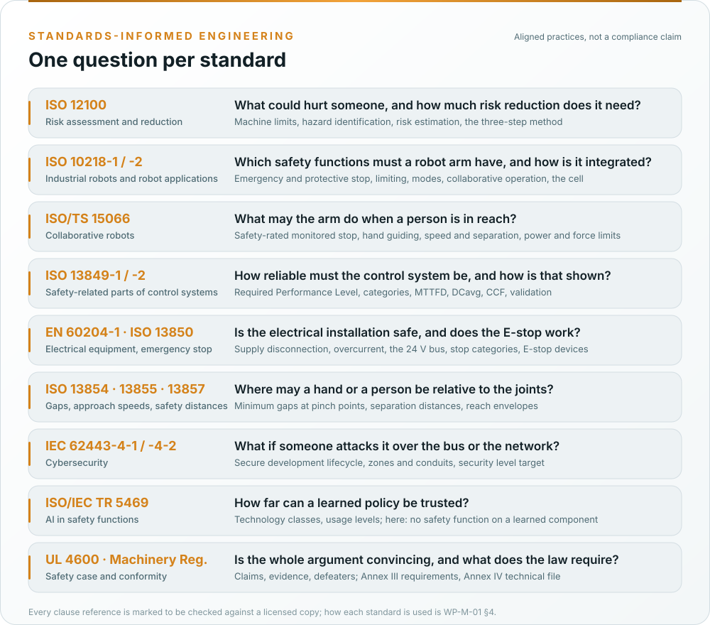

# How we use each standard

reBot-DevArm is a machine, an industrial robot in the sense of ISO 10218, not a road vehicle and not a driverless
truck. The standards are the machinery set, applied with one method: one hazard log, one requirements database,
generated figures, a safety case with its defeaters published. This page says, for each standard, what the fork
takes from it, what it does not claim, and where it lands in the record. The authoritative version is
[WP-M-01 §4 and §5](../assurance/01-management/WP-M-01-assurance-strategy.md#4-the-standards-and-how-each-one-is-used).
**No compliance is claimed** with any of them, because no assessment has been performed and the drafting
environment has no licensed copy; every clause reference is marked to be checked.

*Which gate needs the work products that cite each standard is the [standards map](Standards-at-a-glance.md#where-each-standard-lands-in-the-lifecycle).*

## ISO 12100:2010, risk assessment and risk reduction

- **What we take:** the whole method. Machine limits (use, space, time), hazard identification per life phase,
  risk estimation and evaluation, then the three-step method in order: inherently safe design, safeguarding and
  complementary protective measures, information for use. The documentation of §7 becomes the heart of the
  technical file.
- **How:** [WP-C-01](../assurance/02-concept/WP-C-01-item-definition.md) defines the arm and its
  limits, [WP-C-03](../assurance/02-concept/WP-C-03-risk-assessment.md) is the one hazard log of the project (the
  package's 33 hazards, HZ-M01 to HZ-D01, re-rated per operating envelope), and
  [WP-C-05](../assurance/02-concept/WP-C-05-risk-reduction-concept.md) allocates every row to the three steps, which
  the package left undone for 18 of them (GAP-27).
- **Position taken:** a limitation that is only documented is not a control for a hazard that can injure; the gap
  assessment's worst findings (no emergency stop, a lost connection that holds the last torque command) are closed
  by design or safeguarding, not by a warning.

## ISO 10218-1:2025 and ISO 10218-2:2025, industrial robots and robot applications

- **What we take:** Part 1 for the arm: the safety functions a robot must provide (emergency stop, protective
  stop, safely limited speed and the axis, torque and space limits, enabling control in manual mode, prevention
  of unexpected start-up, the operational modes), the performance requirement on its safety-related control
  (PL d, category 3, as the default to be checked), and the 2025 editions' collaborative-operation text. Part 2 for
  what the application around the arm must provide: the workspace, the safeguarding, the integrator's duties.
- **How:** [WP-C-04](../assurance/02-concept/WP-C-04-safety-functions-and-plr.md) specifies SF-32 emergency stop,
  SF-08 safe stop on watchdog, SF-24 manual reset, SF-03 joint torque and speed limiting, SF-29 joint limits and the
  rest with their required PL; [WP-C-02](../assurance/02-concept/WP-C-02-operating-environment-and-tasks.md) defines
  the operating envelopes; [WP-S-06](../assurance/03-system/WP-S-06-requirements-installation-operation.md) carries
  the Part 2 duties of whoever installs the arm; the validation work products test the functions.
- **Position taken:** ISO 10218-1 expects PL d for the stop functions. That is the planning assumption
  (decision DQ-004) and it drives the chain hardware the fork must add. The 2011 editions and ISO/TS 15066 are what
  the package cited; the 2025 text is the target and is marked to be checked (DQ-011).

## ISO/TS 15066:2016, collaborative robots

- **What we take:** the four collaborative modes (safety-rated monitored stop, hand guiding, speed and separation
  monitoring, power and force limiting), the body-region force and pressure thresholds of Annex A, and the
  measurement method that turns them into joint torque and speed caps.
- **How:** [WP-C-06](../assurance/02-concept/WP-C-06-human-robot-interaction-and-misuse.md) analyses every scene in
  which a person is in reach; [WP-V-03](../assurance/06-validation/WP-V-03-collaborative-operation-validation.md)
  validates whatever claim is made.
- **Position taken:** the first safety case makes no power-and-force-limiting claim (DQ-005, recommended): the arm
  has no joint torque sensors, no force measurement exists (GAP-28), and the recommended envelope (OE-1) keeps
  everyone but the operator out of reach. Contact detection by torque estimation (SF-02, SF-04) is defence in
  depth, bounded by what the estimator can sense ([WP-C-10](../assurance/02-concept/WP-C-10-functional-insufficiency-analysis.md)).

## ISO 13849-1:2023 and ISO 13849-2:2012, safety-related parts of control systems

- **What we take:** the Performance Level as the measure of a safety function, the risk graph for the required PL,
  the designated architectures (categories B to 4), MTTFD, DCavg and CCF, the software requirements of §7, the
  verification of §8, validation with the fault lists of 13849-2, and the documentation and information-for-use
  requirements.
- **How:** [WP-S-02](../assurance/03-system/WP-S-02-safety-requirements.md) (SRS),
  [WP-S-03](../assurance/03-system/WP-S-03-technical-safety-concept.md) (architecture and categories),
  [WP-H-04](../assurance/04-hardware/WP-H-04-reliability-data-and-pl-calculation.md) (the PL calculation, with a
  SISTEMA project as the record), [WP-H-07](../assurance/04-hardware/WP-H-07-safety-component-qualification.md)
  (certified and well-tried components), [WP-V-01](../assurance/06-validation/WP-V-01-safety-validation.md) and
  [WP-V-05](../assurance/06-validation/WP-V-05-fault-injection.md) (validation and fault lists).
- **Position taken:** the stop functions are allocated to a **hardwired safety chain** (two-channel E-stop and
  enabling inputs, a safety relay, a contactor with mirror contact on the 24 V motor supply). The controller safety
  layer and the host stack are functional layers that are hardened but carry no PL claim in the first safety
  case. That keeps the PL d argument inside components with certificates and known reliability data, which the
  actuators do not have (GAP-14).

## IEC 62061:2021 and IEC 61508:2010, where ISO 13849 runs out

- **What we take:** management of functional safety (61508-1 §6), the functional safety assessment and its
  independence (61508-1 §8), software requirements beyond §7 of 13849-1 (61508-3) if the controller safety layer
  is ever promoted into the chain, and the tool classification T1 to T3.
- **How:** [WP-M-02](../assurance/01-management/WP-M-02-safety-plan.md), [WP-M-06](../assurance/01-management/WP-M-06-confirmation-measures-plan.md),
  [WP-P-07](../assurance/07-supporting/WP-P-07-tool-classification-qualification.md), the software work products.
- **Position taken:** no SIL claim is made. The target measure is the Performance Level; IEC 61508 supplies the
  management and assessment structure the machinery standards leave thin.

## EN 60204-1:2018 and ISO 13850:2015, electrical equipment and the emergency stop

- **What we take:** the supply disconnecting device, overcurrent protection, protection against electric shock,
  protective bonding, control circuits and stop categories 0 and 1, the verification tests of §18; the emergency
  stop function and its devices.
- **How:** [WP-H-05](../assurance/04-hardware/WP-H-05-electrical-safety.md),
  [WP-H-02](../assurance/04-hardware/WP-H-02-electrical-and-safety-chain-design.md),
  [WP-V-04](../assurance/06-validation/WP-V-04-emergency-stop-and-safety-chain-validation.md).
- **Position taken:** the first engineering act of the fork is a lockable disconnect, a fuse and a dual-channel
  E-stop through a safety relay and contactor on any arm it tests with, as bench equipment before it is a product
  design ([WP-V-07](../assurance/06-validation/WP-V-07-test-operations.md), decision DQ-006). The open-frame mains
  supply in upstream's BOM gets an enclosure (GAP-11, DQ-018).

## ISO 13854:2019, ISO 13857:2019 and ISO 13855:2024, gaps, safety distances and safeguard positioning

- **What we take:** the minimum gaps that avoid crushing a finger or a hand at a joint; the reach distances that
  keep a person out of a hazard zone; the approach-speed formula that turns a measured stopping time into a
  separation distance.
- **How:** [WP-H-08](../assurance/04-hardware/WP-H-08-mechanical-analysis.md) measures every joint gap and end-stop,
  [WP-S-04](../assurance/03-system/WP-S-04-response-time-and-stopping-budget.md) owns the budget,
  [WP-V-02](../assurance/06-validation/WP-V-02-stopping-performance-and-holding-tests.md) measures the stopping
  performance, [WP-V-03](../assurance/06-validation/WP-V-03-collaborative-operation-validation.md) validates the
  separation.
- **Position taken:** no joint gap has been measured (GAP-01) and no separation plan exists (GAP-06); until they
  do, nobody is inside the reach envelope while the arm can move.

## IEC 62443-4-1:2018 and IEC 62443-4-2:2019, cybersecurity

- **What we take:** the secure product development lifecycle practices (management, requirements, design,
  implementation, verification, defect management, update management, guidelines) and the component requirements
  with a security level target, plus the zone and conduit model of 62443-3-2/-3-3.
- **How:** [WP-M-08](../assurance/01-management/WP-M-08-cybersecurity-plan.md), the threat and risk assessment
  [WP-C-07](../assurance/02-concept/WP-C-07-cybersecurity-threat-and-risk-assessment.md), the requirements and
  security level target [WP-C-08](../assurance/02-concept/WP-C-08-cybersecurity-requirements-and-sl-target.md), the
  architecture [WP-S-07](../assurance/03-system/WP-S-07-cybersecurity-architecture.md), implementation and
  penetration testing, the cybersecurity case [WP-K-03](../assurance/10-safety-case/WP-K-03-cybersecurity-case.md).
- **Position taken:** threats that can cause a hazard are rated against the hazard list; the safety chain is a zone
  with no conduit from the host network, so no attack on the software can hold the contactor closed. Today any
  process with the CAN-USB adapter open can command every joint (GAP-22) and tele-operation is unauthenticated
  (GAP-23); the security level target is a decision for the lead (DQ-013).

## ISO/IEC TR 5469:2024 and the AI Act, machine learning in safety functions

- **What we take:** the classification of learned components by technology class and usage level, and the
  properties that would have to be shown if one ever implemented a safety function.
- **How:** [WP-M-09](../assurance/01-management/WP-M-09-ml-safety-plan.md),
  [WP-C-09](../assurance/02-concept/WP-C-09-ml-component-definition-and-safety-requirements.md),
  [WP-W-10](../assurance/05-software/WP-W-10-ml-engineering.md),
  [WP-K-07](../assurance/10-safety-case/WP-K-07-ai-act-conformity-record.md).
- **Position taken:** no safety function is allocated to a learned component; every LeRobot policy output passes
  the same clamp as any other command (DQ-008, recommended). That keeps the fork out of the Machinery Regulation's
  Annex I Part A (mandatory third-party assessment for self-evolving safety behaviour) and out of the AI Act's
  high-risk obligations; the threshold is monitored.

## ISO 21448 (SOTIF), as a method only

- **What we take:** the vocabulary and method for hazards that happen without any fault: functional
  insufficiencies, triggering conditions, known and unknown scenarios. No machinery standard covers what a
  current-based torque estimator cannot sense or what a policy does on a scene outside its training set.
- **How:** [WP-C-10](../assurance/02-concept/WP-C-10-functional-insufficiency-analysis.md) and
  [WP-V-08](../assurance/06-validation/WP-V-08-unknown-scenarios-and-field-trials.md); every limit is closed by a
  safety function, an operating-envelope limit, or stays as an open defeater.
- **Position taken:** cited as informative. No SOTIF conformance is claimed or meaningful for a machine.

## UL 4600, the safety case

- **What we take:** the structure: claims, arguments, evidence with review state, defeaters published rather than
  hidden, assumptions stated, feedback from the field.
- **How:** [WP-K-01](../assurance/10-safety-case/WP-K-01-safety-case.md) and the machine-readable records,
  validator and dashboard in [`case/`](../assurance/case/README.md). GAP-01…GAP-36 are the first defeaters, all
  open.
- **Position taken:** no UL 4600 conformance claim; guidance only.

## Regulation (EU) 2023/1230, the Machinery Regulation, and Regulation (EU) 2024/1689, the AI Act

- **What we take:** the essential health and safety requirements (Annex III), the technical documentation
  (Annex IV), the conformity assessment procedures (Art. 25 and the modules), the manufacturer's obligations
  (Art. 10), the declaration of conformity (Annex V); and the AI Act's threshold for a high-risk AI system.
- **How:** [WP-M-13](../assurance/01-management/WP-M-13-regulatory-conformity-strategy.md) is the strategy,
  [WP-K-02](../assurance/10-safety-case/WP-K-02-technical-documentation-index.md) maps the register onto Annex IV,
  [WP-K-06](../assurance/10-safety-case/WP-K-06-release-record.md) holds the unsigned declaration draft.
- **Position taken:** the EU frame is recommended (DQ-002) with internal control (Module A) as the planned route
  (DQ-012); the US frame (ANSI/A3 R15.06) would be a cross-reference, not a second file. The fork places nothing
  on the market, and upstream's CC BY-NC-SA licence forbids commercial use, so the obligations are planned for, not
  incurred (GAP-35).

## Automotive SPICE, process capability

- **What we take:** the process reference model for a self-assessment of process capability, because no
  machinery-specific process model exists and the package already found the ISO 9001 subset (design review,
  nonconformance, corrective action) missing.
- **How:** [WP-M-12](../assurance/01-management/WP-M-12-process-capability-baseline.md), and the ASPICE column of the
  register.
- **Position taken:** a self-assessment, not an assessment; target CL2 for management, support, system and
  software processes, CL1 for hardware and ML.
