# IEC 60812: failure modes and effects analysis

[Standards tour](Standards-tour.md) · stop 12 of 20 · ← [ISO/TS 15066](ISO-TS-15066-collaborative-robots.md) · [IEC 61025](IEC-61025-fault-tree-analysis.md) →

*One row of an FMEA worksheet built step by step, as an illustration of the method: function, failure mode, effect and severity, cause and occurrence, the current control and detection, then the priority and the action. Generated by [`tour_figures.py`](../tools/wiki/tour_figures.py); it explains the standard's idea and claims nothing about the arm.*

> **In one sentence.** IEC 60812 is the method for asking, part by part and function by function, how each can fail, what follows, what causes it and what would catch it, then rating and acting on the worst.

## What it is

IEC 60812:2018, *Failure modes and effects analysis (FMEA and FMECA)*. A method standard, used across industries.
The 2018 edition allows the priority to be set by a risk priority number or by another scheme; the concept-phase
package's DFMEA used the action priority of the AIAG-VDA handbook.

## The idea in the picture

For every function: how can it fail (the **failure mode**), what happens then (the **effect**, rated for
**severity**), why would it fail (the **cause**, rated for **occurrence**), and what would catch it before harm
(the **current controls**, rated for **detection**). The ratings set the priority, an action follows, and the row
is rated again. The worksheet is the analysis.

## Why it matters for a desktop arm

A welded contactor, a loosened fastener, a stalled actuator, a dropped CAN frame: each is a failure mode whose
effect may be a hazard in the risk assessment. The failure modes of the safety chain also feed its PL calculation,
through the diagnostic coverage and the common cause measures.

## How this project uses it

| What the record takes | Where |
|---|---|
| The system FMEA, seeded from the package's failure modes FM-01 to FM-27 | [WP-A-01](../assurance/08-analyses/WP-A-01-system-fmea.md) |
| The hardware failure analysis of the safety chain | [WP-H-03](../assurance/04-hardware/WP-H-03-hardware-failure-analysis.md) |

## What the project does not claim

That the package's DFMEA is complete or reviewed; it is an input. The example in the figure illustrates the method
and is not a row of the record.

## Words you will meet

- **Failure mode**: the way something fails. **Effect**: what that failure does. **Cause**: why it happens.
- **Severity, occurrence, detection (S, O, D)**: the three ratings of a row.
- **RPN**: risk priority number, S × O × D; **AP**: action priority, a table-based alternative.
- **FMECA**: an FMEA with a criticality analysis.

## Clauses to know

No standard is held by the project, so every clause number on this page is **to be checked** against a licensed copy. Whether to buy the standards is a queued question for the lead (DQ-011). The record cites the standard for the method as a whole rather than by clause.

---

[Standards tour](Standards-tour.md) · stop 12 of 20 · ← [ISO/TS 15066](ISO-TS-15066-collaborative-robots.md) · [IEC 61025](IEC-61025-fault-tree-analysis.md) →
