# IEC 61025: fault tree analysis

[Standards tour](Standards-tour.md) · stop 13 of 20 · ← [IEC 60812](IEC-60812-FMEA.md) · [ISO 21448](ISO-21448-performance-limits.md) →

*A fault tree for 'motor power stays on after an E-stop demand', as an illustration of the method: one failed channel does not cause it, both do, and a common cause skips the redundancy. The minimal cut sets list the smallest combinations. Generated by [`tour_figures.py`](../tools/wiki/tour_figures.py); it explains the standard's idea and claims nothing about the arm.*

> **In one sentence.** IEC 61025 is the method for working backwards from one unwanted event to every combination of failures that can cause it, through AND and OR gates.

## What it is

IEC 61025:2006, *Fault tree analysis (FTA)*. A method standard: the symbols, the steps, and the qualitative and
quantitative evaluation of a tree.

## The idea in the picture

Start from the **top event**, the outcome you must avoid. Ask what could cause it: if any one of several causes is
enough, join them with an **OR** gate; if all must happen together, with an **AND** gate. Go down until each branch
ends in a **basic event**, a failure you can put data on. The **minimal cut sets** are the smallest combinations of
basic events that cause the top event: a cut set of one is a single point of failure.

## Why it matters for a desktop arm

The record's argument for the stop functions is redundancy: two channels, two contactors in series. A fault tree shows
whether that holds: that no single failure defeats the stop, and where a common cause, one supply or one welded part,
could defeat both channels at once.

## How this project uses it

| What the record takes | Where |
|---|---|
| A fault tree per safety function | [Fault tree analysis, WP-A-02](../assurance/08-analyses/WP-A-02-fault-tree-analysis.md) |
| The common cause failure analysis | [WP-A-03](../assurance/08-analyses/WP-A-03-common-cause-failure-analysis.md) |
| Independence of the chain from the host stack | [WP-A-05](../assurance/08-analyses/WP-A-05-independence-of-the-safety-chain.md) |

## What the project does not claim

Any fault tree yet: the analyses are skeletons until the chain is designed. The tree in the figure illustrates the
method.

## Words you will meet

- **Top event**: the undesired outcome at the top of the tree.
- **Gate**: AND (all inputs needed) or OR (any input is enough).
- **Basic event**: a failure at the bottom of a branch, with its own probability.
- **Minimal cut set**: a smallest set of basic events that together cause the top event.
- **Common cause failure**: one event that causes several basic events at once.

## Clauses to know

No standard is held by the project, so every clause number on this page is **to be checked** against a licensed copy. Whether to buy the standards is a queued question for the lead (DQ-011). The record cites the standard for the method as a whole rather than by clause.

---

[Standards tour](Standards-tour.md) · stop 13 of 20 · ← [IEC 60812](IEC-60812-FMEA.md) · [ISO 21448](ISO-21448-performance-limits.md) →
