# IEC 61508: the functional safety umbrella

[Standards tour](Standards-tour.md) · stop 5 of 20 · ← [IEC 62061](IEC-62061-machinery-SIL.md) · [EN 60204-1](EN-60204-electrical-equipment.md) →

*The overall safety lifecycle of IEC 61508 as eight phases, with management of functional safety and verification running beside every phase and a functional safety assessment checking the key points. Generated by [`tour_figures.py`](../tools/wiki/tour_figures.py); it explains the standard's idea and claims nothing about the arm.*

> **In one sentence.** IEC 61508 is the parent of the functional safety standards: one lifecycle for electrical, electronic and programmable safety systems, managed, verified and independently assessed from concept to scrapping.

## What it is

IEC 61508:2010, *Functional safety of electrical/electronic/programmable electronic safety-related systems*, seven
parts. It is a basic safety publication: sector standards are written from it, IEC 62061 for machinery among them.
Part 1 holds the lifecycle, management and assessment; Part 2 the hardware; Part 3 the software; Part 4 the
definitions.

## The idea in the picture

Safety is built through a **lifecycle**: concept and scope, hazard and risk analysis, safety requirements and their
allocation to systems, realisation in hardware and software, installation and commissioning, validation, operation and
modification, decommissioning. Three things run beside every phase:

- **Management of functional safety**: who is responsible, competent and independent for what.
- **Verification**: each phase checks that its outputs meet its inputs.
- **Functional safety assessment**: an independent judgement that functional safety has been achieved; the more
  integrity the function needs, the more independent the assessor must be.

Integrity is rated as a **SIL**, 1 to 4. Software tools are classified **T1 to T3** by how far they can put an
error into the result, from a text editor (T1) to a compiler or code generator (T3).

## Why it matters for a desktop arm

The machinery standards say little about how the work is managed and assessed. IEC 61508 fills that gap, and it
would govern the software of the controller safety layer if that layer ever carried a safety function.

## How this project uses it

| What the record takes | Where |
|---|---|
| Management of functional safety: roles, competence, independence | [Safety plan, WP-M-02](../assurance/01-management/WP-M-02-safety-plan.md) |
| Confirmation measures and their independence | [Confirmation measures plan, WP-M-06](../assurance/01-management/WP-M-06-confirmation-measures-plan.md) |
| The functional safety assessment | [WP-K-04](../assurance/10-safety-case/WP-K-04-functional-safety-assessment.md); the question on engaging an independent assessor (DQ-009, open) |
| Software tool classification T1 to T3 | [WP-P-07](../assurance/07-supporting/WP-P-07-tool-classification-qualification.md) |

## What the project does not claim

Any SIL. IEC 61508 supplies the management and assessment structure; the measure of a safety function stays the PL.

## Words you will meet

- **E/E/PE**: electrical, electronic and programmable electronic.
- **Systematic capability**: how well a component's design process guards against systematic faults, on the SIL scale.
- **Functional safety assessment**: an investigation, by someone independent, of whether functional safety has been achieved.
- **T1, T2, T3**: software tool classes; a T3 tool can put an error into the executable code.

## Clauses to know

No standard is held by the project, so every clause number on this page is **to be checked** against a licensed copy. Whether to buy the standards is a queued question for the lead (DQ-011).

| Clause | What it covers |
|---|---|
| 61508-1 §6 | Management of functional safety |
| 61508-1 §7 | The overall safety lifecycle |
| 61508-1 §8 | Functional safety assessment |
| 61508-3 §7.4.4 | Requirements for support tools, including the classes T1 to T3 |
| 61508-4 | Definitions and abbreviations |

---

[Standards tour](Standards-tour.md) · stop 5 of 20 · ← [IEC 62061](IEC-62061-machinery-SIL.md) · [EN 60204-1](EN-60204-electrical-equipment.md) →
