# IEC 62061: functional safety of machinery control systems

[Standards tour](Standards-tour.md) · stop 4 of 20 · ← [ISO 13849-1 and -2](ISO-13849-control-system-reliability.md) · [IEC 61508](IEC-61508-functional-safety.md) →

*One logarithmic scale of the probability of a dangerous failure per hour, with ISO 13849-1's Performance Levels on the left and IEC 62061's Safety Integrity Levels on the right; PL d and SIL 2 share a band. Generated by [`tour_figures.py`](../tools/wiki/tour_figures.py); it explains the standard's idea and claims nothing about the arm.*

> **In one sentence.** IEC 62061 is the machinery route to safety integrity expressed in SIL rather than PL; it shares ISO 13849-1's scale of failure rates, so the two meet on the same numbers.

## What it is

IEC 62061:2021, *Safety of machinery: functional safety of safety-related control systems*. It is the machinery
sector's application of [IEC 61508](IEC-61508-functional-safety.md) and an alternative to ISO 13849-1 for designing a
safety function: it assigns the required integrity as a **SIL**, builds the function from subsystems, and
calculates the probability of a dangerous failure per hour.

## The idea in the picture

Both standards rate a safety function by the same quantity, PFHD, the average probability of a dangerous failure per
hour, and cut the scale into bands. ISO 13849-1 calls them PL a to e; IEC 62061 calls them SIL 1 to 3. PL b and c
fall in SIL 1, PL d in SIL 2, PL e in SIL 3, and PL a has no SIL. Machinery stops at SIL 3; IEC 61508 goes to SIL 4.

IEC 62061 also has its own way to assign the required SIL from the risk (severity, frequency and duration of
exposure, probability of the hazardous event, avoidance), the counterpart of ISO 13849-1's risk graph.

## Why it matters for a desktop arm

The record measures safety functions in PL, because the machinery standards for robots speak PL. IEC 62061 matters at
two edges: if the controller safety layer were ever promoted into the chain, its software would need the more
detailed treatment that the SIL route and IEC 61508 give; and an assessor may ask for a SIL view as a cross-check.

## How this project uses it

| What the record takes | Where |
|---|---|
| Management and the specification of safety functions, where ISO 13849 runs thin | [Safety plan, WP-M-02](../assurance/01-management/WP-M-02-safety-plan.md); [Software safety requirements, WP-W-02](../assurance/05-software/WP-W-02-software-safety-requirements.md) |
| The PL to SIL correspondence when an assessor asks | [Assurance strategy, WP-M-01 §4](../assurance/01-management/WP-M-01-assurance-strategy.md#4-the-standards-and-how-each-one-is-used) |

## What the project does not claim

Any SIL. The target measure is the Performance Level; the target for the stop functions is the open PL question
(DQ-004).

## Words you will meet

- **SIL**: safety integrity level, 1 to 3 for machinery.
- **SIL CL**: the SIL claim limit of a subsystem, the highest SIL it can be used in.
- **PFHD**: average probability of a dangerous failure per hour.
- **Subsystem**: a part of the safety function whose failure alone causes the function to fail.

## Clauses to know

No standard is held by the project, so every clause number on this page is **to be checked** against a licensed copy. Whether to buy the standards is a queued question for the lead (DQ-011).

| Clause | What it covers |
|---|---|
| §5 | Planning and management, as the record cites it |
| §6 | Specification of the safety functions, as the record cites it |
| Annex A | Assigning the required SIL from the risk |

---

[Standards tour](Standards-tour.md) · stop 4 of 20 · ← [ISO 13849-1 and -2](ISO-13849-control-system-reliability.md) · [IEC 61508](IEC-61508-functional-safety.md) →
