# IEC 62443: industrial cybersecurity

[Standards tour](Standards-tour.md) · stop 15 of 20 · ← [ISO 21448](ISO-21448-performance-limits.md) · [ISO/IEC TR 5469](ISO-IEC-TR-5469-AI-and-safety.md) →

*Four zones from the network to the safety chain. An attack is refused at an authenticated conduit; one that gets through to the motor bus still cannot reach the chain, which has no network path. Below, the eight practices of a secure development lifecycle. Generated by [`tour_figures.py`](../tools/wiki/tour_figures.py); it explains the standard's idea and claims nothing about the arm.*

> **In one sentence.** IEC 62443 is the series for securing industrial control systems: split the system into zones joined by controlled conduits, develop each product with a secure lifecycle, and give each component the security level its zone needs.

## What it is

A series of standards for industrial automation and control systems. The record uses three of them:

- **IEC 62443-4-1:2018**, the secure product development lifecycle, in eight practices: security management (SM),
  security requirements (SR), secure by design (SD), secure implementation (SI), verification and validation
  testing (SVV), management of security issues (DM), security update management (SUM) and security guidelines (SG).
- **IEC 62443-4-2:2019**, technical requirements for components, grouped under seven foundational requirements
  (identification and authentication, use control, system integrity, data confidentiality, restricted data flow,
  timely response to events, resource availability), each at a **security level** from SL 1 to SL 4.
- **IEC 62443-3-2**, risk assessment for system design, with the model of **zones** and **conduits**.

## The idea in the picture

Group the system into zones of equal trust and join them only through conduits that control what passes. A safety
function that must work under attack is placed in a zone no conduit reaches.

## Why it matters for a desktop arm

Today any program with the CAN-USB adapter open can command every joint (GAP-22), and tele-operation is
unauthenticated and unencrypted (GAP-23). An attack on the arm is a hazard, not only a data breach.

## How this project uses it

| What the record takes | Where |
|---|---|
| The cybersecurity plan | [WP-M-08](../assurance/01-management/WP-M-08-cybersecurity-plan.md) |
| The threat and risk assessment, with threats rated against the hazard list | [WP-C-07](../assurance/02-concept/WP-C-07-cybersecurity-threat-and-risk-assessment.md) |
| The requirements and the security level target | [WP-C-08](../assurance/02-concept/WP-C-08-cybersecurity-requirements-and-sl-target.md); the security level question (DQ-013, queued; recommended SL 2 for authentication, integrity and confidentiality, SL 1 for the rest) |
| The architecture: the safety chain as a zone with no conduit from any network | [WP-S-07](../assurance/03-system/WP-S-07-cybersecurity-architecture.md) |
| Implementation, testing, incident response and updates | [WP-W-11](../assurance/05-software/WP-W-11-cybersecurity-implementation-verification.md), [WP-V-06](../assurance/06-validation/WP-V-06-cybersecurity-validation.md), [WP-O-05](../assurance/09-production-operation/WP-O-05-cybersecurity-incident-response-updates.md) |
| The cybersecurity case and its assessment | [WP-K-03](../assurance/10-safety-case/WP-K-03-cybersecurity-case.md), [WP-K-05](../assurance/10-safety-case/WP-K-05-cybersecurity-assessment.md) |

## What the project does not claim

Any security level. The zones and conduits are the target architecture, not today's arm.

## Words you will meet

- **Zone**: a group of assets with the same security requirements.
- **Conduit**: a controlled communication path between zones.
- **Security level (SL)**: 1 to 4, from casual misuse to a sophisticated attacker with extended resources.
- **Foundational requirement (FR)**: one of the seven groups of security requirements.

## Clauses to know

No standard is held by the project, so every clause number on this page is **to be checked** against a licensed copy. Whether to buy the standards is a queued question for the lead (DQ-011).

| Part | What it covers |
|---|---|
| 62443-4-1 | The eight practices SM, SR, SD, SI, SVV, DM, SUM, SG |
| 62443-4-2 | Component requirements (CR) under FR 1 to FR 7, with security levels |
| 62443-3-2 | Zones, conduits and the security risk assessment for system design |

---

[Standards tour](Standards-tour.md) · stop 15 of 20 · ← [ISO 21448](ISO-21448-performance-limits.md) · [ISO/IEC TR 5469](ISO-IEC-TR-5469-AI-and-safety.md) →
