# ISO 10218-1 and -2: industrial robots and robot applications

[Standards tour](Standards-tour.md) · stop 2 of 20 · ← [ISO 12100](ISO-12100-risk-assessment.md) · [ISO 13849-1 and -2](ISO-13849-control-system-reliability.md) →

*Part 1 draws its boundary around the robot and lists what the robot must provide; Part 2 draws it around the whole application, bench, marked area and person included, and lists what whoever builds that application must do. Generated by [`tour_figures.py`](../tools/wiki/tour_figures.py); it explains the standard's idea and claims nothing about the arm.*

> **In one sentence.** ISO 10218 is the standard written for industrial robots: Part 1 says what the robot itself must provide, Part 2 what the application built around it must provide.

## What it is

ISO 10218-1:2025, *Robotics: safety requirements, Part 1: industrial robots*, and ISO 10218-2:2025, *Part 2:
industrial robot applications and robot cells*. The 2025 editions replace those of 2011 and bring collaborative
applications into the standard itself; the concept-phase package cited the 2011 editions with ISO/TS 15066. It is a
type-C standard, written for one kind of machine: where it says something specific, that governs over the general
type A and B standards for a robot built to it (to be checked).

The record treats the arm as an industrial robot in this sense: a reprogrammable manipulator that moves in three or
more axes ([WP-M-01 §4](../assurance/01-management/WP-M-01-assurance-strategy.md#4-the-standards-and-how-each-one-is-used)).

## The idea in the picture

- **Part 1, the robot.** The robot must provide an emergency stop and a protective stop, limits on speed, force,
  axes and space, an enabling device for manual mode, operating modes and a safe way to select them, safety-related
  control that reaches a required Performance Level, and the features a collaborative application needs.
- **Part 2, the application.** Whoever puts the robot to work must assess the risk of the whole cell, lay it out with
  clearances and safeguarding, integrate the stops and modes with everything else, write the information for use and
  train the people, and verify and validate it on site.

## Why it matters for a desktop arm

The arm is sold as a kit. The person who assembles it, bolts it to a bench and runs it is the robot's maker, its
integrator and its user at once, so the duties of both parts land on the same desk. The record splits them anyway:
what the arm must do, and what the bench around it must provide.

## How this project uses it

| What the record takes | Where |
|---|---|
| The robot's safety functions: the emergency stop (SF-32), the safe stop on watchdog (SF-08), the manual reset (SF-24), joint torque and speed limiting (SF-03), joint limits (SF-29) and the rest | [Safety functions and PLr, WP-C-04](../assurance/02-concept/WP-C-04-safety-functions-and-plr.md) |
| The operating envelopes and tasks: the application | [Operating environment, WP-C-02](../assurance/02-concept/WP-C-02-operating-environment-and-tasks.md) |
| What whoever installs the arm must do | [Installation and operation requirements, WP-S-06](../assurance/03-system/WP-S-06-requirements-installation-operation.md) |
| Assembly, installation and commissioning | [WP-O-01](../assurance/09-production-operation/WP-O-01-assembly-installation-commissioning.md) |
| The Performance Level the stop functions must reach | The question on the PL target (DQ-004, open; recommended PL d for the stops) |

## What the project does not claim

Conformity with either part. The 2025 text is not held, so the record's citations are the package's and are to be
checked (DQ-011). Nothing on the arm today provides the Part 1 stop functions: there is no emergency stop and no
protective stop outside the client library (GAP-08, GAP-17).

## Words you will meet

- **Industrial robot**: an automatically controlled, reprogrammable manipulator, programmable in three or more axes.
- **Robot application, robot cell**: the robot with its end effector, the task, the workspace and the safeguarding.
- **Integrator**: whoever designs and builds the application; here, often the person who bought the kit.
- **Protective stop**: a stop triggered by a safeguard, as opposed to the emergency stop a person triggers.
- **Enabling device**: a three-position switch held in the middle position to allow motion in manual mode;
  releasing it or squeezing it hard stops the robot.
- **Collaborative application**: one where a person and the robot share a workspace on purpose
  ([ISO/TS 15066](ISO-TS-15066-collaborative-robots.md)).

## Clauses to know

No standard is held by the project, so every clause number on this page is **to be checked** against a licensed copy. Whether to buy the standards is a queued question for the lead (DQ-011). The 2025 editions renumbered much of the 2011 text; the clauses below are those the record cites.

| Clause | What it covers |
|---|---|
| 10218-1 §5 | Requirements on the robot, including its safety functions and limits (the record cites §5.10 for axis and space limiting) |
| 10218-1 Annex A | List of significant hazards for robots |
| 10218-2 §5 | Requirements on the application, including collaborative applications |
| 10218-2 §6 | Verification and validation of the application |
| 10218-2 Annex A | List of significant hazards for robot applications |

---

[Standards tour](Standards-tour.md) · stop 2 of 20 · ← [ISO 12100](ISO-12100-risk-assessment.md) · [ISO 13849-1 and -2](ISO-13849-control-system-reliability.md) →
