# ISO 12100: risk assessment and risk reduction

[Standards tour](Standards-tour.md) · stop 1 of 20 · ← [the tour](Standards-tour.md) · [ISO 10218-1 and -2](ISO-10218-industrial-robots.md) →

*The loop of ISO 12100: four steps of risk assessment on the left, the three steps of risk reduction in their fixed order on the right, and round again until the risk is reduced enough. The chips name the work product of the record that does each step. Generated by [`tour_figures.py`](../tools/wiki/tour_figures.py); it explains the standard's idea and claims nothing about the arm.*

> **In one sentence.** ISO 12100 is the method every machine starts with: decide what the machine is for and where its limits are, find what could hurt someone, judge how bad it is, and reduce it in a fixed order of preference.

## What it is

ISO 12100:2010, *Safety of machinery: general principles for design, risk assessment and risk reduction*. It is the
only type-A standard of the machinery set: it applies to every machine and gives the vocabulary and the method that
every other machinery standard builds on ([how the standards stack](Standards-tour.md#how-the-standards-fit-together)).

## The idea in the picture

1. **Limits of the machine.** What it is for and what people will predictably do with it anyway, the space it needs
   and sweeps, its life from transport to scrapping, and who is around it.
2. **Identify hazards** in every phase of that life: transport, assembly, setting, use, cleaning, maintenance,
   decommissioning. The standard's annex lists the kinds: mechanical, electrical, thermal, noise, vibration,
   radiation, materials, ergonomics and the environment.
3. **Estimate the risk** from how bad the harm could be and how likely it is: how often and how long people are
   exposed, how likely the hazardous event is, and whether they could avoid it.
4. **Evaluate** whether the risk needs reducing.
5. If it does, **reduce it in order**. First change the design so the hazard goes away or shrinks. Then add
   safeguarding: guards, protective devices, safety functions, complementary measures such as the emergency stop.
   Only then rely on information for use: warnings, instructions, training. A later step may not replace an earlier
   one that was reasonably practicable.
6. Every measure is checked for **new hazards** it brings, so the loop runs again. The whole result is documented.

## Why it matters for a desktop arm

The arm is small, sold as a kit, runs on 24 V and looks harmless. That impression is what a structured method
corrects: a pinch point at every joint, a payload that can drop, a policy that can move fast, and an assembler who is
also the user. The method makes each of them be named, rated and given a measure from the right step.

## How this project uses it

| What the record takes | Where |
|---|---|
| Limits: intended use, foreseeable misuse, space and time limits | [Item definition, WP-C-01](../assurance/02-concept/WP-C-01-item-definition.md) |
| The one hazard log of the project: the package's hazards HZ-M01 to HZ-D01, rated per operating envelope | [Risk assessment, WP-C-03](../assurance/02-concept/WP-C-03-risk-assessment.md) |
| The three-step allocation for every hazard | [Risk reduction concept, WP-C-05](../assurance/02-concept/WP-C-05-risk-reduction-concept.md); GAP-27 records that the package left it undone for 18 hazards |
| The documentation the standard asks for | [Technical documentation index, WP-K-02](../assurance/10-safety-case/WP-K-02-technical-documentation-index.md) |
| Fifteen of the hazards drawn on upstream's CAD for review | [Hazard scenes](Hazard-scenes.md) |

## What the project does not claim

That the risk assessment is complete or accepted. The ratings are the package's and are not yet re-rated for the
bench envelope (WP-C-03, open item OI-1), and a reviewer who has run the arm has yet to confirm the severities
(OI-2). A limitation that is only written down is not counted as a control for a hazard that can injure.

## Words you will meet

- **Hazard**: a potential source of harm. **Hazardous situation**: a person exposed to it. **Hazardous event**:
  what turns the situation into harm.
- **Risk**: the combination of how severe the harm is and how likely it is to happen.
- **Reasonably foreseeable misuse**: use the designer did not intend but people predictably make.
- **Protective measure**: anything that reduces risk, from a design change to an instruction.
- **Residual risk**: what is left after the protective measures.

## Clauses to know

No standard is held by the project, so every clause number on this page is **to be checked** against a licensed copy. Whether to buy the standards is a queued question for the lead (DQ-011).

| Clause | What it covers |
|---|---|
| §4 | The strategy for risk assessment and risk reduction |
| §5.3 | Determining the limits of the machine |
| §5.4 | Hazard identification |
| §5.5, §5.6 | Risk estimation, risk evaluation |
| §6.2, §6.3, §6.4 | Inherently safe design, safeguarding and complementary protective measures, information for use |
| §7 | Documentation of risk assessment and risk reduction |
| Annex B | Examples of hazards, hazardous situations and hazardous events |

---

[Standards tour](Standards-tour.md) · stop 1 of 20 · ← [the tour](Standards-tour.md) · [ISO 10218-1 and -2](ISO-10218-industrial-robots.md) →
