# ISO 13849-1 and -2: safety-related parts of control systems

[Standards tour](Standards-tour.md) · stop 3 of 20 · ← [ISO 10218-1 and -2](ISO-10218-industrial-robots.md) · [IEC 62061](IEC-62061-machinery-SIL.md) →

*The risk graph of ISO 13849-1. Three questions, how severe, how often, can it be avoided, lead to the required Performance Level. The two traced paths use the ratings the record carries for two hazards, read from WP-C-03 when the figure is generated. Generated by [`tour_figures.py`](../tools/wiki/tour_figures.py); it explains the standard's idea and claims nothing about the arm.*

> **In one sentence.** ISO 13849 measures how dependable a safety function is, as a Performance Level from PL a to PL e, and says how to find the level the risk needs, design for it, prove it by calculation and validate it.

## What it is

ISO 13849-1:2023, *Safety of machinery: safety-related parts of control systems, Part 1: general principles for
design*, and ISO 13849-2:2012, *Part 2: validation*. A type-B standard. A **safety function** is a function whose
failure can immediately increase the risk, such as stopping the arm when the emergency stop is pressed. The
**safety-related parts of the control system** (SRP/CS) are everything that carries it: the input, the logic and
the output.

## The idea in the pictures

**How good it must be.** The risk graph asks three questions about the hazard the function protects against:

- **S**, severity: S1 a slight, normally reversible injury; S2 a serious one, including death.
- **F**, frequency or duration of exposure: F1 seldom or short; F2 frequent, continuous or long.
- **P**, possibility of avoiding the hazard: P1 possible under specific conditions; P2 scarcely possible.

The answers give the **required Performance Level**, PLr, from a to e.

**How good it is.** The design then reaches an achieved PL from four things: the **category** (the architecture,
B and 1 to 4), the **MTTFD** of each channel (how long, on average, until a dangerous failure), the **DCavg**
(how much of that is caught by diagnostics) and the measures against **common cause failure**. Software and
systematic failures have their own requirements. The achieved PL must be at least the PLr.

- Categories B and 1: one channel, no fault detection; category 1 uses well-tried components.
- Category 2: one channel, tested periodically.
- Category 3: two channels; a single fault does not lose the function and is detected where reasonably practicable.
- Category 4: two channels; faults are detected in time and an accumulation of faults is considered.

*Category 3, the architecture usually behind PL d: two channels, so one fault does not lose the stop, and monitoring that catches the fault before it is joined by a second. Generated by [`tour_figures.py`](../tools/wiki/tour_figures.py); it explains the standard's idea and claims nothing about the arm.*

## Why it matters for a desktop arm

Today no safety function exists at the baseline: the only stop is a software command on the motor bus (GAP-08). The
actuators publish no reliability data (GAP-14), so no PL could be calculated on them even if a function ran there.
That is why the record puts the stop functions on a hardwired chain of certified parts.

## How this project uses it

| What the record takes | Where |
|---|---|
| The risk graph ratings and PLr of every hazard (the package's, to be re-rated) | [Risk assessment, WP-C-03 §5](../assurance/02-concept/WP-C-03-risk-assessment.md) |
| The safety requirements specification | [WP-S-02](../assurance/03-system/WP-S-02-safety-requirements.md) |
| The architecture: a two-channel E-stop, a safety relay and contactors with mirror contacts on the 24 V motor supply | [Technical safety concept, WP-S-03](../assurance/03-system/WP-S-03-technical-safety-concept.md); the bench stop question (DQ-006, open) |
| The PL calculation, with a SISTEMA project as the record | [WP-H-04](../assurance/04-hardware/WP-H-04-reliability-data-and-pl-calculation.md) |
| Certified and well-tried components | [WP-H-07](../assurance/04-hardware/WP-H-07-safety-component-qualification.md) |
| Validation, and fault injection with the fault lists of Part 2 | [WP-V-01](../assurance/06-validation/WP-V-01-safety-validation.md), [WP-V-05](../assurance/06-validation/WP-V-05-fault-injection.md) |
| The PL target for the stop functions | The PL target question (DQ-004, open; recommended PL d for the stops) |

## What the project does not claim

Any achieved PL: nothing exists to achieve one yet. The ratings are the package's. In the first safety case the
controller safety layer and the host software are hardened as defence in depth and carry no PL claim; only the
hardwired chain does ([WP-M-01 §6](../assurance/01-management/WP-M-01-assurance-strategy.md#6-safety-architecture-argument-the-central-strategy)).

## Words you will meet

- **PL, PLr**: Performance Level achieved, Performance Level required; a to e.
- **Category**: the designated architecture, B and 1 to 4.
- **MTTFD**: mean time to dangerous failure of a channel.
- **DCavg**: average diagnostic coverage, the share of dangerous failures the diagnostics detect.
- **CCF**: common cause failure, one event that defeats both channels.
- **PFHD**: average probability of a dangerous failure per hour; each PL is a band of it ([IEC 62061](IEC-62061-machinery-SIL.md)).
- **Mirror contact**: an auxiliary contact mechanically linked to a contactor's main contacts, so it shows whether
  they really opened.

## Clauses to know

No standard is held by the project, so every clause number on this page is **to be checked** against a licensed copy. Whether to buy the standards is a queued question for the lead (DQ-011).

| Clause | What it covers |
|---|---|
| 13849-1 §5 | Specification of the safety functions |
| 13849-1 §6 | Design considerations, categories and the achieved PL |
| 13849-1 §7 | Software safety requirements |
| 13849-1 §8, §10 | Verification of the achieved PL; validation |
| 13849-1 §12 | Technical documentation |
| 13849-1 Annex A | Determining the required PL: the risk graph |
| 13849-1 Annexes C to F | MTTFD, diagnostic coverage and common cause failure |
| 13849-2 Annexes A to D | Fault lists and well-tried principles for mechanical, pneumatic, hydraulic and electrical parts |

---

[Standards tour](Standards-tour.md) · stop 3 of 20 · ← [ISO 10218-1 and -2](ISO-10218-industrial-robots.md) · [IEC 62061](IEC-62061-machinery-SIL.md) →
