# ISO 13850: the emergency stop function

[Standards tour](Standards-tour.md) · stop 7 of 20 · ← [EN 60204-1](EN-60204-electrical-equipment.md) · [ISO 13854](ISO-13854-minimum-gaps.md) →

*Press, stop, stay stopped, reset, restart on purpose: the five steps of an emergency stop. The arm keeps still through the reset and moves again only after a separate start command. Generated by [`tour_figures.py`](../tools/wiki/tour_figures.py); it explains the standard's idea and claims nothing about the arm.*

> **In one sentence.** ISO 13850 says what an emergency stop must do: one action by anyone stops the machine, overriding everything else, and it stays stopped until a person resets it on purpose, without the reset starting anything.

## What it is

ISO 13850:2015, *Safety of machinery: emergency stop function, principles for design*. A type-B standard. The
emergency stop is a **complementary protective measure**: it backs up the safeguards, it does not replace them.

## The idea in the picture

1. **Press.** Anyone can trigger it with one action, on a device in easy reach: a red actuator on a yellow
   background.
2. **Stop.** It overrides every other function and stops as a category 0 or category 1 stop
   ([EN 60204-1](EN-60204-electrical-equipment.md)), chosen from the risk assessment.
3. **Stay stopped.** The device latches; the command stays until it is reset.
4. **Reset the device.** Resetting is a deliberate manual act, and it must not start the machine.
5. **Restart.** Only a separate start command moves the machine again.

How dependable the function must be is set by the risk assessment, as a PL under
[ISO 13849-1](ISO-13849-control-system-reliability.md).

## Why it matters for a desktop arm

No emergency stop exists in upstream's documented design (GAP-08). The only stop is a software command, which a stalled
program or a dropped connection can defeat. Until a real stop exists, the record's hold point allows no powered test
with anyone in reach of the arm ([WP-V-07](../assurance/06-validation/WP-V-07-test-operations.md)).

## How this project uses it

| What the record takes | Where |
|---|---|
| The emergency stop as a safety function: motor supply removed by the contactor, latched until a deliberate reset | SF-32 in [Safety functions and PLr, WP-C-04](../assurance/02-concept/WP-C-04-safety-functions-and-plr.md) |
| The manual reset that does not restart | SF-24 in the same work product |
| Its validation | [WP-V-04](../assurance/06-validation/WP-V-04-emergency-stop-and-safety-chain-validation.md) |
| The hardware on the bench before any powered test | The bench stop question (DQ-006, open; recommended a wired two-channel stop with a safety relay and contactor) |

## What the project does not claim

That any arm has an emergency stop today, or that upstream's wireless stop meets the standard; that is one option of
the open bench stop question.

## Words you will meet

- **Emergency stop function**: the function; **emergency stop device**: the button or pull-cord that triggers it.
- **Latching**: the device stays in its pressed state until reset.
- **Reset**: the deliberate act that releases the latch; it permits a restart, never causes one.
- **Complementary protective measure**: a measure that supports the safeguards, such as the emergency stop.

## Clauses to know

No standard is held by the project, so every clause number on this page is **to be checked** against a licensed copy. Whether to buy the standards is a queued question for the lead (DQ-011).

| Clause | What it covers |
|---|---|
| §4 | Safety requirements: the function's priority, its stop category, latching and reset, and the device |

---

[Standards tour](Standards-tour.md) · stop 7 of 20 · ← [EN 60204-1](EN-60204-electrical-equipment.md) · [ISO 13854](ISO-13854-minimum-gaps.md) →
