# ISO 13854: minimum gaps to avoid crushing

[Standards tour](Standards-tour.md) · stop 8 of 20 · ← [ISO 13850](ISO-13850-emergency-stop.md) · [ISO 13857](ISO-13857-reach-distances.md) →

*Two parts close the gap between them; as it narrows past each minimum gap, the body part it protected can be crushed. The values are the ones the record's hazard scenes use, read from scenes.yaml when the figure is generated. Generated by [`tour_figures.py`](../tools/wiki/tour_figures.py); it explains the standard's idea and claims nothing about the arm.*

> **In one sentence.** ISO 13854 gives the smallest gap that lets a body part sit between two closing surfaces without being crushed; a gap must be at least that wide, or too narrow for the part to get in at all.

## What it is

ISO 13854:2019, *Safety of machinery: minimum gaps to avoid crushing of parts of the human body*. A type-B standard
with one central table: for each body part, the gap that keeps it from being crushed.

## The idea in the picture

Wherever two surfaces move towards each other, check the gap they leave at the closest point. If it is at least the
minimum for a body part that can get there, that part fits without being crushed. If it is smaller, there are two
other ways out: make the opening too small for the part to enter at all ([ISO 13857](ISO-13857-reach-distances.md)),
or keep the part out with a guard or a stop. The standard lists more parts than the figure shows, the head, leg,
foot and toes among them.

## Why it matters for a desktop arm

Every joint of the arm is a closing gap: between adjacent links, between the covers and the links, and between the
gripper jaws. None of them has been measured against the minimum gaps (GAP-01). In the record's hazard scenes, the
elbow and wrist covers as modelled close through the finger gap well before the end-stop
([Hazard scenes](Hazard-scenes.md)).

## How this project uses it

| What the record takes | Where |
|---|---|
| Measuring every joint gap and the gripper jaws | [Mechanical analysis, WP-H-08](../assurance/04-hardware/WP-H-08-mechanical-analysis.md) |
| A design measure for joint gaps (DM-02) | [Risk assessment, WP-C-03](../assurance/02-concept/WP-C-03-risk-assessment.md) |
| The pinch scenes, with the gap plotted against these values | [Hazard scenes, WP-P-12](../assurance/sim/README.md) |

## What the project does not claim

That any gap on the arm meets the standard; none has been measured. The scene gaps come from upstream's CAD in
assumed poses, as pictures for review.

## Words you will meet

- **Minimum gap**: the smallest gap that avoids crushing a given body part.
- **Crushing hazard**: two surfaces closing on a body part; **shearing**: two edges passing each other.

## Clauses to know

No standard is held by the project, so every clause number on this page is **to be checked** against a licensed copy. Whether to buy the standards is a queued question for the lead (DQ-011).

| Clause | What it covers |
|---|---|
| §4 | Minimum gaps, with the table of body parts |

---

[Standards tour](Standards-tour.md) · stop 8 of 20 · ← [ISO 13850](ISO-13850-emergency-stop.md) · [ISO 13857](ISO-13857-reach-distances.md) →
