# ISO 13855: positioning safeguards, approach speed and stopping time

[Standards tour](Standards-tour.md) · stop 10 of 20 · ← [ISO 13857](ISO-13857-reach-distances.md) · [ISO/TS 15066](ISO-TS-15066-collaborative-robots.md) →

*A person approaches at speed K and crosses a detection line; the time T from detection to standstill runs while they keep moving. The minimum distance S from the detection line to the hazard zone is K × T plus an intrusion allowance C. Generated by [`tour_figures.py`](../tools/wiki/tour_figures.py); it explains the standard's idea and claims nothing about the arm.*

> **In one sentence.** ISO 13855 says how far from a hazard a detecting safeguard must be: far enough that a person moving at a standard speed cannot arrive before the machine has stopped.

## What it is

ISO 13855:2024, *Safety of machinery: positioning of safeguards with respect to the approach of the human body*. A
type-B standard that turns a measured stopping time into a minimum distance:

**S = K × T + C**

- **K**, the approach speed of a person or a body part, a value the standard gives.
- **T**, the overall time from detection to standstill: the detection device's response, the control system's
  reaction and the machine's stopping time.
- **C**, an intrusion allowance: how far a hand or body reaches past the detection zone before it is detected,
  which depends on what the device can detect.

## The idea in the picture

The faster a person can approach and the longer the machine takes to stop, the further out the detection must be. A
safeguard placed closer than S is too late, however reliable it is.

## Why it matters for a desktop arm

The record's recommended position for the first safety case is separation: no contact with a person is claimed, so
keeping people out of reach while the arm moves is what makes it safe (DQ-005, open). Where a person may stand
follows from this formula, and the formula needs the arm's measured stopping time, which nobody has measured yet. No
separation plan exists (GAP-06).

## How this project uses it

| What the record takes | Where |
|---|---|
| The approach speeds and intrusion allowance, and the form of the derivation | [Human-robot interaction, WP-C-06](../assurance/02-concept/WP-C-06-human-robot-interaction-and-misuse.md) |
| The response-time and stopping budget that gives T | [WP-S-04](../assurance/03-system/WP-S-04-response-time-and-stopping-budget.md) |
| Measuring the stopping performance | [WP-V-02](../assurance/06-validation/WP-V-02-stopping-performance-and-holding-tests.md) |
| Validating the separation | [WP-V-03](../assurance/06-validation/WP-V-03-collaborative-operation-validation.md) |

## What the project does not claim

Any separation distance. The arm has no detection device today, and T is unknown until the stopping tests run.

## Words you will meet

- **Detection zone**: the zone in which a protective device detects a person.
- **Approach speed (K)**: the speed the standard assumes for a walking body or a reaching hand.
- **Overall system stopping performance (T)**: the time from detection to standstill.
- **Intrusion distance (C)**: how far a body part reaches past the detection zone before it is detected.

## Clauses to know

No standard is held by the project, so every clause number on this page is **to be checked** against a licensed copy. Whether to buy the standards is a queued question for the lead (DQ-011).

| Clause | What it covers |
|---|---|
| §5 | The general formula and its terms |
| §6 | Approach speeds, stopping performance and the minimum distance for the kinds of safeguard, as the record cites it |

---

[Standards tour](Standards-tour.md) · stop 10 of 20 · ← [ISO 13857](ISO-13857-reach-distances.md) · [ISO/TS 15066](ISO-TS-15066-collaborative-robots.md) →
