# ISO 21448: hazards without a failure, used as a method

[Standards tour](Standards-tour.md) · stop 14 of 20 · ← [IEC 61025](IEC-61025-fault-tree-analysis.md) · [IEC 62443](IEC-62443-cybersecurity.md) →

*Known or unknown, safe or unsafe. Exploring shrinks the unknown and unsafe area by turning it into known cases; measures and limits then shrink the known and unsafe area; what is left is argued as acceptable. Generated by [`tour_figures.py`](../tools/wiki/tour_figures.py); it explains the standard's idea and claims nothing about the arm.*

> **In one sentence.** ISO 21448 deals with harm that happens when nothing has failed, because a function's design or sensing is not good enough for the situation; the record borrows its method, not its scope.

## What it is

ISO 21448:2022, *Road vehicles: safety of the intended functionality*, known as SOTIF. It is an automotive standard.
The record uses it **as a method only**, because no machinery standard covers hazards that arise without a fault:
what a current-based torque estimate cannot sense, or what a learned policy does on a scene it was not trained on.

## The idea in the picture

Every situation the function meets falls into one of four areas:

1. **Known and safe**: handled by a measure or a limit.
2. **Known and unsafe**: a **triggering condition** that leads to harm, identified but not yet handled.
3. **Unknown and unsafe**: the situations nobody has thought of yet.
4. **Unknown and safe**: harmless whether found or not.

Analysis, tests and field data move situations out of area 3 into area 2; measures, or limits on the operating
envelope, move them from area 2 into area 1; what remains is argued as acceptable residual risk.

## Why it matters for a desktop arm

Two of the arm's safeguards are estimates, not sensors: contact is detected from motor currents, and learned
policies propose motions from camera images. Both can fail to do their job with every part working.

## How this project uses it

| What the record takes | Where |
|---|---|
| The functional insufficiencies and triggering conditions of sensing and the learned policy | [Insufficiency analysis, WP-C-10](../assurance/02-concept/WP-C-10-functional-insufficiency-analysis.md) |
| Unknown scenarios and field trials | [WP-V-08](../assurance/06-validation/WP-V-08-unknown-scenarios-and-field-trials.md) |

Every limit found is closed by a safety function or an operating-envelope limit, or stays open as a defeater in the
safety case.

## What the project does not claim

Any SOTIF conformance; the standard is written for road vehicles and is cited as informative.

## Words you will meet

- **Functional insufficiency**: a shortfall in the specification or the performance of a function.
- **Triggering condition**: a situation that, with an insufficiency, leads to a hazardous behaviour.
- **Known and unknown scenarios**: situations already identified, and those not yet.

## Clauses to know

No standard is held by the project, so every clause number on this page is **to be checked** against a licensed copy. Whether to buy the standards is a queued question for the lead (DQ-011).

| Clause | What it covers |
|---|---|
| §6, §7 | Identifying hazards, functional insufficiencies and triggering conditions, as the record cites them |

---

[Standards tour](Standards-tour.md) · stop 14 of 20 · ← [IEC 61025](IEC-61025-fault-tree-analysis.md) · [IEC 62443](IEC-62443-cybersecurity.md) →
