# ISO/IEC TR 5469: artificial intelligence and functional safety

[Standards tour](Standards-tour.md) · stop 16 of 20 · ← [IEC 62443](IEC-62443-cybersecurity.md) · [UL 4600](UL-4600-safety-case.md) →

*A learned component proposes a motion; a clamp keeps it inside the limits; a safety layer stops anything that breaks a rule; a hardwired chain can cut power whatever the software does. Below, the two questions the report classifies an AI component by. Generated by [`tour_figures.py`](../tools/wiki/tour_figures.py); it explains the standard's idea and claims nothing about the arm.*

> **In one sentence.** ISO/IEC TR 5469 is guidance on using AI in or near safety functions: classify the component by how far existing safety methods can cover it and by how much say it has over safety, then design accordingly.

## What it is

ISO/IEC TR 5469:2024, *Artificial intelligence: functional safety and AI systems*. A technical report: guidance, not
requirements. It looks at what makes machine learning hard to fit into functional safety, how to classify an AI
component, and what properties and measures matter.

## The idea in the picture

The report classifies a component two ways:

- **By technology class**: whether it can be developed and checked with existing functional safety methods, only
  partly, or not at all.
- **By usage level**: whether it is part of a safety function and how much it decides on its own, or sits outside
  every safety function with no say over safety.

A common way to keep a learned component away from the hardest class is the pattern in the figure: the learned part
only proposes, and conventional, verifiable parts check every proposal before it reaches the motors.

The exact class and level definitions of the report are to be checked against a licensed copy.

## Why it matters for a desktop arm

The arm runs learned imitation policies and a grasping demo. Today their output reaches the motors with no independent
clamp and no check against the hazard list (GAP-24).

## How this project uses it

| What the record takes | Where |
|---|---|
| The plan for machine-learning safety | [WP-M-09](../assurance/01-management/WP-M-09-ml-safety-plan.md) |
| The definition of each learned component and its safety requirements | [WP-C-09](../assurance/02-concept/WP-C-09-ml-component-definition-and-safety-requirements.md) |
| Engineering the learned components | [WP-W-10](../assurance/05-software/WP-W-10-ml-engineering.md) |
| Where the policies sit | The policy question (DQ-008, open; recommended inside the item, outside every safety function, behind the clamps and the watchdog) |

## What the project does not claim

That any learned component is safe, or carries a safety function.

## Words you will meet

- **AI technology class**: how far existing safety methods can cover a component.
- **Usage level**: how much say a component has over a safety-related outcome.
- **Clamp**: a conventional check that forces a command inside its limits before it is used.

## Clauses to know

No standard is held by the project, so every clause number on this page is **to be checked** against a licensed copy. Whether to buy the standards is a queued question for the lead (DQ-011).

| Clause | What it covers |
|---|---|
| §6 to §8 | Technology classes, usage levels and the properties of AI components, as the record cites them |

---

[Standards tour](Standards-tour.md) · stop 16 of 20 · ← [IEC 62443](IEC-62443-cybersecurity.md) · [UL 4600](UL-4600-safety-case.md) →
