# ISO/TS 15066: collaborative robots

[Standards tour](Standards-tour.md) · stop 11 of 20 · ← [ISO 13855](ISO-13855-separation-distance.md) · [IEC 60812](IEC-60812-FMEA.md) →

*The four collaborative modes: a stop while a person is inside, guiding the arm by hand with an enabling device, slowing and stopping as a person comes closer, and contact kept below the limit for the body region. Generated by [`tour_figures.py`](../tools/wiki/tour_figures.py); it explains the standard's idea and claims nothing about the arm.*

> **In one sentence.** ISO/TS 15066 describes four ways a person and a robot can share a workspace on purpose, and gives the force and pressure limits for when contact is allowed.

## What it is

ISO/TS 15066:2016, *Robots and robotic devices: collaborative robots*. A technical specification that extended the
2011 editions of [ISO 10218](ISO-10218-industrial-robots.md); the 2025 editions bring much of it into ISO 10218 itself,
and the record uses the TS where the 2025 text is not held.

## The idea in the picture

1. **Safety-rated monitored stop.** The robot stops, and stays stopped under monitoring, while a person is in the
   collaborative workspace; it resumes when they leave.
2. **Hand guiding.** The operator moves the robot by hand, with an enabling device and limited speed.
3. **Speed and separation monitoring.** The robot slows as a person approaches and stops before contact, keeping a
   protective separation distance.
4. **Power and force limiting.** Contact is allowed, with the force and pressure kept below the limits for that body
   region. The specification's annex gives the limits for quasi-static contact (clamping) and transient contact
   (impact) by body region.

## Why it matters for a desktop arm

The arm looks like a collaborative robot, but it has no joint torque sensors: contact can only be estimated from the
motor currents, and no force or pressure has been measured (GAP-28). A collaborative claim would need a measurement
campaign and limits bound to the joint torque and speed caps.

## How this project uses it

| What the record takes | Where |
|---|---|
| Every situation with a person in reach, and the foreseeable misuse | [Human-robot interaction, WP-C-06](../assurance/02-concept/WP-C-06-human-robot-interaction-and-misuse.md) |
| Validating whatever collaborative claim is made | [WP-V-03](../assurance/06-validation/WP-V-03-collaborative-operation-validation.md) |
| What a torque estimate cannot sense | [Insufficiency analysis, WP-C-10](../assurance/02-concept/WP-C-10-functional-insufficiency-analysis.md) |
| Whether to make a collaborative claim at all | The collaborative claim question (DQ-005, open; recommended no claim, separation only, with contact detection as defence in depth) |

## What the project does not claim

Any of the four modes. Contact detection by torque estimation (SF-02, SF-04) is planned as defence in depth, not as a
power and force limiting claim.

## Words you will meet

- **Collaborative workspace**: the space where the robot and a person can work at the same time.
- **Quasi-static contact**: clamping, a body part caught between the robot and something else.
- **Transient contact**: an impact, where the body part can recoil.
- **Body region**: the parts of the body the specification gives separate limits for, from the head to the lower legs.

## Clauses to know

No standard is held by the project, so every clause number on this page is **to be checked** against a licensed copy. Whether to buy the standards is a queued question for the lead (DQ-011).

| Clause | What it covers |
|---|---|
| §5.5.2 to §5.5.5 | The four collaborative modes |
| §6 | Verification and validation |
| Annex A | Limits for quasi-static and transient contact by body region |

---

[Standards tour](Standards-tour.md) · stop 11 of 20 · ← [ISO 13855](ISO-13855-separation-distance.md) · [IEC 60812](IEC-60812-FMEA.md) →
