# The Machinery Regulation: Regulation (EU) 2023/1230

[Standards tour](Standards-tour.md) · stop 19 of 20 · ← [Automotive SPICE](Automotive-SPICE-process-capability.md) · [AI Act](AI-Act.md) →

*In force since 19 July 2023 and applying from 20 January 2027, when it replaces the Machinery Directive. The route: essential requirements, risk assessment, technical documentation, conformity assessment, EU declaration, CE marking. Generated by [`tour_figures.py`](../tools/wiki/tour_figures.py); it explains the standard's idea and claims nothing about the arm.*

> **In one sentence.** The Machinery Regulation is the EU law a machine must meet before it is placed on the market: its essential requirements, a technical file, a conformity assessment, a declaration and the CE mark.

## What it is

Regulation (EU) 2023/1230 on machinery. It replaces the Machinery Directive 2006/42/EC and applies from
20 January 2027. Being a regulation, it applies directly in every member state. It is law, not a standard: the
harmonised standards (ISO 12100, ISO 10218, ISO 13849 and the rest) are the usual way to show its essential
requirements are met.

## The idea in the picture

1. Meet the **essential health and safety requirements** of Annex III.
2. Do and document a **risk assessment**.
3. Compile the **technical documentation** of Annex IV.
4. Follow a **conformity assessment** procedure: internal control by the manufacturer (Module A), or a notified body.
   A notified body is required for the machinery listed in Annex I Part A, which includes safety components and
   machinery with fully or partly self-evolving behaviour from machine learning that ensures a safety function.
5. Draw up the **EU declaration of conformity** of Annex V.
6. Affix the **CE marking**; only then may the machine be placed on the market.

## Why it matters for a desktop arm

It sets the target the whole record aims at, if the arm is ever placed on the market in the EU. And its Annex I Part A
is one reason the record keeps learned components outside every safety function: a learned safety function would
require a notified body.

## How this project uses it

| What the record takes | Where |
|---|---|
| The regulatory strategy | [WP-M-13](../assurance/01-management/WP-M-13-regulatory-conformity-strategy.md); the frame question (DQ-002, open; recommended the EU frame) |
| The route to conformity | The conformity route question (DQ-012, queued; recommended internal control, Module A) |
| The register mapped onto Annex IV | [Technical documentation index, WP-K-02](../assurance/10-safety-case/WP-K-02-technical-documentation-index.md) |
| The unsigned declaration draft | [Release record, WP-K-06](../assurance/10-safety-case/WP-K-06-release-record.md) |

## What the project does not claim

Conformity, or any obligation incurred. The fork places nothing on the market, and upstream's CC BY-NC-SA licence
forbids commercial use, so the obligations are planned for, not incurred (GAP-35).

## Words you will meet

- **Essential health and safety requirements**: the legal requirements of Annex III every machine must meet.
- **Harmonised standard**: a standard whose use gives a presumption of conformity with the requirements it covers.
- **Notified body**: an organisation a member state designates to carry out third-party conformity assessment.
- **Placing on the market**: making a machine available in the EU for the first time.

## Articles and annexes to know

The record cites these from the Official Journal text; the numbering is **to be checked** against the current
consolidated version.

| Where | What it covers |
|---|---|
| Art. 10 | Obligations of manufacturers |
| Art. 25 | Conformity assessment procedures |
| Annex I | The machinery needing third-party assessment (Part A) or allowed internal control with harmonised standards (Part B) |
| Annex III | Essential health and safety requirements |
| Annex IV | Technical documentation |
| Annex V | EU declaration of conformity |

---

[Standards tour](Standards-tour.md) · stop 19 of 20 · ← [Automotive SPICE](Automotive-SPICE-process-capability.md) · [AI Act](AI-Act.md) →
