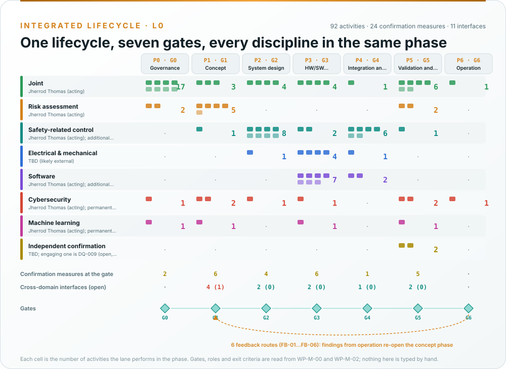
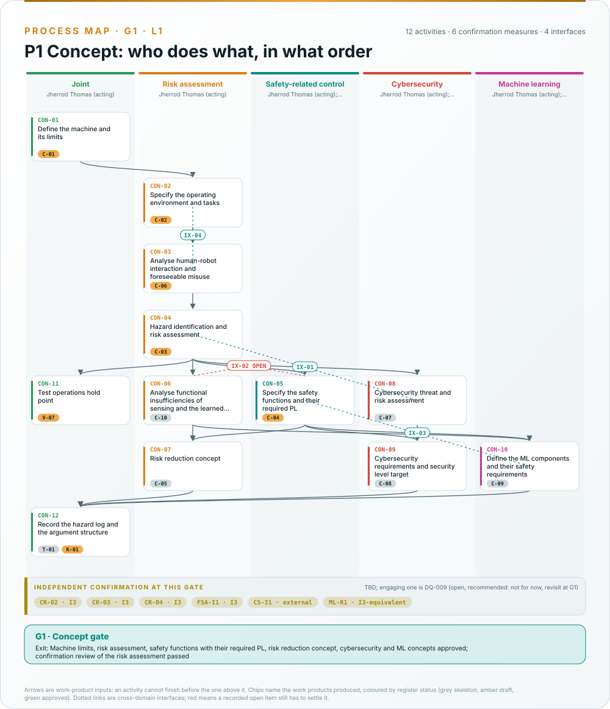
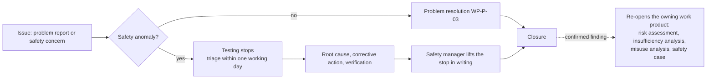

# Processes

How the work is done: one lifecycle with seven gates, the activities each discipline performs inside each phase,
and the supporting processes every change passes through. This page is the plain-language version; the authoritative
records are the [safety plan, WP-M-02](../assurance/01-management/WP-M-02-safety-plan.md), the
[integrated process model, WP-P-11](../assurance/process/README.md) and the supporting work products of
[`07-supporting/`](../assurance/07-supporting/README.md). The generated swimlane maps are on
[Process maps](Process-maps.md).

## One lifecycle, seven gates

Every discipline (machinery risk assessment, safety-related control system, electrical and mechanical, software,
cybersecurity, machine learning) works inside the same phase and decides at the same gate. There is no separate
cybersecurity lifecycle or ML lifecycle running beside the safety one.

*Drawn from the process model by [`process_figures.py`](../assurance/process/tools/process_figures.py); the
swimlane of every phase is on [Process maps](Process-maps.md). What each phase contains:*

```mermaid
flowchart LR
  P0[P0 Governance<br/>plans, roles, configuration control] --> G0{{G0}}
  G0 --> P1[P1 Concept<br/>machine limits, risk assessment,<br/>safety functions and PLr] --> G1{{G1}}
  G1 --> P2[P2 System design<br/>SRS, chain and safety-layer architecture,<br/>stopping and separation budget, analyses] --> G2{{G2}}
  G2 --> P3[P3 HW/SW development<br/>chain hardware, PL calculation,<br/>the controller safety layer] --> G3{{G3}}
  G3 --> P4[P4 Integration and verification<br/>bench, stopping, holding and E-stop tests,<br/>fault injection] --> G4{{G4}}
  G4 --> P5[P5 Validation and release<br/>validation on the arm, assessment,<br/>technical file] --> G5{{G5}}
  G5 --> P6[P6 Operation<br/>field monitoring, incident response] --> G6{{G6}}
  P6 -. findings re-open P1 work products .-> P1
```

| Gate | What must be true to pass |
|---|---|
| G0 Governance | Plans approved; roles assigned; configuration and change control running |
| G1 Concept | Machine limits, risk assessment, safety functions with their required PL, risk reduction concept, cybersecurity and ML concepts approved; confirmation review of the risk assessment passed |
| G2 System design | Safety requirements specification, SRP/CS architecture, response-time and separation budget, mechanical analysis and system analyses approved |
| G3 HW/SW development | Chain hardware and PL calculation, software requirements, architecture, units and unit verification approved |
| G4 Integration and verification | Integration and PL verification complete; stopping, holding, force or separation and E-stop tests passed; fault injection closed |
| G5 Validation and release | Validation on the arm, cybersecurity validation, safety case, assessment and technical documentation complete; release record signed |
| G6 Operation | Field monitoring, incident response and update processes running |

The exit criteria are owned by [WP-M-00 §2](../assurance/01-management/WP-M-00-work-product-register.md#2-gates). A
gate review follows [WP-M-02 §10](../assurance/01-management/WP-M-02-safety-plan.md#10-progress-tracking-and-gate-reviews),
and a pre-filled skeleton per gate is generated by the process model into
[`10-safety-case/gates/skeletons/`](../assurance/10-safety-case/gates/skeletons/). No gate has been held.

## Two hold points

- **Before any powered test with a person in reach** (G1): the bench safety hardware is fitted (a lockable
  disconnect and a fuse on the 24 V supply, a dual-channel emergency stop through a safety relay that drops the
  motor supply by contactor), the arm is fixtured, the software build is pinned, the bench is clear of everyone but
  the operator, and the operator has run the pre-session checks with the pendant stop in hand.
  [WP-V-07](../assurance/06-validation/WP-V-07-test-operations.md) is the procedure; buying the hardware is a
  decision for the lead (DQ-006).
- **Before any person is inside the reach envelope during motion** (G4): the stopping performance is measured
  ([WP-V-02](../assurance/06-validation/WP-V-02-stopping-performance-and-holding-tests.md)) and whatever
  collaborative claim the lead makes (DQ-005) has passed
  [WP-V-03](../assurance/06-validation/WP-V-03-collaborative-operation-validation.md).

## Inside a phase: activities in lanes

The process model records each phase as activities in discipline lanes, linked by the work products they consume
and produce, with explicit cross-domain interfaces where one discipline's result depends on another's.

*The concept phase: the risk-assessment lane produces the hazard list, the control-system lane derives the safety
functions and their required PL from it, cybersecurity rates its threats against the same hazards, and the ML lane
shows that no learned policy carries a safety function. The one open interface is what the joint torque
estimator can and cannot sense, which bounds the contact-detection functions and waits on the collaborative-claim
decision. The other six phases are on [Process maps](Process-maps.md).*

## What a change goes through

*Rendered from the [safety-relevant file list](../assurance/07-supporting/safety-relevant-paths.txt) and the [workflow files](../.github/workflows) at every wiki sync.*

1. **Classify.** The paths a change touches put it in class SR-A (the chain design files, the controller safety
   layer, the parameter sets), SR-Q (the forked SDK and driver, the policy runtime integration, upstream's hardware
   record), SR-T (build, CI, the generators) or NSR
   ([WP-P-01](../assurance/07-supporting/WP-P-01-configuration-management-plan.md)).
2. **Analyse the impact.** A safety-relevant change names the hazards, safety functions, requirements and
   assumptions it touches, in a record under [`07-supporting/impact/`](../assurance/07-supporting/impact/README.md)
   ([WP-P-02](../assurance/07-supporting/WP-P-02-change-management.md), [WP-M-11](../assurance/01-management/WP-M-11-impact-analysis.md)).
3. **Verify.** Tests, analyses, generators re-run; CI checks the register, the process model, the figures, the
   links and the tables on every pull request.
4. **Review.** A person other than the author reviews at the independence level
   [WP-P-05](../assurance/07-supporting/WP-P-05-verification-review-procedure.md) requires; two approvals on SR-A paths.
5. **Record.** The affected work products change in the same pull request; nothing moves past Draft without a
   review record.

## Review and independence

| Level | Meaning | Who can do it today |
|---|---|---|
| I0 | May be done by the author | The maintainer |
| I1 | A person other than the author | Nobody yet: the verification reviewer role is open |
| I2 | Independent of the team | An external reviewer |
| I3 | Independent of the organisation | An external assessor |

Verification reviews (per pull request) check a work product against its inputs. Confirmation measures check that
the work product, the process and the result meet the standards: confirmation reviews CR-01…CR-12, functional safety
audits AUD-1 and AUD-2, interim and final functional safety assessments, a cybersecurity review and assessment, ML
reviews, and, depending on the conformity route, a notified body's type-examination. Which is due at which gate is
[WP-M-06 §9](../assurance/01-management/WP-M-06-confirmation-measures-plan.md#9-schedule-summary). None has been
performed; no assessor is engaged (DQ-009).

## Problems, anomalies and field findings

A safety anomaly is anything that could violate a safety function, an operating limit or an assumption of the risk
assessment: unexpected or uncommanded joint motion, a stop that did not happen or was late, a joint that ran to its
end-stop, a dropped payload, contact with a person. It stops testing ([WP-M-02 §9](../assurance/01-management/WP-M-02-safety-plan.md#9-safety-anomaly-handling),
[WP-V-07 §6](../assurance/06-validation/WP-V-07-test-operations.md#6-anomalies)). In operation, the same path is
[field monitoring](../assurance/09-production-operation/WP-O-04-field-monitoring.md), whose routing table sends each
kind of finding back to the work product that owns it; the process model draws those routes as feedback into the
concept phase ([G6 map](../assurance/process/maps/g6-operation.md)).

## Decisions

Questions only the project lead can answer (risk acceptance, required PL, arm behaviour defaults,
operating-envelope limits, money, hardware, the assessor, roles, gate go/no-go) go into the decision register as
self-contained questions, in batches of ten. See [How decisions are made](How-decisions-are-made.md).

## Release

A release is a tagged commit of this record, the pinned software forks, a parameter set and a documentation state
([WP-P-10](../assurance/07-supporting/WP-P-10-release-management.md)). It needs gate G5: validation on the arm, the
assessment report, the technical documentation of the Machinery Regulation and an unsigned declaration draft
([WP-K-06](../assurance/10-safety-case/WP-K-06-release-record.md)). The fork publishes no release yet, and the
non-commercial licence bounds what a release could be used for.
