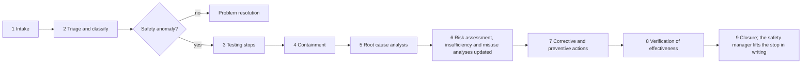

# Reporting a safety concern

Three routes, depending on what you found. If you are unsure which one applies, report anyway and say so; the
safety manager will route it.

| What you found | Where it goes | Why |
|---|---|---|
| A security vulnerability | **Privately**, through [GitHub private vulnerability reporting](https://github.com/jherrodthomas/reBot-DevArm/security/advisories/new). Never a public issue, pull request or discussion. | A vulnerability in the arm's software or on its bus can move a machine with a person in reach. [SECURITY.md](../SECURITY.md) has the full policy. |
| A hazard the analyses may miss, a near miss, contact, injury or damage | A GitHub issue with the **Safety concern** template | It enters the problem resolution and field monitoring path ([WP-P-03](../assurance/07-supporting/WP-P-03-problem-resolution.md), [WP-O-04](../assurance/09-production-operation/WP-O-04-field-monitoring.md)). |
| A defect, a test anomaly, or a doubt about an analysis | A GitHub issue with the **Problem report** template | Everything else. |

## What to include

- The configuration and baseline: which arm and variant, which actuator firmware, which commits of this record and
  of the software forks.
- The mode (OFF, IDLE, TEACH, RUN, ESTOP), the payload, the speed setting, who was where relative to the reach
  envelope, if an event.
- Facts first, conclusions after; logs, the test log entry, photos, the actuator temperatures, the supply voltage.
- Which work product and section you think is affected, if a finding against the analyses.

If you are unsure, report anyway. A near miss in a scenario that can crush a hand or strike a head is a class A
anomaly even when nothing happened this time.

## What happens next

A safety anomaly is anything that could violate a safety function, an operating limit or an assumption of the risk
assessment: unexpected or uncommanded joint motion, a stop that did not happen or was late, a joint that ran to its
end-stop, a dropped payload, a failed pre-session check, contact with a person or object. Triage happens within one
working day ([WP-M-02 §9](../assurance/01-management/WP-M-02-safety-plan.md#9-safety-anomaly-handling)). Testing
stops until the safety manager lifts the stop ([WP-V-07 §6](../assurance/06-validation/WP-V-07-test-operations.md#6-anomalies)).

The severity class is based on the worst credible outcome, not the outcome observed; the classes and the root
cause categories are defined in [WP-P-03](../assurance/07-supporting/WP-P-03-problem-resolution.md). Class A and B
anomalies cannot close without a review by someone other than the analyst. A confirmed finding is routed back to
the work product that owns it by the table in
[WP-O-04](../assurance/09-production-operation/WP-O-04-field-monitoring.md): the risk assessment, the insufficiency
analysis, the misuse analysis, the ML definition or the safety case.

## Rules for anyone testing

No arm is powered under the fork's control with a person in reach until the conditions of
[WP-V-07](../assurance/06-validation/WP-V-07-test-operations.md) hold: the bench safety hardware is fitted and tested
before every session, the arm is bolted to the bench, nobody but the operator is inside the 650 mm reach while the
arm can move, and the operator has a hand on the pendant E-stop. Test only on equipment you own or are authorised
to test, never with a bystander inside the reach envelope, and never against upstream or third-party
infrastructure.
