# The standards tour

The machinery standards are what this record is built on, and nobody reads twenty standards before contributing. This
tour is the short way in: **20 stops in 8 chapters**, one page per standard, in the order you would
meet them if you followed the arm from its first risk assessment to the law it would have to meet. Read it in order,
or jump to the stop you need.

*The route of the tour. Generated by [`tour_figures.py`](../tools/wiki/tour_figures.py); it explains the tour and claims nothing about the arm.*

> [!IMPORTANT]
> **No standard is held and no compliance is claimed.** The pages explain each standard's idea in plain words and say
> how the record uses it; every clause number is to be checked against a licensed copy (DQ-011). Where a page says
> something about the arm, it links to the work product of the [assurance record](../assurance/README.md) that owns
> it, and that work product, not the wiki, is the authority.

## The route

| Chapter | The question it answers | Stops |
|---|---|---|
| **1 · Find the risk** | What could hurt someone, and what must a robot and its cell provide? | [ISO 12100](ISO-12100-risk-assessment.md) · [ISO 10218-1 and -2](ISO-10218-industrial-robots.md) |
| **2 · Make the stop reliable** | How dependable must a safety function be, and how is that shown? | [ISO 13849-1 and -2](ISO-13849-control-system-reliability.md) · [IEC 62061](IEC-62061-machinery-SIL.md) · [IEC 61508](IEC-61508-functional-safety.md) |
| **3 · Wire it and stop it** | Are the electrics safe, and does the emergency stop do what it must? | [EN 60204-1](EN-60204-electrical-equipment.md) · [ISO 13850](ISO-13850-emergency-stop.md) |
| **4 · Keep people out of harm's way** | How small must a gap be, how far must a hazard be, and when may a person be in reach? | [ISO 13854](ISO-13854-minimum-gaps.md) · [ISO 13857](ISO-13857-reach-distances.md) · [ISO 13855](ISO-13855-separation-distance.md) · [ISO/TS 15066](ISO-TS-15066-collaborative-robots.md) |
| **5 · Check the design** | How can it fail, which combinations defeat it, and what if nothing fails? | [IEC 60812](IEC-60812-FMEA.md) · [IEC 61025](IEC-61025-fault-tree-analysis.md) · [ISO 21448](ISO-21448-performance-limits.md) |
| **6 · New kinds of risk** | What if someone attacks it, and how far can a learned component be trusted? | [IEC 62443](IEC-62443-cybersecurity.md) · [ISO/IEC TR 5469](ISO-IEC-TR-5469-AI-and-safety.md) |
| **7 · Argue it and run it** | Is the whole argument convincing, and are the processes behind it capable? | [UL 4600](UL-4600-safety-case.md) · [Automotive SPICE](Automotive-SPICE-process-capability.md) |
| **8 · The law** | What does EU law require of the machine and of any AI in it? | [Machinery Regulation](Machinery-Regulation.md) · [AI Act](AI-Act.md) |

## How to read a stop

Every page has the same shape, so you can skim one in a minute:

1. **In one sentence**: the standard's purpose.
2. **The figure**: an animated diagram of the one idea worth remembering. It loops; a browser set to reduce motion
   shows the finished picture instead.
3. **What it is** and **the idea in the picture**: the standard in plain words.
4. **Why it matters for a desktop arm**: what it means for this arm in particular, with the gap findings it touches.
5. **How this project uses it**: the work products and decisions of the record that apply it.
6. **What the project does not claim**: so nothing on the page is read as a claim of conformity.
7. **Words you will meet** and **clauses to know**: the vocabulary, and where to look in the standard.

## How the standards fit together

*How machinery standards stack. Generated by [`tour_figures.py`](../tools/wiki/tour_figures.py); it explains how the standards relate and claims nothing about the arm.*

Machinery standards come in three types. **Type A** gives the basic concepts for every machine:
[ISO 12100](ISO-12100-risk-assessment.md). **Type B** covers one safety aspect or one kind of safeguard for many
machines: [ISO 13849](ISO-13849-control-system-reliability.md), [EN 60204-1](EN-60204-electrical-equipment.md),
[ISO 13850](ISO-13850-emergency-stop.md) and the distance standards. **Type C** covers one kind of machine:
[ISO 10218](ISO-10218-industrial-robots.md) for industrial robots. Where a type C standard deals with something
specifically, it governs over the general ones for a machine built to it (to be checked).

The rest sit beside the pyramid: functional safety ([IEC 61508](IEC-61508-functional-safety.md),
[IEC 62061](IEC-62061-machinery-SIL.md)), analysis methods ([IEC 60812](IEC-60812-FMEA.md),
[IEC 61025](IEC-61025-fault-tree-analysis.md), [ISO 21448](ISO-21448-performance-limits.md)), the new kinds of risk
([IEC 62443](IEC-62443-cybersecurity.md), [ISO/IEC TR 5469](ISO-IEC-TR-5469-AI-and-safety.md)), the argument and the
process ([UL 4600](UL-4600-safety-case.md), [Automotive SPICE](Automotive-SPICE-process-capability.md)), and the law,
which is not a standard at all ([Machinery Regulation](Machinery-Regulation.md), [AI Act](AI-Act.md)).

ISO 3691-4, for driverless industrial trucks, is not on the tour: the arm does not drive.

## After the tour

- [How we use each standard](How-we-use-each-standard.md): the whole tour on one page, for reference.
- [Standards at a glance](Standards-at-a-glance.md): which gate needs the work products that cite each standard.
- [Hazard scenes](Hazard-scenes.md): fifteen of the hazards drawn on the real CAD.
- [Reading the safety case](Reading-the-safety-case.md): how the claims, evidence and defeaters fit together.
- [Glossary](Glossary.md): every code and abbreviation.
