# UL 4600: the safety case

[Standards tour](Standards-tour.md) · stop 17 of 20 · ← [ISO/IEC TR 5469](ISO-IEC-TR-5469-AI-and-safety.md) · [Automotive SPICE](Automotive-SPICE-process-capability.md) →

*A safety case as a tree: a top claim, an argument, sub-claims, evidence with its review state, and a defeater that keeps a claim open until it is closed. Field data return to the top claim as safety performance indicators. Generated by [`tour_figures.py`](../tools/wiki/tour_figures.py); it explains the standard's idea and claims nothing about the arm.*

> **In one sentence.** UL 4600 asks for the safety argument itself: claims, the argument that supports them, the evidence under them, the reasons to doubt them, and field indicators that would show a claim has stopped being true.

## What it is

UL 4600, *Standard for safety for the evaluation of autonomous products*. It is written for autonomous products and is goal-based:
instead of prescribing designs, it asks the maker to argue that the product is acceptably safe, and checks that the
argument covers what it must. The record uses its principles for the safety case only.

## The idea in the picture

- A **claim** is something asserted about the product: it is acceptably safe in its envelope.
- An **argument** says how the claim is broken down: over each hazard, each safety function, each assumption.
- **Evidence** supports each sub-claim, with its review state.
- A **defeater** is a reason to doubt a claim. It is published, not hidden, and the claim stays open until the
  defeater is closed.
- **Safety performance indicators** from the field show whether the claims still hold in use.

## Why it matters for a desktop arm

A safety case makes the gaps as visible as the progress. Every finding of the gap assessment is a defeater against a
claim, so anyone can see what is not yet true.

## How this project uses it

| What the record takes | Where |
|---|---|
| The safety case: claims, arguments, evidence and defeaters | [WP-K-01](../assurance/10-safety-case/WP-K-01-safety-case.md) |
| The machine-readable records, their validator and the dashboard | [`assurance/case/`](../assurance/case/README.md); [Reading the safety case](Reading-the-safety-case.md) |
| The first defeaters: every finding of the gap assessment, all open | [Gap assessment](../assurance/00-assessment/gap-assessment.md) |
| Field monitoring as indicators | [WP-O-04](../assurance/09-production-operation/WP-O-04-field-monitoring.md) |

## What the project does not claim

Any UL 4600 conformance; the standard is used as guidance.

## Words you will meet

- **Claim, argument, evidence**: what is asserted, how it is supported, what supports it.
- **Defeater**: a reason to doubt a claim.
- **Safety performance indicator (SPI)**: a measured value that shows whether a claim still holds in the field.

## Clauses to know

No standard is held by the project, so every clause number on this page is **to be checked** against a licensed copy. Whether to buy the standards is a queued question for the lead (DQ-011). The record uses the standard's principles for the safety case as a whole rather than by section.

---

[Standards tour](Standards-tour.md) · stop 17 of 20 · ← [ISO/IEC TR 5469](ISO-IEC-TR-5469-AI-and-safety.md) · [Automotive SPICE](Automotive-SPICE-process-capability.md) →
